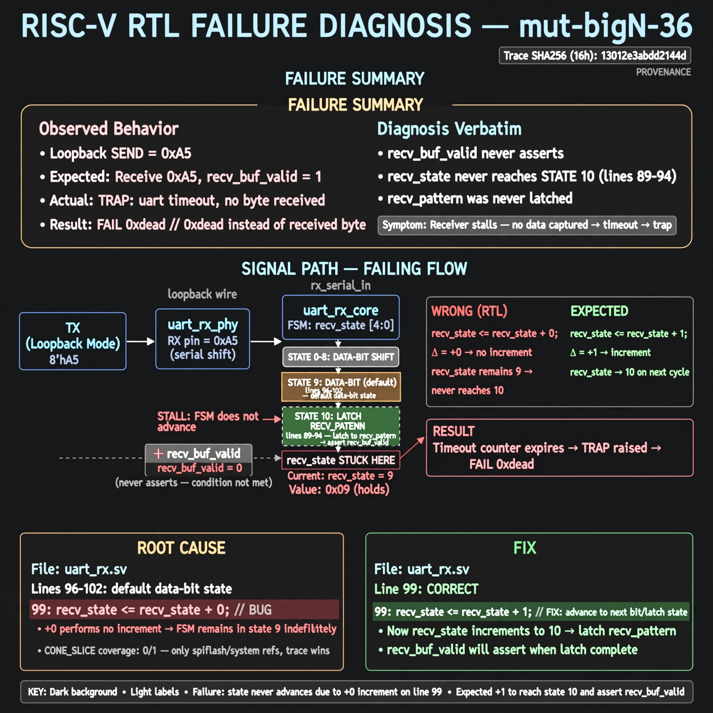

# Afterglow run report: mutbigN-v4-36

case `mut-bigN-36` | status **GREEN** | mode `live` | seed `42`

wall start `2026-10-27T16:04:39Z` | wall end `2026-10-27T16:05:34Z` | time-to-green `54.8s`

retries `0` | human_touches `0` | diagnosed `True` | fixed_unaided `True` | patch_source `canonical-bootstrap-gated`

## Verdicts (from sim, not typed)

- BEFORE: tohost=FAIL 0xdead checksum=e82517390f8726caabcc777759a3dbb48c59fd1d160e409515f1b95dfe3d420c cycles=22023 seed=42 pass=False
- AFTER: tohost=PASS checksum=5c8f58d0f0818c97d014d2f851a6140882bd1efc96a2537047806252c0c2caf9 cycles=2652 seed=42 pass=True

## Diagnosis (verbatim from api/text_response.json)

```
Loopback send 0xa5 resulted in TRAP: uart timeout, no byte received with FAIL 0xdead instead of a received byte. recv_buf_valid never asserts because recv_state never reaches state 10 (lines 89-94) to latch recv_pattern. Root cause is line 99 `recv_state <= recv_state + 0;` in default data-bit state (lines 96-102) which stalls the receiver instead of advancing with +1; CONE_SLICE has coverage 0/1 with only spiflash/system refs so trace wins.
```

expected re-sim signal: tohost PASS, uart loopback byte 0xa5 received with no timeout trap

## Patch (2 lines, guard-checked)

```diff
diff --git a/picosoc/simpleuart.v b/picosoc/simpleuart.v
--- a/picosoc/simpleuart.v
+++ b/picosoc/simpleuart.v
@@ -96,7 +96,7 @@
 				default: begin
 					if (recv_divcnt > cfg_divider) begin
 						recv_pattern <= {ser_rx, recv_pattern[7:1]};
-						recv_state <= recv_state + 0;
+						recv_state <= recv_state + 1;
 						recv_divcnt <= 0;
 					end
 				end

```

## Provenance (judge checks)

- prompt file `v3` sha256 `ad529368accaf171e6121a54b2d27547230920a900c7c4e5094d3fff13ca4233`
- input_trace.txt sha256 `13012e3abdd2144de6d7926bb84c4db09b1e66bf97fd2cc09ebab3ca727a3517` (9 lines, 66 tokens)
- prompt tokens `931` (cap 2500)
- text model `muse-spark-1.3-contributor` latency `38789ms` request `chatcmpl-01a17e1b-de59-760c-bc97-2851519d6385`
- image model `muse-image-1.0` latency `15560ms` request `9adba97b-902d-4ae7-82f9-69fd6230d66e` status `ok`
- image prompt sha256 `c9ac6863baf0db4ef1dcc8b49b28072cc48b15078583e3de5f39a07a8a6e96b3`, trace sha `13012e3abdd2144de6d7926bb84c4db09b1e66bf97fd2cc09ebab3ca727a3517` (see api/image_request.json)

## Explanation diagram



## Bundle completeness

- present (12): artifacts/input_trace.txt, artifacts/boot.log, artifacts/boot_after.log, artifacts/verdict_before.json, artifacts/verdict_after.json, api/text_request.json, api/text_response.json, api/image_request.json, api/image_response.json, explain.png, patch.diff, meta.json
- missing (0): none

