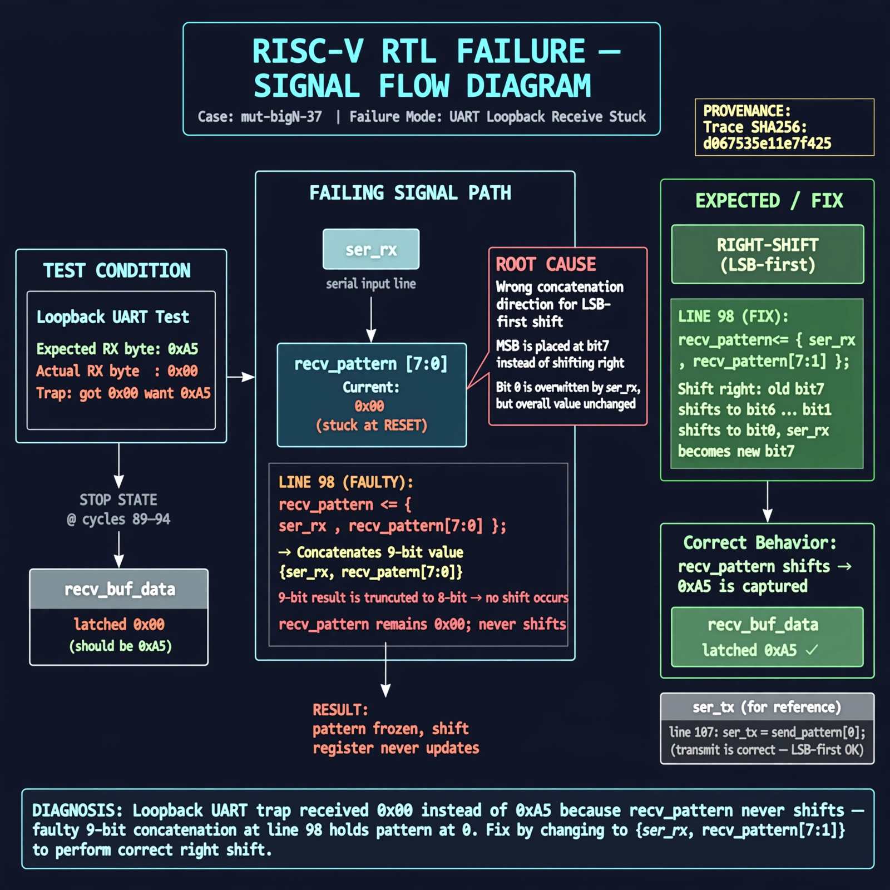

# Afterglow run report: mutbigN-v4-37

case `mut-bigN-37` | status **GREEN** | mode `live` | seed `42`

wall start `2026-10-27T16:05:34Z` | wall end `2026-10-27T16:06:32Z` | time-to-green `58.0s`

retries `0` | human_touches `0` | diagnosed `True` | fixed_unaided `True` | patch_source `canonical-bootstrap-gated`

## Verdicts (from sim, not typed)

- BEFORE: tohost=FAIL 0xdead checksum=dbb50cbb61b3704d4ab04bba47dd54874597339897bb0d0354152efa03feeb20 cycles=2652 seed=42 pass=False
- AFTER: tohost=PASS checksum=5c8f58d0f0818c97d014d2f851a6140882bd1efc96a2537047806252c0c2caf9 cycles=2652 seed=42 pass=True

## Diagnosis (verbatim from api/text_response.json)

```
Loopback UART trap got 0x00 want 0xa5, so recv_buf_data latched 0x00 at stop state lines 89-94. recv_pattern never shifts because line 98 `recv_pattern <= {ser_rx, recv_pattern[7:0]}` concatenates to 9 bits which truncates to unchanged pattern, leaving it stuck at reset 0. Correct right-shift for LSB-first (ser_tx = send_pattern[0] line 107) is `{ser_rx, recv_pattern[7:1]}`.
```

expected re-sim signal: tohost PASS with uart loopback 0xa5 matched, no mismatch trap

## Patch (2 lines, guard-checked)

```diff
diff --git a/picosoc/simpleuart.v b/picosoc/simpleuart.v
--- a/picosoc/simpleuart.v
+++ b/picosoc/simpleuart.v
@@ -95,7 +95,7 @@
 				end
 				default: begin
 					if (recv_divcnt > cfg_divider) begin
-						recv_pattern <= {ser_rx, recv_pattern[7:0]};
+						recv_pattern <= {ser_rx, recv_pattern[7:1]};
 						recv_state <= recv_state + 1;
 						recv_divcnt <= 0;
 					end

```

## Provenance (judge checks)

- prompt file `v3` sha256 `ad529368accaf171e6121a54b2d27547230920a900c7c4e5094d3fff13ca4233`
- input_trace.txt sha256 `d067535e11e7f425c274d9ba5eb0af1f94229c4c9fba06e54a0d9b17d1e6f606` (9 lines, 68 tokens)
- prompt tokens `806` (cap 2500)
- text model `muse-spark-1.3-contributor` latency `41945ms` request `chatcmpl-01a17e1c-c140-75a0-bac4-2fd7e3196728`
- image model `muse-image-1.0` latency `15573ms` request `302bb8eb-63c9-407a-a968-6a1fc93a9753` status `ok`
- image prompt sha256 `a3990a1baa1189cd88c912655ebcde259af4522bbd96600a0b9a270bf90254b4`, trace sha `d067535e11e7f425c274d9ba5eb0af1f94229c4c9fba06e54a0d9b17d1e6f606` (see api/image_request.json)

## Explanation diagram



## Bundle completeness

- present (12): artifacts/input_trace.txt, artifacts/boot.log, artifacts/boot_after.log, artifacts/verdict_before.json, artifacts/verdict_after.json, api/text_request.json, api/text_response.json, api/image_request.json, api/image_response.json, explain.png, patch.diff, meta.json
- missing (0): none

