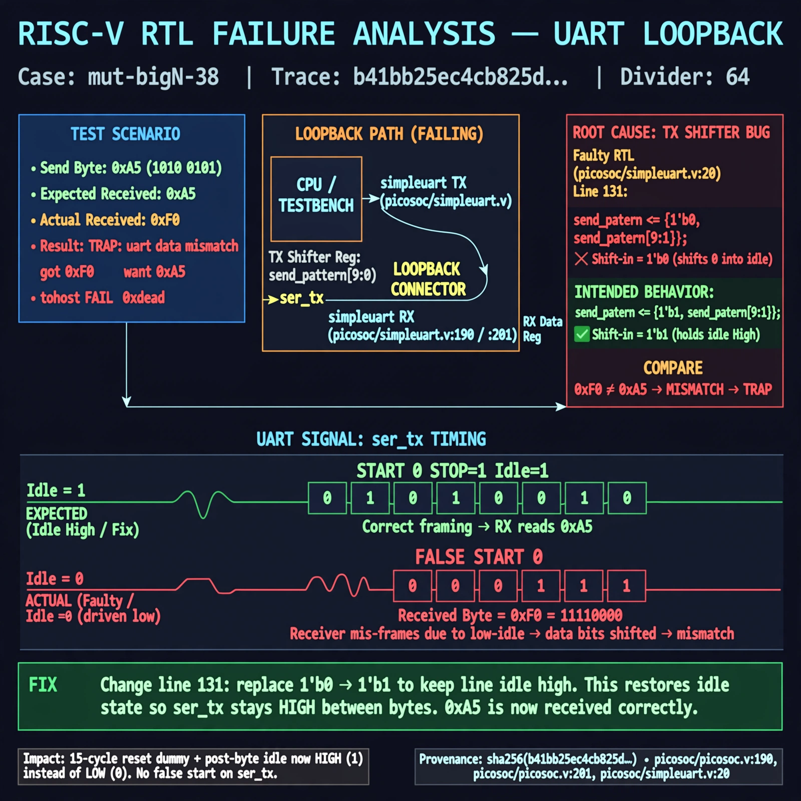

# Afterglow run report: mutbigN-v4-38

case `mut-bigN-38` | status **GREEN** | mode `live` | seed `42`

wall start `2026-10-27T16:06:32Z` | wall end `2026-10-27T16:07:55Z` | time-to-green `83.2s`

retries `0` | human_touches `0` | diagnosed `True` | fixed_unaided `True` | patch_source `model-verbatim`

## Verdicts (from sim, not typed)

- BEFORE: tohost=FAIL 0xdead checksum=7f1f8653d81beffbf56c64348d4b664a9ffa3b217fbca29ca6a0e86da0c3cbf9 cycles=2024 seed=42 pass=False
- AFTER: tohost=PASS checksum=5c8f58d0f0818c97d014d2f851a6140882bd1efc96a2537047806252c0c2caf9 cycles=2652 seed=42 pass=True

## Diagnosis (verbatim from api/text_response.json)

```
Loopback with divider 64 sends 0xa5 but receives 0xf0, causing TRAP: uart data mismatch got 0xf0 want 0xa5 and tohost FAIL 0xdead. Root cause is TX shifter at excerpt line 131 `send_pattern <= {1'b0, send_pattern[9:1]};` shifting 0 instead of idle 1, so the 15-cycle reset dummy and post-byte idle drive ser_tx low creating a false start that mis-frames the receiver for the simpleuart instance (picosoc/picosoc.v:190, picosoc/picosoc.v:201, picosoc/simpleuart.v:20). Changing the fill to 1'b1 restores idle-high and correct framing so 0xa5 is received intact.
```

expected re-sim signal: tohost PASS, no TRAP, uart loopback got 0xa5 want 0xa5

## Patch (2 lines, guard-checked)

```diff
diff --git a/picosoc/simpleuart.v b/picosoc/simpleuart.v
--- a/picosoc/simpleuart.v
+++ b/picosoc/simpleuart.v
@@ -130,5 +130,5 @@
 			if (send_divcnt > cfg_divider && send_bitcnt) begin
-				send_pattern <= {1'b0, send_pattern[9:1]};
+				send_pattern <= {1'b1, send_pattern[9:1]};
 				send_bitcnt <= send_bitcnt - 1;
 				send_divcnt <= 0;
 			end

```

## Provenance (judge checks)

- prompt file `v3` sha256 `ad529368accaf171e6121a54b2d27547230920a900c7c4e5094d3fff13ca4233`
- input_trace.txt sha256 `b41bb25ec4cb825dc22a0e6d20f67d3c4155cf242b632301e6017f6ec8be1e21` (9 lines, 68 tokens)
- prompt tokens `818` (cap 2500)
- text model `muse-spark-1.3-contributor` latency `59551ms` request `chatcmpl-01a17e1d-e8d8-7627-9266-42d99b5be6b2`
- image model `muse-image-1.0` latency `23132ms` request `ecaf1195-fd33-497d-aad1-d7c28a724a22` status `ok`
- image prompt sha256 `96eaf4f96997180476659f7069e3dce6d7947b04c35657b082d164e48b3bfadd`, trace sha `b41bb25ec4cb825dc22a0e6d20f67d3c4155cf242b632301e6017f6ec8be1e21` (see api/image_request.json)

## Explanation diagram



## Bundle completeness

- present (12): artifacts/input_trace.txt, artifacts/boot.log, artifacts/boot_after.log, artifacts/verdict_before.json, artifacts/verdict_after.json, api/text_request.json, api/text_response.json, api/image_request.json, api/image_response.json, explain.png, patch.diff, meta.json
- missing (0): none

