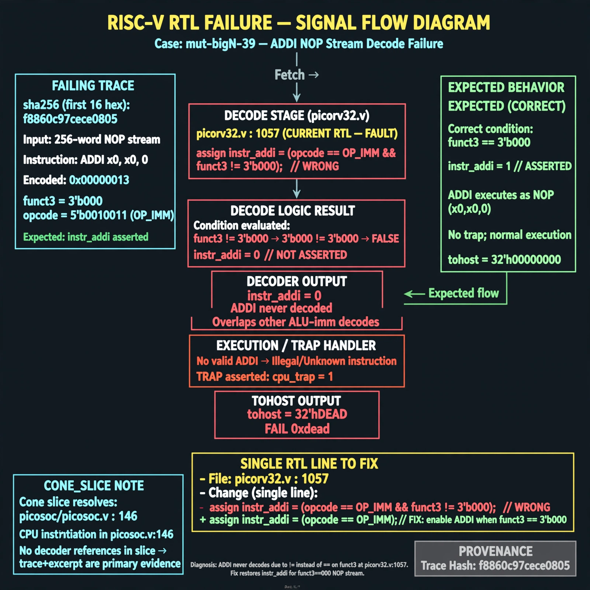

# Afterglow run report: mutbigN-v4-39

case `mut-bigN-39` | status **GREEN** | mode `live` | seed `42`

wall start `2026-10-27T16:07:55Z` | wall end `2026-10-27T16:08:52Z` | time-to-green `57.2s`

retries `0` | human_touches `0` | diagnosed `True` | fixed_unaided `True` | patch_source `model-verbatim`

## Verdicts (from sim, not typed)

- BEFORE: tohost=FAIL 0xdead checksum=c2a7a4d6295484feeb9ec1ea9381732b8e39a7ccd1997c7d70f6454da2fb4659 cycles=2009 seed=42 pass=False
- AFTER: tohost=PASS checksum=5c28238265cb94168311e9914f0df355642c557d04dba11845d557ac8a64aa4a cycles=2009 seed=42 pass=True

## Diagnosis (verbatim from api/text_response.json)

```
TRAP: cpu trap asserted with tohost FAIL 0xdead on 256-word NOP (ADDI x0,x0,0, funct3==000) stream, expected instr_addi asserted. picorv32.v:1057 uses `!= 3'b000` so ADDI never decodes and overlaps other ALU-imm decodes. CONE_SLICE only resolves picosoc/picosoc.v:146 cpu instantiation with no decoder refs, so trace+excerpt win.
```

expected re-sim signal: tohost PASS with no TRAP: cpu trap asserted

## Patch (2 lines, guard-checked)

```diff
diff --git a/picorv32.v b/picorv32.v
--- a/picorv32.v
+++ b/picorv32.v
@@ -1057,3 +1057,3 @@
-			instr_addi  <= is_alu_reg_imm && mem_rdata_q[14:12] != 3'b000;
+			instr_addi  <= is_alu_reg_imm && mem_rdata_q[14:12] == 3'b000;
 			instr_slti  <= is_alu_reg_imm && mem_rdata_q[14:12] == 3'b010;
 			instr_sltiu <= is_alu_reg_imm && mem_rdata_q[14:12] == 3'b011;

```

## Provenance (judge checks)

- prompt file `v3` sha256 `ad529368accaf171e6121a54b2d27547230920a900c7c4e5094d3fff13ca4233`
- input_trace.txt sha256 `f8860c97cece08055bb6d2f2159ebd65f37465494d64bbc8eb01e5355a74ea25` (9 lines, 69 tokens)
- prompt tokens `1110` (cap 2500)
- text model `muse-spark-1.3-contributor` latency `26850ms` request `chatcmpl-01a17e1e-ae94-701f-8cb5-4fd14d09a91f`
- image model `muse-image-1.0` latency `29822ms` request `7478eec6-c462-4080-a193-1d58c5796247` status `ok`
- image prompt sha256 `0d9ddcf523b06c10a0caf95f34a9f80176f8afee00cc0afe6ef02eecaeba3659`, trace sha `f8860c97cece08055bb6d2f2159ebd65f37465494d64bbc8eb01e5355a74ea25` (see api/image_request.json)

## Explanation diagram



## Bundle completeness

- present (12): artifacts/input_trace.txt, artifacts/boot.log, artifacts/boot_after.log, artifacts/verdict_before.json, artifacts/verdict_after.json, api/text_request.json, api/text_response.json, api/image_request.json, api/image_response.json, explain.png, patch.diff, meta.json
- missing (0): none

