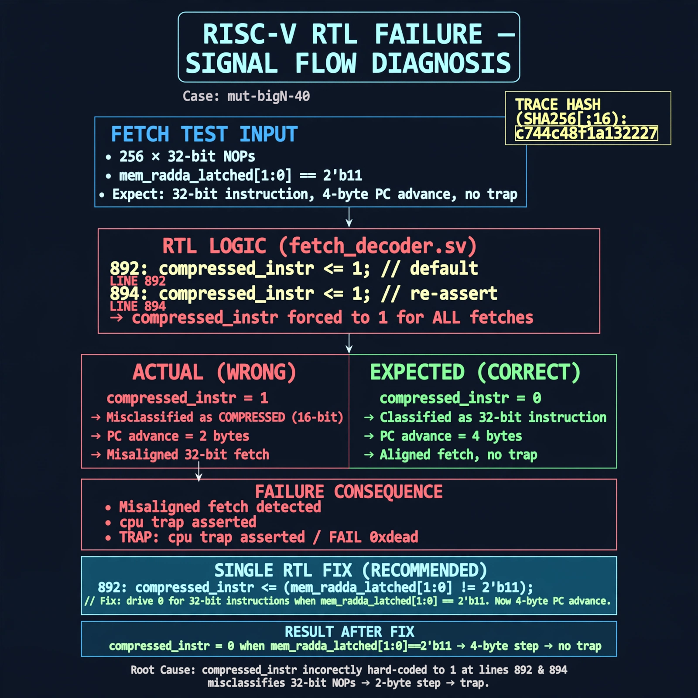

# Afterglow run report: mutbigN-v4-40

case `mut-bigN-40` | status **GREEN** | mode `live` | seed `42`

wall start `2026-10-27T16:08:52Z` | wall end `2026-10-27T16:09:42Z` | time-to-green `50.2s`

retries `0` | human_touches `0` | diagnosed `True` | fixed_unaided `True` | patch_source `model-verbatim`

## Verdicts (from sim, not typed)

- BEFORE: tohost=FAIL 0xdead checksum=c2a7a4d6295484feeb9ec1ea9381732b8e39a7ccd1997c7d70f6454da2fb4659 cycles=2009 seed=42 pass=False
- AFTER: tohost=PASS checksum=5c28238265cb94168311e9914f0df355642c557d04dba11845d557ac8a64aa4a cycles=2009 seed=42 pass=True

## Diagnosis (verbatim from api/text_response.json)

```
Fetch test uses 256 32-bit NOPs (mem_rdata_latched[1:0]==2'b11) expecting compressed_instr==0 and 4-byte advance with no trap. Excerpt defaults compressed_instr<=1 at line 892 and re-asserts <=1 at line 894, so 32-bit instructions are misclassified as compressed. This causes 2-byte stepping, misaligned fetches, and TRAP: cpu trap asserted / FAIL 0xdead.
```

expected re-sim signal: tohost PASS with no TRAP: cpu trap asserted, fetch alignment and progress check completes

## Patch (2 lines, guard-checked)

```diff
diff --git a/picorv32.v b/picorv32.v
--- a/picorv32.v
+++ b/picorv32.v
@@ -889,7 +889,7 @@
 			if (mem_rdata_latched[6:0] == 7'b0001011 && mem_rdata_latched[31:25] == 7'b0000010 && ENABLE_IRQ)
 				decoded_rs1 <= ENABLE_IRQ_QREGS ? irqregs_offset : 3; // instr_retirq
 
-			compressed_instr <= 1;
+			compressed_instr <= 0;
 			if (COMPRESSED_ISA && mem_rdata_latched[1:0] != 2'b11) begin
 				compressed_instr <= 1;
 				decoded_rd <= 0;

```

## Provenance (judge checks)

- prompt file `v3` sha256 `ad529368accaf171e6121a54b2d27547230920a900c7c4e5094d3fff13ca4233`
- input_trace.txt sha256 `c744c48f1a132227c03ee1fa4913519723122f175e519f6b9246b6511240ae7d` (9 lines, 69 tokens)
- prompt tokens `985` (cap 2500)
- text model `muse-spark-1.3-contributor` latency `21536ms` request `chatcmpl-01a17e1f-79a2-72f4-94b8-2243370ed0b2`
- image model `muse-image-1.0` latency `28085ms` request `a6264938-a132-48cc-8e5e-8cd7940d04c6` status `ok`
- image prompt sha256 `5970f19b326f6732435fa932b2c1f73e31ea6a776411f72feb77cda54538f272`, trace sha `c744c48f1a132227c03ee1fa4913519723122f175e519f6b9246b6511240ae7d` (see api/image_request.json)

## Explanation diagram



## Bundle completeness

- present (12): artifacts/input_trace.txt, artifacts/boot.log, artifacts/boot_after.log, artifacts/verdict_before.json, artifacts/verdict_after.json, api/text_request.json, api/text_response.json, api/image_request.json, api/image_response.json, explain.png, patch.diff, meta.json
- missing (0): none

