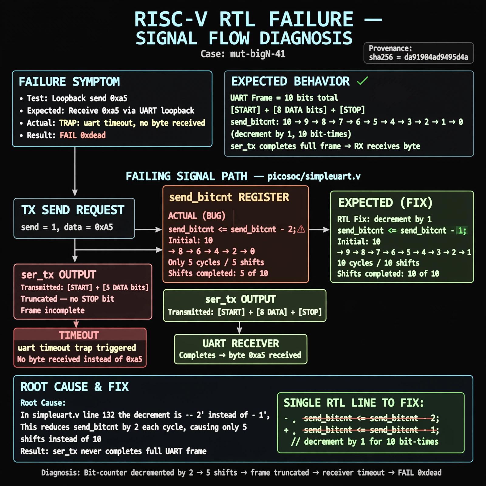

# Afterglow run report: mutbigN-v4-41

case `mut-bigN-41` | status **GREEN** | mode `live` | seed `42`

wall start `2026-10-27T16:09:43Z` | wall end `2026-10-27T16:10:44Z` | time-to-green `61.4s`

retries `0` | human_touches `0` | diagnosed `True` | fixed_unaided `True` | patch_source `model-verbatim`

## Verdicts (from sim, not typed)

- BEFORE: tohost=FAIL 0xdead checksum=e82517390f8726caabcc777759a3dbb48c59fd1d160e409515f1b95dfe3d420c cycles=22023 seed=42 pass=False
- AFTER: tohost=PASS checksum=5c8f58d0f0818c97d014d2f851a6140882bd1efc96a2537047806252c0c2caf9 cycles=2652 seed=42 pass=True

## Diagnosis (verbatim from api/text_response.json)

```
Loopback send 0xa5 timed out with TRAP: uart timeout, no byte received instead of a received byte. Expected send_bitcnt 10->0 over 10 bit-times, but picosoc/simpleuart.v:132 does send_bitcnt <= send_bitcnt - 2, so only 5 shifts occur and ser_tx never completes start+8data+stop. The truncated frame means the receiver never completes, matching the timeout and FAIL 0xdead.
```

expected re-sim signal: tohost PASS, uart loopback byte 0xa5 received with no timeout

## Patch (2 lines, guard-checked)

```diff
diff --git a/picosoc/simpleuart.v b/picosoc/simpleuart.v
--- a/picosoc/simpleuart.v
+++ b/picosoc/simpleuart.v
@@ -130,4 +130,4 @@
 			if (send_divcnt > cfg_divider && send_bitcnt) begin
 				send_pattern <= {1'b1, send_pattern[9:1]};
-				send_bitcnt <= send_bitcnt - 2;
+				send_bitcnt <= send_bitcnt - 1;
 				send_divcnt <= 0;

```

## Provenance (judge checks)

- prompt file `v3` sha256 `ad529368accaf171e6121a54b2d27547230920a900c7c4e5094d3fff13ca4233`
- input_trace.txt sha256 `da91904ad9495d4ad976cfd1cd3b18d9171faa35e1462f9ee7aaa636d6c494c3` (9 lines, 66 tokens)
- prompt tokens `942` (cap 2500)
- text model `muse-spark-1.3-contributor` latency `42185ms` request `chatcmpl-01a17e20-8e65-720c-8710-841e82994f8c`
- image model `muse-image-1.0` latency `18728ms` request `4696bbad-bf6f-448f-aa81-dc5406e90e25` status `ok`
- image prompt sha256 `0e267b6cd2ce316b53da19e8f57f83823942fc00c26f8387ff1001762314e44a`, trace sha `da91904ad9495d4ad976cfd1cd3b18d9171faa35e1462f9ee7aaa636d6c494c3` (see api/image_request.json)

## Explanation diagram



## Bundle completeness

- present (12): artifacts/input_trace.txt, artifacts/boot.log, artifacts/boot_after.log, artifacts/verdict_before.json, artifacts/verdict_after.json, api/text_request.json, api/text_response.json, api/image_request.json, api/image_response.json, explain.png, patch.diff, meta.json
- missing (0): none

