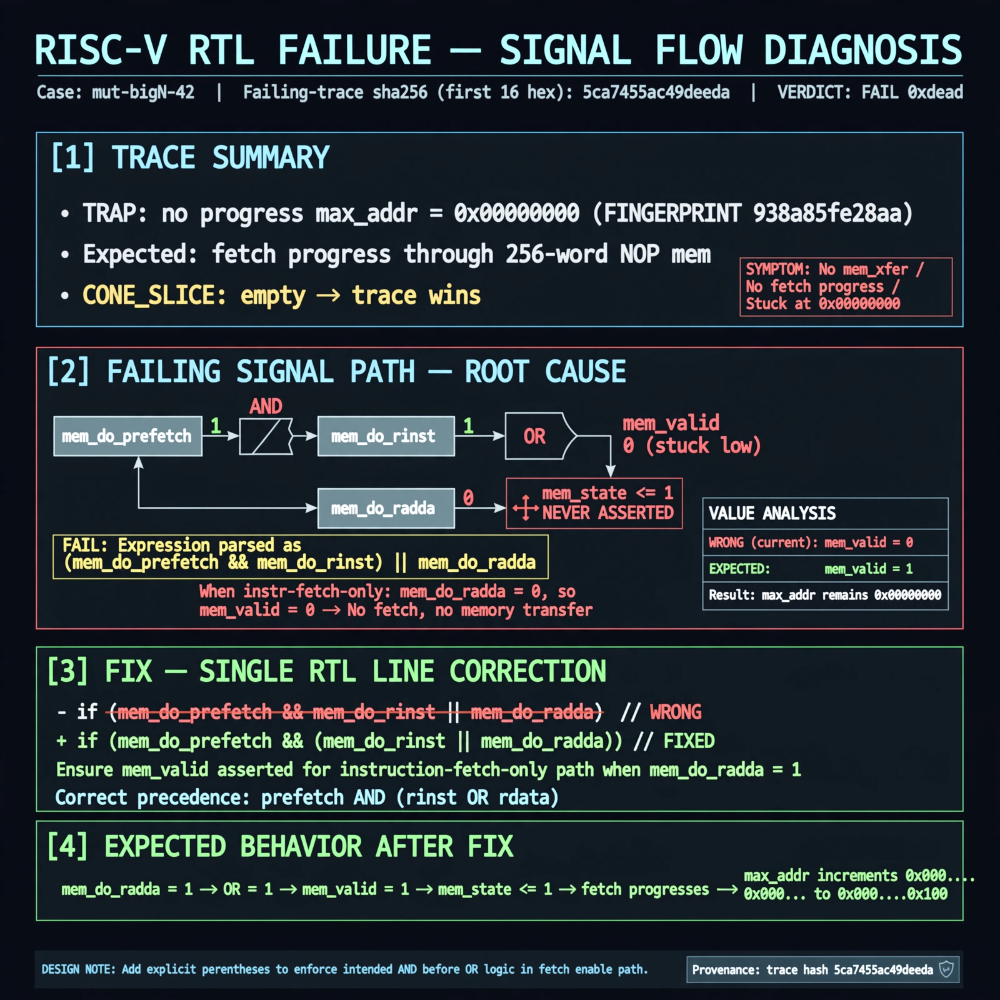

# Afterglow run report: mutbigN-v4-42

case `mut-bigN-42` | status **GREEN** | mode `live` | seed `42`

wall start `2026-10-27T16:10:44Z` | wall end `2026-10-27T16:11:50Z` | time-to-green `66.0s`

retries `0` | human_touches `0` | diagnosed `True` | fixed_unaided `True` | patch_source `model-verbatim`

## Verdicts (from sim, not typed)

- BEFORE: tohost=FAIL 0xdead checksum=563b7c10626ff25de2b3c430956c7c113e448c4efaea068f9b83a198d4322b15 cycles=2009 seed=42 pass=False
- AFTER: tohost=PASS checksum=5c28238265cb94168311e9914f0df355642c557d04dba11845d557ac8a64aa4a cycles=2009 seed=42 pass=True

## Diagnosis (verbatim from api/text_response.json)

```
Trace shows TRAP: no progress max_addr=0x00000000 (FINGERPRINT 938a85fe28aa, VERDICT FAIL 0xdead) vs expected fetch progress through 256-word NOP mem. CONE_SLICE is empty so trace wins; excerpt line 583 `if (mem_do_prefetch && mem_do_rinst || mem_do_rdata)` parses as (prefetch&&rinst)||rdata, so instr-fetch-only never asserts mem_valid/mem_state<=1. Hence no mem_xfer/fetch and max_addr stuck at 0.
```

expected re-sim signal: tohost PASS (not FAIL 0xdead), no TRAP: no progress, max_addr>0x00000000 showing fetch progress

## Patch (2 lines, guard-checked)

```diff
diff --git a/picorv32.v b/picorv32.v
--- a/picorv32.v
+++ b/picorv32.v
@@ -581,7 +581,7 @@
 			case (mem_state)
 				0: begin
-					if (mem_do_prefetch && mem_do_rinst || mem_do_rdata) begin
+					if (mem_do_prefetch || mem_do_rinst || mem_do_rdata) begin
 						mem_valid <= !mem_la_use_prefetched_high_word;
 						mem_instr <= mem_do_prefetch || mem_do_rinst;
 						mem_wstrb <= 0;
 						mem_state <= 1;

```

## Provenance (judge checks)

- prompt file `v3` sha256 `ad529368accaf171e6121a54b2d27547230920a900c7c4e5094d3fff13ca4233`
- input_trace.txt sha256 `5ca7455ac49deeda193a141fbc2c10dc79edc0181c5db71413b8213e3649ef52` (9 lines, 69 tokens)
- prompt tokens `713` (cap 2500)
- text model `muse-spark-1.3-contributor` latency `34998ms` request `chatcmpl-01a17e21-62bb-740e-8229-dff5e1195572`
- image model `muse-image-1.0` latency `30432ms` request `6d7257e3-5cd4-4b7f-bded-dcc3bfe50c6d` status `ok`
- image prompt sha256 `517da02b9b2359de39e9d1b7617efaf6999ec0088a222c6eb75e90f1744c4c08`, trace sha `5ca7455ac49deeda193a141fbc2c10dc79edc0181c5db71413b8213e3649ef52` (see api/image_request.json)

## Explanation diagram



## Bundle completeness

- present (12): artifacts/input_trace.txt, artifacts/boot.log, artifacts/boot_after.log, artifacts/verdict_before.json, artifacts/verdict_after.json, api/text_request.json, api/text_response.json, api/image_request.json, api/image_response.json, explain.png, patch.diff, meta.json
- missing (0): none

