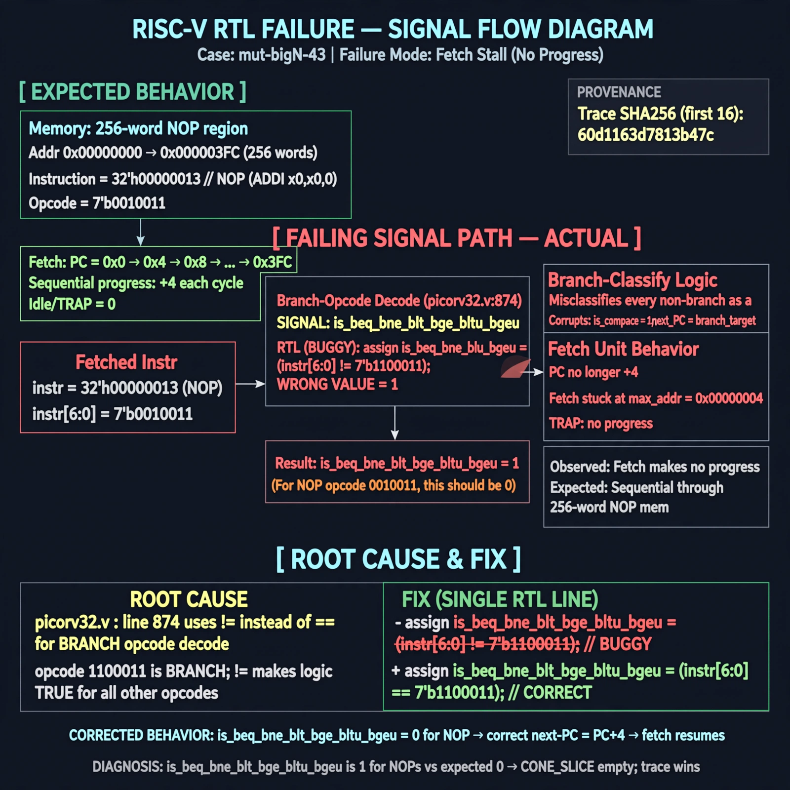

# Afterglow run report: mutbigN-v4-43

case `mut-bigN-43` | status **GREEN** | mode `live` | seed `42`

wall start `2026-10-27T16:11:50Z` | wall end `2026-10-27T16:12:33Z` | time-to-green `42.8s`

retries `0` | human_touches `0` | diagnosed `True` | fixed_unaided `True` | patch_source `model-verbatim`

## Verdicts (from sim, not typed)

- BEFORE: tohost=FAIL 0xdead checksum=9bf5d2591144696f56ca014343e1655f97020c36292daceaf3f26e732301574d cycles=2009 seed=42 pass=False
- AFTER: tohost=PASS checksum=5c28238265cb94168311e9914f0df355642c557d04dba11845d557ac8a64aa4a cycles=2009 seed=42 pass=True

## Diagnosis (verbatim from api/text_response.json)

```
Fetch makes no progress with max_addr=0x00000004 and TRAP: no progress vs expected sequential progress through 256-word NOP mem. is_beq_bne_blt_bge_bltu_bgeu is 1 for NOPs vs expected 0, misclassifying every non-branch as a branch and corrupting is_compare/next-PC. Root cause at picorv32.v:874 which uses != 7'b1100011 instead of == 7'b1100011 for branch-opcode decode; CONE_SLICE empty so trace wins.
```

expected re-sim signal: tohost PASS (not FAIL 0xdead), no TRAP: no progress, max_addr advances beyond 0x00000004

## Patch (2 lines, guard-checked)

```diff
diff --git a/picorv32.v b/picorv32.v
--- a/picorv32.v
+++ b/picorv32.v
@@ -874,4 +874,4 @@
-			is_beq_bne_blt_bge_bltu_bgeu <= mem_rdata_latched[6:0] != 7'b1100011;
+			is_beq_bne_blt_bge_bltu_bgeu <= mem_rdata_latched[6:0] == 7'b1100011;
 			is_lb_lh_lw_lbu_lhu          <= mem_rdata_latched[6:0] == 7'b0000011;
 			is_sb_sh_sw                  <= mem_rdata_latched[6:0] == 7'b0100011;
 			is_alu_reg_imm               <= mem_rdata_latched[6:0] == 7'b0010011;

```

## Provenance (judge checks)

- prompt file `v3` sha256 `ad529368accaf171e6121a54b2d27547230920a900c7c4e5094d3fff13ca4233`
- input_trace.txt sha256 `60d1163d7813b47c92ddcf9a38a143013d1a1584743afa8dac9b0c8c30213464` (9 lines, 69 tokens)
- prompt tokens `776` (cap 2500)
- text model `muse-spark-1.3-contributor` latency `27580ms` request `chatcmpl-01a17e22-47df-724d-a94c-82e320ce624a`
- image model `muse-image-1.0` latency `14619ms` request `8170623a-2b6a-46db-a756-eea03ca27149` status `ok`
- image prompt sha256 `80b93ac3d1ef9f2407997e09ecbfe3d877f484e535b607fb3112769c6fa36ba1`, trace sha `60d1163d7813b47c92ddcf9a38a143013d1a1584743afa8dac9b0c8c30213464` (see api/image_request.json)

## Explanation diagram



## Bundle completeness

- present (12): artifacts/input_trace.txt, artifacts/boot.log, artifacts/boot_after.log, artifacts/verdict_before.json, artifacts/verdict_after.json, api/text_request.json, api/text_response.json, api/image_request.json, api/image_response.json, explain.png, patch.diff, meta.json
- missing (0): none

