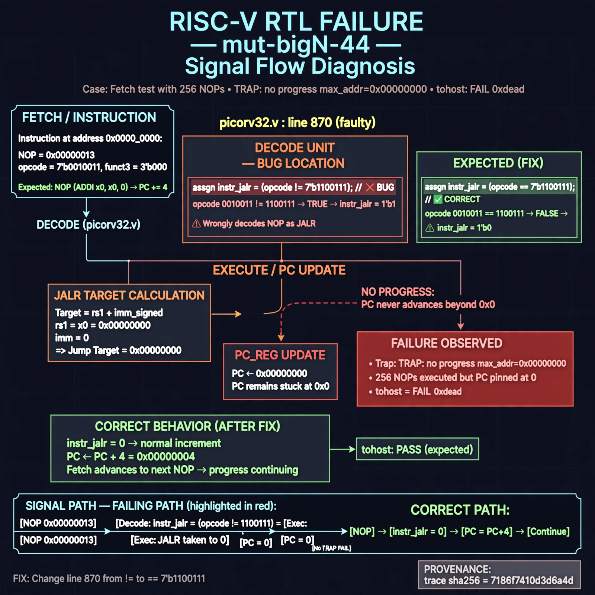

# Afterglow run report: mutbigN-v4-44

case `mut-bigN-44` | status **GREEN** | mode `live` | seed `42`

wall start `2026-10-27T16:12:33Z` | wall end `2026-10-27T16:13:09Z` | time-to-green `36.3s`

retries `0` | human_touches `0` | diagnosed `True` | fixed_unaided `True` | patch_source `model-verbatim`

## Verdicts (from sim, not typed)

- BEFORE: tohost=FAIL 0xdead checksum=563b7c10626ff25de2b3c430956c7c113e448c4efaea068f9b83a198d4322b15 cycles=2009 seed=42 pass=False
- AFTER: tohost=PASS checksum=5c28238265cb94168311e9914f0df355642c557d04dba11845d557ac8a64aa4a cycles=2009 seed=42 pass=True

## Diagnosis (verbatim from api/text_response.json)

```
Fetch test with 256 NOPs traps with `TRAP: no progress max_addr=0x00000000` vs expected advancing PC, yielding `tohost: FAIL 0xdead`. Every NOP (opcode 0010011, funct3 000) satisfies the wrong decode at picorv32.v:870 where `instr_jalr` uses `!= 7'b1100111` instead of `==`. The false JALR with rs1=x0 and imm=0 forces jump target 0x0, pinning PC at 0 and preventing progress.
```

expected re-sim signal: tohost PASS with progress max_addr > 0x00000000 and no TRAP: no progress

## Patch (2 lines, guard-checked)

```diff
diff --git a/picorv32.v b/picorv32.v
--- a/picorv32.v
+++ b/picorv32.v
@@ -867,7 +867,7 @@
 			instr_lui     <= mem_rdata_latched[6:0] == 7'b0110111;
 			instr_auipc   <= mem_rdata_latched[6:0] == 7'b0010111;
 			instr_jal     <= mem_rdata_latched[6:0] == 7'b1101111;
-			instr_jalr    <= mem_rdata_latched[6:0] != 7'b1100111 && mem_rdata_latched[14:12] == 3'b000;
+			instr_jalr    <= mem_rdata_latched[6:0] == 7'b1100111 && mem_rdata_latched[14:12] == 3'b000;
 			instr_retirq  <= mem_rdata_latched[6:0] == 7'b0001011 && mem_rdata_latched[31:25] == 7'b0000010 && ENABLE_IRQ;
 			instr_waitirq <= mem_rdata_latched[6:0] == 7'b0001011 && mem_rdata_latched[31:25] == 7'b0000100 && ENABLE_IRQ;

```

## Provenance (judge checks)

- prompt file `v3` sha256 `ad529368accaf171e6121a54b2d27547230920a900c7c4e5094d3fff13ca4233`
- input_trace.txt sha256 `7186f7410d3d6a4dc4873a84de6b1fdea05a22f04070caae28f13def7d02cb0e` (9 lines, 69 tokens)
- prompt tokens `782` (cap 2500)
- text model `muse-spark-1.3-contributor` latency `20888ms` request `chatcmpl-01a17e22-d53f-731d-bba8-9c5294b3bb1b`
- image model `muse-image-1.0` latency `14836ms` request `47638233-0926-4986-863a-bbd22cfffd3d` status `ok`
- image prompt sha256 `560fb23e55d60a2cb53b966170a5562f12ca74b259fcb385daa8e4ed8111684f`, trace sha `7186f7410d3d6a4dc4873a84de6b1fdea05a22f04070caae28f13def7d02cb0e` (see api/image_request.json)

## Explanation diagram



## Bundle completeness

- present (12): artifacts/input_trace.txt, artifacts/boot.log, artifacts/boot_after.log, artifacts/verdict_before.json, artifacts/verdict_after.json, api/text_request.json, api/text_response.json, api/image_request.json, api/image_response.json, explain.png, patch.diff, meta.json
- missing (0): none

