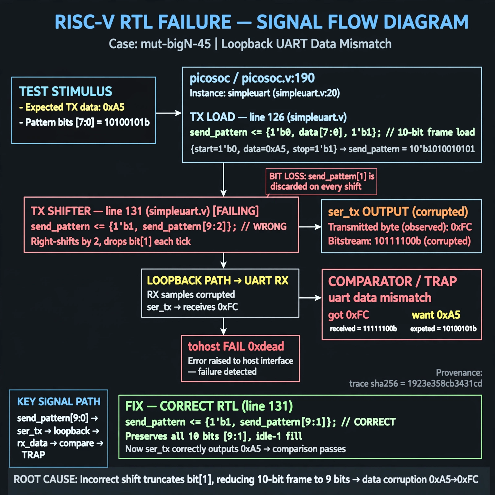

# Afterglow run report: mutbigN-v4-45

case `mut-bigN-45` | status **GREEN** | mode `live` | seed `42`

wall start `2026-10-27T16:13:09Z` | wall end `2026-10-27T16:14:27Z` | time-to-green `77.9s`

retries `0` | human_touches `0` | diagnosed `True` | fixed_unaided `True` | patch_source `model-verbatim`

## Verdicts (from sim, not typed)

- BEFORE: tohost=FAIL 0xdead checksum=81da732e94fc072e4bfde6dbde0f87fc64d6bd1ce2626374b0f08525d89d43af cycles=2652 seed=42 pass=False
- AFTER: tohost=PASS checksum=5c8f58d0f0818c97d014d2f851a6140882bd1efc96a2537047806252c0c2caf9 cycles=2652 seed=42 pass=True

## Diagnosis (verbatim from api/text_response.json)

```
Loopback UART failed with TRAP: uart data mismatch got 0xfc want 0xa5 and tohost FAIL 0xdead via simpleuart instance at picosoc/picosoc.v:190 of module at picosoc/simpleuart.v:20. TX shifter at excerpt line 131 uses {1'b1, send_pattern[9:2]} which drops bit[1] each baud tick and mis-sizes the 10-bit frame loaded at line 126, corrupting ser_tx. Correct right-shift with idle-1 fill is {1'b1, send_pattern[9:1]} to preserve start/data/stop bits.
```

expected re-sim signal: tohost PASS, TRAP cleared, uart loopback 0xa5 matches

## Patch (2 lines, guard-checked)

```diff
diff --git a/picosoc/simpleuart.v b/picosoc/simpleuart.v
--- a/picosoc/simpleuart.v
+++ b/picosoc/simpleuart.v
@@ -130,4 +130,4 @@
 			if (send_divcnt > cfg_divider && send_bitcnt) begin
-				send_pattern <= {1'b1, send_pattern[9:2]};
+				send_pattern <= {1'b1, send_pattern[9:1]};
 				send_bitcnt <= send_bitcnt - 1;
 				send_divcnt <= 0;

```

## Provenance (judge checks)

- prompt file `v3` sha256 `ad529368accaf171e6121a54b2d27547230920a900c7c4e5094d3fff13ca4233`
- input_trace.txt sha256 `1923e358cb3431cd68308557e02dac024d0f63f22eb65263078e5032c953edbe` (9 lines, 68 tokens)
- prompt tokens `818` (cap 2500)
- text model `muse-spark-1.3-contributor` latency `43253ms` request `chatcmpl-01a17e23-ba77-72b5-a331-6928dc926778`
- image model `muse-image-1.0` latency `34164ms` request `55605149-5dc0-4926-afd4-c4006ecc4b25` status `ok`
- image prompt sha256 `65b843a0cfbede9e17032da86cb778834b34a443cd18fb551c8bc52ced877940`, trace sha `1923e358cb3431cd68308557e02dac024d0f63f22eb65263078e5032c953edbe` (see api/image_request.json)

## Explanation diagram



## Bundle completeness

- present (12): artifacts/input_trace.txt, artifacts/boot.log, artifacts/boot_after.log, artifacts/verdict_before.json, artifacts/verdict_after.json, api/text_request.json, api/text_response.json, api/image_request.json, api/image_response.json, explain.png, patch.diff, meta.json
- missing (0): none

