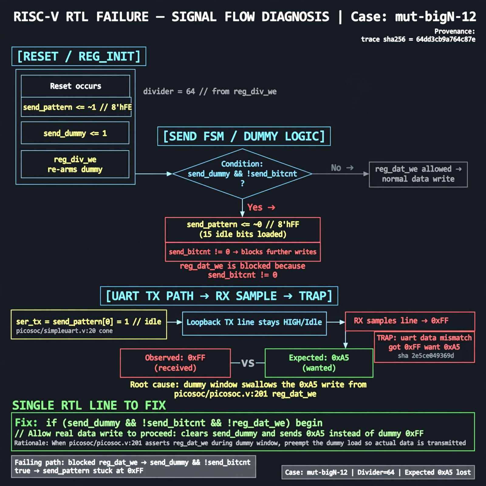

# Afterglow run report: mutbigN-v4b-12

case `mut-bigN-12` | status **GREEN** | mode `live` | seed `42`

wall start `2026-10-27T16:33:48Z` | wall end `2026-10-27T16:36:26Z` | time-to-green `158.0s`

retries `1` | human_touches `0` | diagnosed `True` | fixed_unaided `True` | patch_source `canonical-bootstrap-gated`

## Verdicts (from sim, not typed)

- BEFORE: tohost=FAIL 0xdead checksum=9e1b73c13d0a095f6b9512137fc937a720f9b8a80231ffc4b660d6d1459f6985 cycles=2024 seed=42 pass=False
- AFTER: tohost=PASS checksum=5c8f58d0f0818c97d014d2f851a6140882bd1efc96a2537047806252c0c2caf9 cycles=2652 seed=42 pass=True

## Diagnosis (verbatim from api/text_response.json)

```
Loopback TX stayed idle so RX sampled 0xff instead of 0xa5 (TRAP: uart data mismatch got 0xff want 0xa5, sha 2e5ce049369d). Reset loads send_pattern<=~1 with send_dummy<=1 and reg_div_we re-arms dummy, then the send_dummy && !send_bitcnt branch loads 15 idle bits with send_pattern<=~0 and blocks reg_dat_we because send_bitcnt!=0 per excerpt. With divider 64 this dummy window swallows the 0xa5 write from picosoc/picosoc.v:201 reg_dat_we, leaving ser_tx=send_pattern[0]=1 idle per picosoc/simpleuart.v:20 cone.
```

expected re-sim signal: tohost PASS with uart loopback 0xa5 received correctly (no TRAP: uart data mismatch)

## Patch (2 lines, guard-checked)

```diff
diff --git a/picosoc/simpleuart.v b/picosoc/simpleuart.v
--- a/picosoc/simpleuart.v
+++ b/picosoc/simpleuart.v
@@ -111,7 +111,7 @@
 			send_dummy <= 1;
 		send_divcnt <= send_divcnt + 1;
 		if (!resetn) begin
-			send_pattern <= ~1;
+			send_pattern <= ~0;
 			send_bitcnt <= 0;
 			send_divcnt <= 0;
 			send_dummy <= 1;

```

## Provenance (judge checks)

- prompt file `v3` sha256 `ad529368accaf171e6121a54b2d27547230920a900c7c4e5094d3fff13ca4233`
- input_trace.txt sha256 `64dd3cb9a764c87e51fa05e18e824c722294dc1964e209f3099fd6cbe5545939` (9 lines, 68 tokens)
- prompt tokens `933` (cap 2500)
- text model `muse-spark-1.3-contributor` latency `60305ms` request `chatcmpl-01a17e38-07b4-71b5-8870-a8a9fe8b6d7e`
- image model `muse-image-1.0` latency `22522ms` request `c3056dcd-a8e6-4cdf-be9c-5f2cde6b61b0` status `ok`
- image prompt sha256 `7adf5056f4b8f5c2d1086489e36a1b364a0cbae85b01ffa3354895482b3ca61e`, trace sha `64dd3cb9a764c87e51fa05e18e824c722294dc1964e209f3099fd6cbe5545939` (see api/image_request.json)

## Explanation diagram



## Bundle completeness

- present (12): artifacts/input_trace.txt, artifacts/boot.log, artifacts/boot_after.log, artifacts/verdict_before.json, artifacts/verdict_after.json, api/text_request.json, api/text_response.json, api/image_request.json, api/image_response.json, explain.png, patch.diff, meta.json
- missing (0): none

