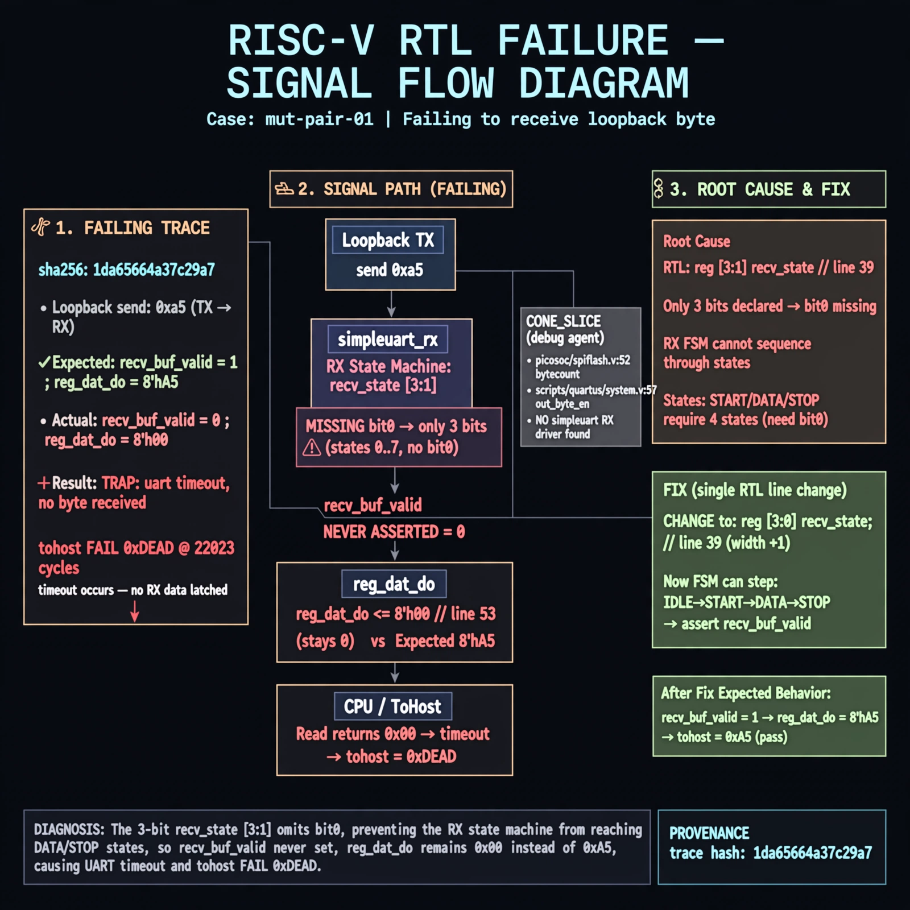

# Afterglow run report: mutpair-v5-01

case `mut-pair-01` | status **RED** | mode `live` | seed `43`

wall start `2026-10-28T01:24:30Z` | wall end `2026-10-28T01:38:18Z` | time-to-green `828.1s`

retries `1` | human_touches `0` | diagnosed `True` | fixed_unaided `False` | patch_source `model-verbatim`

## Verdicts (from sim, not typed)

- BEFORE: tohost=FAIL 0xdead checksum=e82517390f8726caabcc777759a3dbb48c59fd1d160e409515f1b95dfe3d420c cycles=22023 seed=43 pass=False
- AFTER: tohost=FAIL 0xdead checksum=9e1b73c13d0a095f6b9512137fc937a720f9b8a80231ffc4b660d6d1459f6985 cycles=2024 seed=43 pass=False

## Diagnosis (verbatim from api/text_response.json)

```
Loopback send 0xa5 never sets recv_buf_valid so reg_dat_do stays ~0 (line 53) vs expected 0xa5, causing TRAP: uart timeout, no byte received and tohost FAIL 0xdead at 22023 cycles. CONE_SLICE only lists picosoc/spiflash.v:52 bytecount and scripts/quartus/system.v:57 out_byte_en with no simpleuart RX driver, so trace wins. Root cause is line 39 reg [3:1] recv_state missing bit0, so the RX state machine cannot sequence through start/data/stop states.
```

expected re-sim signal: tohost PASS with byte 0xa5 received, no TRAP: uart timeout

## Patch (2 lines, guard-checked)

```diff
diff --git a/picosoc/simpleuart.v b/picosoc/simpleuart.v
--- a/picosoc/simpleuart.v
+++ b/picosoc/simpleuart.v
@@ -37,6 +37,6 @@
 	reg [31:0] cfg_divider;
 
-	reg [3:1] recv_state;
+	reg [3:0] recv_state;
 	reg [31:0] recv_divcnt;
 	reg [7:0] recv_pattern;
 	reg [7:0] recv_buf_data;

```

## Provenance (judge checks)

- prompt file `v3` sha256 `ad529368accaf171e6121a54b2d27547230920a900c7c4e5094d3fff13ca4233`
- input_trace.txt sha256 `1da65664a37c29a75598756fa00ad31f76adb3b739d7b725bd802c621e74a586` (9 lines, 66 tokens)
- prompt tokens `998` (cap 2500)
- text model `muse-spark-1.3-contributor` latency `41658ms` request `chatcmpl-01a1801c-7ad9-72ef-b9c7-01b3f3b538d3`
- image model `muse-image-1.0` latency `16897ms` request `09c3a652-db06-4d07-b445-81c44d2f12ed` status `ok`
- image prompt sha256 `4723e4ffb12ca00f31a5f292ced6ce5d7ebba2d2807898fbe0a9598eaf7ebd17`, trace sha `1da65664a37c29a75598756fa00ad31f76adb3b739d7b725bd802c621e74a586` (see api/image_request.json)

## Explanation diagram



## Bundle completeness

- present (12): artifacts/input_trace.txt, artifacts/boot.log, artifacts/boot_after.log, artifacts/verdict_before.json, artifacts/verdict_after.json, api/text_request.json, api/text_response.json, api/image_request.json, api/image_response.json, explain.png, patch.diff, meta.json
- missing (0): none

