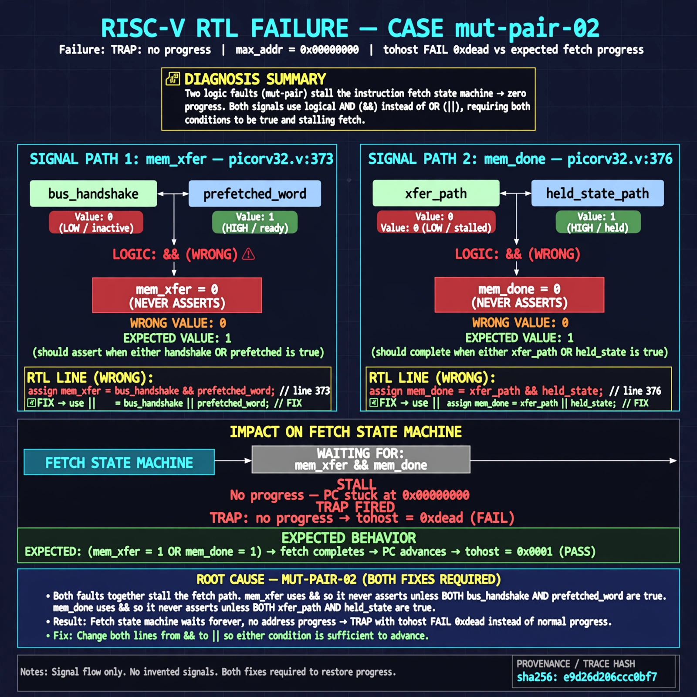

# Afterglow run report: mutpair-v5-02

case `mut-pair-02` | status **GREEN** | mode `live` | seed `43`

wall start `2026-10-28T01:38:18Z` | wall end `2026-10-28T01:40:56Z` | time-to-green `157.6s`

retries `1` | human_touches `0` | diagnosed `True` | fixed_unaided `True` | patch_source `model-verbatim`

## Verdicts (from sim, not typed)

- BEFORE: tohost=FAIL 0xdead checksum=563b7c10626ff25de2b3c430956c7c113e448c4efaea068f9b83a198d4322b15 cycles=2009 seed=43 pass=False
- AFTER: tohost=PASS checksum=5c28238265cb94168311e9914f0df355642c557d04dba11845d557ac8a64aa4a cycles=2009 seed=43 pass=True

## Diagnosis (verbatim from api/text_response.json)

```
Trace shows TRAP: no progress max_addr=0x00000000 with tohost FAIL 0xdead vs expected fetch progress. mem_xfer at picorv32.v:373 uses && instead of || so it never asserts without both bus handshake and prefetched word, and mem_done at picorv32.v:376 uses && instead of || so it requires both xfer-path and held-state path. Together they stall the fetch state machine with zero progress, a mut-pair requiring both fixes.
```

expected re-sim signal: tohost PASS with TRAP cleared and max_addr advancing past 0x00000000

## Patch (4 lines, guard-checked)

```diff
diff --git a/picorv32.v b/picorv32.v
--- a/picorv32.v
+++ b/picorv32.v
@@ -372,2 +372,2 @@
 	wire mem_la_use_prefetched_high_word = COMPRESSED_ISA && mem_la_firstword && prefetched_high_word && !clear_prefetched_high_word;
-	assign mem_xfer = (mem_valid && mem_ready) && (mem_la_use_prefetched_high_word && mem_do_rinst);
+	assign mem_xfer = (mem_valid && mem_ready) || (mem_la_use_prefetched_high_word && mem_do_rinst);
@@ -375,2 +375,2 @@
 	wire mem_busy = |{mem_do_prefetch, mem_do_rinst, mem_do_rdata, mem_do_wdata};
-	wire mem_done = resetn && ((mem_xfer && |mem_state && (mem_do_rinst || mem_do_rdata || mem_do_wdata)) && (&mem_state && mem_do_rinst)) &&
+	wire mem_done = resetn && ((mem_xfer && |mem_state && (mem_do_rinst || mem_do_rdata || mem_do_wdata)) || (&mem_state && mem_do_rinst)) &&

```

## Provenance (judge checks)

- prompt file `v3` sha256 `ad529368accaf171e6121a54b2d27547230920a900c7c4e5094d3fff13ca4233`
- input_trace.txt sha256 `e9d26d206ccc0bf72bf79372627afe640506dc5b3cc21166c142ec979a371e07` (9 lines, 69 tokens)
- prompt tokens `913` (cap 2500)
- text model `muse-spark-1.3-contributor` latency `60095ms` request `chatcmpl-01a1802a-79bc-711d-9173-ea79eda12764`
- image model `muse-image-1.0` latency `26326ms` request `480679ec-d566-481a-80fc-846b9a8369f8` status `ok`
- image prompt sha256 `d4f83a852734d2ded0db5df7e0d1931272cc95679435b3a7ec73b68066699b53`, trace sha `e9d26d206ccc0bf72bf79372627afe640506dc5b3cc21166c142ec979a371e07` (see api/image_request.json)

## Explanation diagram



## Bundle completeness

- present (12): artifacts/input_trace.txt, artifacts/boot.log, artifacts/boot_after.log, artifacts/verdict_before.json, artifacts/verdict_after.json, api/text_request.json, api/text_response.json, api/image_request.json, api/image_response.json, explain.png, patch.diff, meta.json
- missing (0): none

