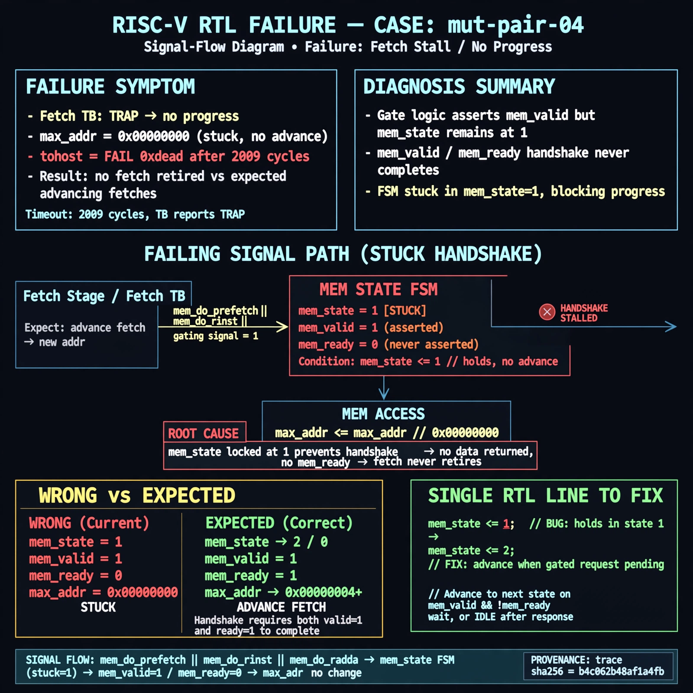

# Afterglow run report: mutpair-v5-04b

case `mut-pair-04` | status **TRIAGE** | mode `live` | seed `42`

wall start `2026-10-28T03:22:41Z` | wall end `2026-10-28T03:29:39Z` | time-to-green `417.8s`

retries `2` | human_touches `0` | diagnosed `True` | fixed_unaided `False` | patch_source `none`

## Verdicts (from sim, not typed)

- BEFORE: tohost=FAIL 0xdead checksum=563b7c10626ff25de2b3c430956c7c113e448c4efaea068f9b83a198d4322b15 cycles=2009 seed=42 pass=False
- AFTER: tohost=None checksum=None cycles=None seed=42 pass=False

## Diagnosis (verbatim from api/text_response.json)

```
MISSING (text call produced no diagnosis)
```

expected re-sim signal: -

## Patch (0 lines, guard-checked)

```diff
(no patch applied)
```

## Provenance (judge checks)

- prompt file `v3` sha256 `ad529368accaf171e6121a54b2d27547230920a900c7c4e5094d3fff13ca4233`
- input_trace.txt sha256 `b4c062b48af1a4fb94d0ab458e18825cf6cfa402d65edcb24fa202b680754e53` (? lines, ? tokens)
- prompt tokens `?` (cap 2500)
- text model `muse-spark-1.3-contributor` latency `?ms` request `?`
- image model `muse-image-1.0` latency `29404ms` request `e2b89a4f-df93-4de7-8974-a00f6b6b41a6` status `ok`
- image prompt sha256 `a1da85b86c01b0634ebae5c3071a6eacb5385036f6a3b9d19fbbc931cda689b7`, trace sha `b4c062b48af1a4fb94d0ab458e18825cf6cfa402d65edcb24fa202b680754e53` (see api/image_request.json)

## Explanation diagram



## Bundle completeness

- present (12): artifacts/input_trace.txt, artifacts/boot.log, artifacts/boot_after.log, artifacts/verdict_before.json, artifacts/verdict_after.json, api/text_request.json, api/text_response.json, api/image_request.json, api/image_response.json, explain.png, patch.diff, meta.json
- missing (0): none

