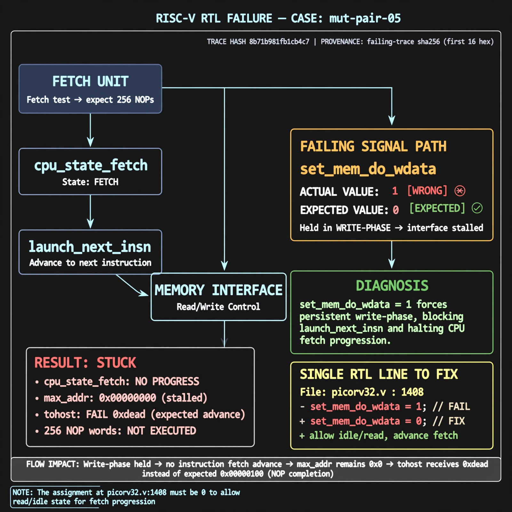

# Afterglow run report: mutpair-v5-05

case `mut-pair-05` | status **RED** | mode `live` | seed `43`

wall start `2026-10-28T01:55:58Z` | wall end `2026-10-28T02:00:28Z` | time-to-green `269.8s`

retries `2` | human_touches `0` | diagnosed `True` | fixed_unaided `False` | patch_source `model-verbatim`

## Verdicts (from sim, not typed)

- BEFORE: tohost=FAIL 0xdead checksum=563b7c10626ff25de2b3c430956c7c113e448c4efaea068f9b83a198d4322b15 cycles=2009 seed=43 pass=False
- AFTER: tohost=FAIL 0xdead checksum=563b7c10626ff25de2b3c430956c7c113e448c4efaea068f9b83a198d4322b15 cycles=2009 seed=43 pass=False

## Diagnosis (verbatim from api/text_response.json)

```
Fetch test traps with TRAP: no progress max_addr=0x00000000 and tohost FAIL 0xdead instead of advancing through 256 NOP words. The default assignment set_mem_do_wdata = 1 at picorv32.v:1408 holds the memory interface in write-phase instead of expected 0. This blocks launch_next_insn and cpu_state_fetch progress so max_addr never advances.
```

expected re-sim signal: tohost PASS (not FAIL 0xdead), no TRAP: no progress, max_addr != 0x00000000 with forward fetch progress

## Patch (2 lines, guard-checked)

```diff
diff --git a/picorv32.v b/picorv32.v
--- a/picorv32.v
+++ b/picorv32.v
@@ -1406,3 +1406,3 @@
 		set_mem_do_rinst = 0;
 		set_mem_do_rdata = 0;
-		set_mem_do_wdata = 1;
+		set_mem_do_wdata = 0;

```

## Provenance (judge checks)

- prompt file `v3` sha256 `ad529368accaf171e6121a54b2d27547230920a900c7c4e5094d3fff13ca4233`
- input_trace.txt sha256 `8b71b981fb1cb4c759935d8aead98e853947d756cb34fc6a20b5fb667ee6f4f7` (9 lines, 69 tokens)
- prompt tokens `834` (cap 2500)
- text model `muse-spark-1.3-contributor` latency `67195ms` request `chatcmpl-01a1803c-8f1c-725b-9924-92d860aa2caf`
- image model `muse-image-1.0` latency `13013ms` request `7d63f6d9-0f57-4677-8c55-40a2083807d0` status `ok`
- image prompt sha256 `af875c3785c924a88e3ebc0c42204ca9e5faa9b43e95aa472668119241422add`, trace sha `8b71b981fb1cb4c759935d8aead98e853947d756cb34fc6a20b5fb667ee6f4f7` (see api/image_request.json)

## Explanation diagram



## Bundle completeness

- present (12): artifacts/input_trace.txt, artifacts/boot.log, artifacts/boot_after.log, artifacts/verdict_before.json, artifacts/verdict_after.json, api/text_request.json, api/text_response.json, api/image_request.json, api/image_response.json, explain.png, patch.diff, meta.json
- missing (0): none

