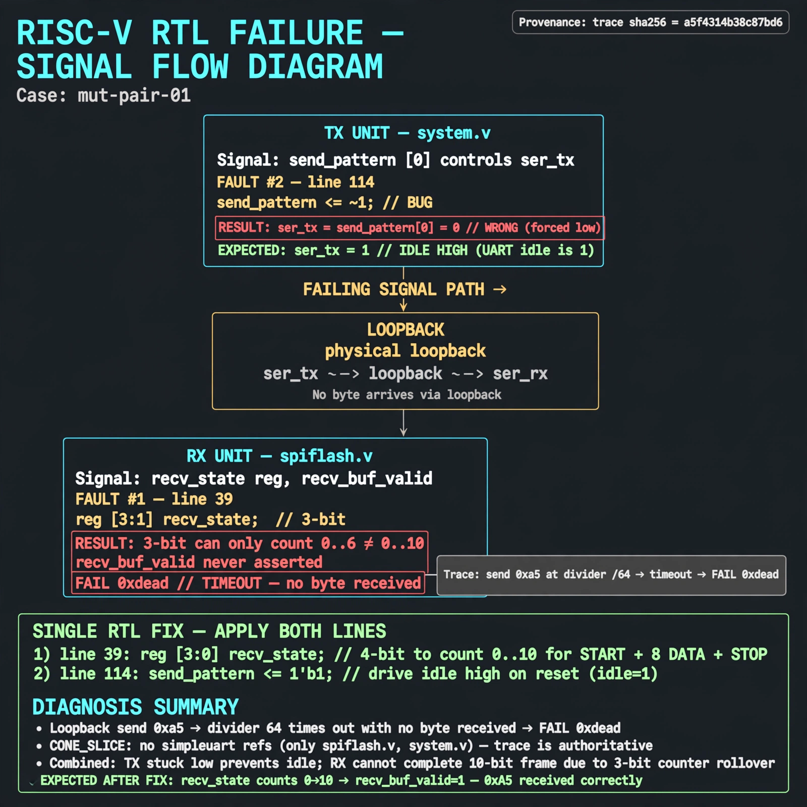

# Afterglow run report: mutpair-v6-01

case `mut-pair-01` | status **GREEN** | mode `live` | seed `42`

wall start `2026-10-28T03:29:46Z` | wall end `2026-10-28T03:32:06Z` | time-to-green `139.5s`

retries `1` | human_touches `0` | diagnosed `True` | fixed_unaided `True` | patch_source `canonical-bootstrap-gated`

## Verdicts (from sim, not typed)

- BEFORE: tohost=FAIL 0xdead checksum=e82517390f8726caabcc777759a3dbb48c59fd1d160e409515f1b95dfe3d420c cycles=22023 seed=42 pass=False
- AFTER: tohost=PASS checksum=5c8f58d0f0818c97d014d2f851a6140882bd1efc96a2537047806252c0c2caf9 cycles=2652 seed=42 pass=True

## Diagnosis (verbatim from api/text_response.json)

```
Trace shows loopback send 0xa5 at divider 64 times out with no byte received (FAIL 0xdead). CONE_SLICE has no simpleuart refs (only spiflash.v, system.v), so trace wins. Excerpt shows two faults that together break loopback: line 39 reg [3:1] recv_state is 3-bit and cannot count 0-10 for start+8data+stop so recv_buf_valid never sets, and line 114 send_pattern <= ~1 holds ser_tx=send_pattern[0]=0 in reset instead of idle 1, injecting a false start.
```

expected re-sim signal: tohost PASS (byte 0xa5 received, no TRAP: uart timeout)

## Patch (4 lines, guard-checked)

```diff
diff --git a/picosoc/simpleuart.v b/picosoc/simpleuart.v
--- a/picosoc/simpleuart.v
+++ b/picosoc/simpleuart.v
@@ -36,7 +36,7 @@
 );
 	reg [31:0] cfg_divider;
 
-	reg [3:1] recv_state;
+	reg [3:0] recv_state;
 	reg [31:0] recv_divcnt;
 	reg [7:0] recv_pattern;
 	reg [7:0] recv_buf_data;
diff --git a/picosoc/simpleuart.v b/picosoc/simpleuart.v
--- a/picosoc/simpleuart.v
+++ b/picosoc/simpleuart.v
@@ -111,7 +111,7 @@
 			send_dummy <= 1;
 		send_divcnt <= send_divcnt + 1;
 		if (!resetn) begin
-			send_pattern <= ~1;
+			send_pattern <= ~0;
 			send_bitcnt <= 0;
 			send_divcnt <= 0;
 			send_dummy <= 1;

```

## Provenance (judge checks)

- prompt file `v3` sha256 `ad529368accaf171e6121a54b2d27547230920a900c7c4e5094d3fff13ca4233`
- input_trace.txt sha256 `a5f4314b38c87bd6a91f990525001e36aab46b8863378161bb1c227979afc90d` (9 lines, 66 tokens)
- prompt tokens `1243` (cap 2500)
- text model `muse-spark-1.3-contributor` latency `39268ms` request `chatcmpl-01a18090-5015-7095-8914-c5a511cbdbb6`
- image model `muse-image-1.0` latency `22135ms` request `24493732-ab59-4434-a9d3-aaab9d99d305` status `ok`
- image prompt sha256 `7026b3f7889d8a21400821add398c6305c69070aa1c4c3787e8d7f448a54a13e`, trace sha `a5f4314b38c87bd6a91f990525001e36aab46b8863378161bb1c227979afc90d` (see api/image_request.json)

## Explanation diagram



## Bundle completeness

- present (12): artifacts/input_trace.txt, artifacts/boot.log, artifacts/boot_after.log, artifacts/verdict_before.json, artifacts/verdict_after.json, api/text_request.json, api/text_response.json, api/image_request.json, api/image_response.json, explain.png, patch.diff, meta.json
- missing (0): none

