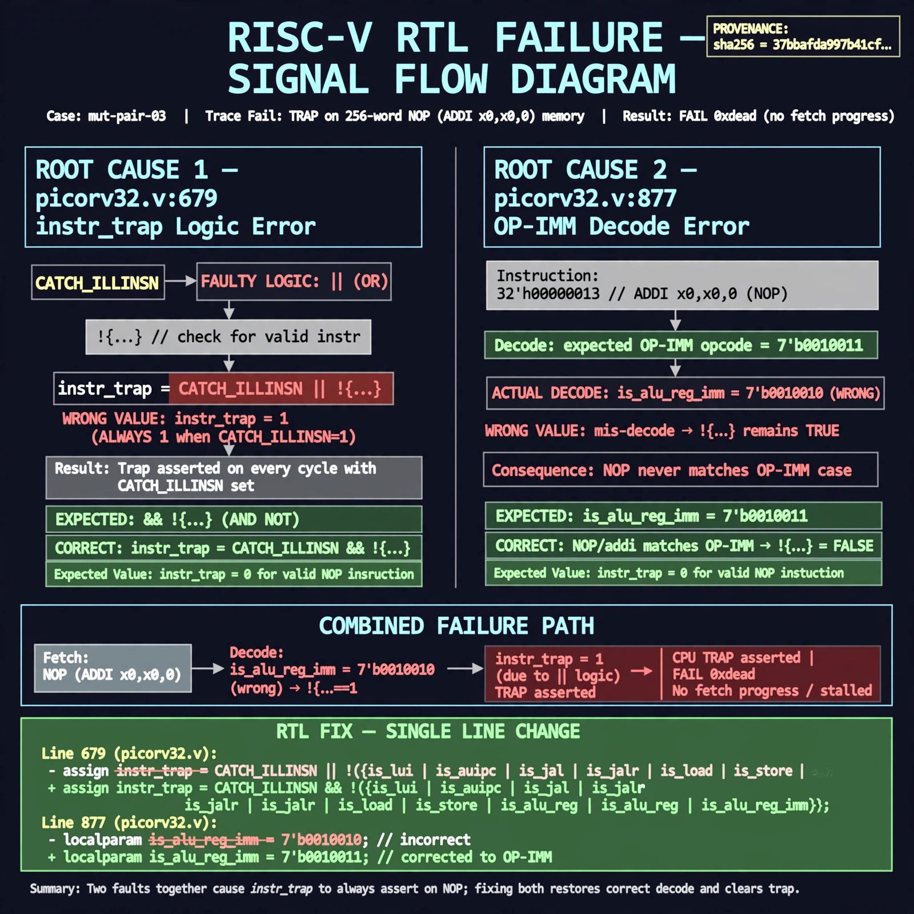

# Afterglow run report: mutpair-v6-03

case `mut-pair-03` | status **GREEN** | mode `live` | seed `42`

wall start `2026-10-28T03:32:06Z` | wall end `2026-10-28T03:35:38Z` | time-to-green `212.6s`

retries `1` | human_touches `0` | diagnosed `True` | fixed_unaided `True` | patch_source `model-verbatim`

## Verdicts (from sim, not typed)

- BEFORE: tohost=FAIL 0xdead checksum=c2a7a4d6295484feeb9ec1ea9381732b8e39a7ccd1997c7d70f6454da2fb4659 cycles=2009 seed=42 pass=False
- AFTER: tohost=PASS checksum=5c28238265cb94168311e9914f0df355642c557d04dba11845d557ac8a64aa4a cycles=2009 seed=42 pass=True

## Diagnosis (verbatim from api/text_response.json)

```
Trace shows TRAP: cpu trap asserted on 256-word NOP (ADDI x0,x0,0) memory with FAIL 0xdead instead of fetch progress. Root cause is paired: picorv32.v:679 uses `||` making `instr_trap` always 1 when CATCH_ILLINSN is set, vs expected `&& !{...}`; and picorv32.v:877 decodes `is_alu_reg_imm` as 7'b0010010 vs expected OP-IMM 7'b0010011, so NOP/addi never decodes and keeps `!{...}` true.
```

expected re-sim signal: tohost PASS (no TRAP: cpu trap asserted), fetch alignment + progress, checksum != c2a7a4d6295484feeb9ec1ea9381732b8e39a7ccd1997c7d70f6454da2fb4659

## Patch (4 lines, guard-checked)

```diff
diff --git a/picorv32.v b/picorv32.v
--- a/picorv32.v
+++ b/picorv32.v
@@ -679,1 +679,1 @@
-	assign instr_trap = (CATCH_ILLINSN || WITH_PCPI) || !{instr_lui, instr_auipc, instr_jal, instr_jalr,
+	assign instr_trap = (CATCH_ILLINSN || WITH_PCPI) && !{instr_lui, instr_auipc, instr_jal, instr_jalr,
@@ -877,1 +877,1 @@
-			is_alu_reg_imm               <= mem_rdata_latched[6:0] == 7'b0010010;
+			is_alu_reg_imm               <= mem_rdata_latched[6:0] == 7'b0010011;

```

## Provenance (judge checks)

- prompt file `v3` sha256 `ad529368accaf171e6121a54b2d27547230920a900c7c4e5094d3fff13ca4233`
- input_trace.txt sha256 `37bbafda997b41cf48c43995a54e26419ddef150f33247e3ba415286ee45cbfb` (9 lines, 69 tokens)
- prompt tokens `1396` (cap 2500)
- text model `muse-spark-1.3-contributor` latency `41948ms` request `chatcmpl-01a18093-b12f-7069-87e6-db3119cf938e`
- image model `muse-image-1.0` latency `13232ms` request `6415b738-e821-4d6b-a2ff-285c6cc32793` status `ok`
- image prompt sha256 `8f6bfb171ae42dda474e4a37679c69479b8be0fb86083da850f7ca8040da3ed8`, trace sha `37bbafda997b41cf48c43995a54e26419ddef150f33247e3ba415286ee45cbfb` (see api/image_request.json)

## Explanation diagram



## Bundle completeness

- present (12): artifacts/input_trace.txt, artifacts/boot.log, artifacts/boot_after.log, artifacts/verdict_before.json, artifacts/verdict_after.json, api/text_request.json, api/text_response.json, api/image_request.json, api/image_response.json, explain.png, patch.diff, meta.json
- missing (0): none

