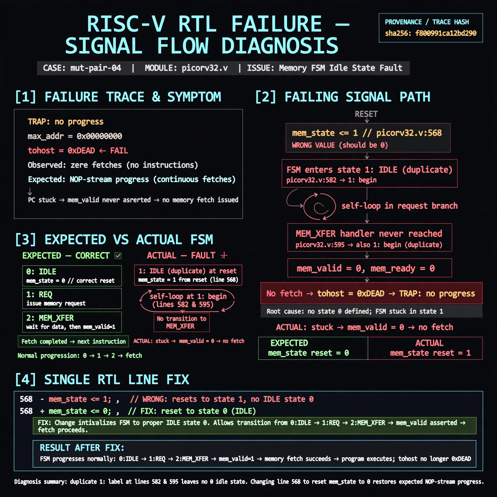

# Afterglow run report: mutpair-v6-04

case `mut-pair-04` | status **GREEN** | mode `live` | seed `42`

wall start `2026-10-28T03:35:39Z` | wall end `2026-10-28T03:38:17Z` | time-to-green `158.9s`

retries `0` | human_touches `0` | diagnosed `True` | fixed_unaided `True` | patch_source `model-verbatim`

## Verdicts (from sim, not typed)

- BEFORE: tohost=FAIL 0xdead checksum=563b7c10626ff25de2b3c430956c7c113e448c4efaea068f9b83a198d4322b15 cycles=2009 seed=42 pass=False
- AFTER: tohost=PASS checksum=5c28238265cb94168311e9914f0df355642c557d04dba11845d557ac8a64aa4a cycles=2009 seed=42 pass=True

## Diagnosis (verbatim from api/text_response.json)

```
Trace shows TRAP: no progress max_addr=0x00000000 with tohost FAIL 0xdead, i.e. zero fetches vs expected NOP-stream progress. Root cause in excerpt is the memory FSM idle state: picorv32.v:568 resets mem_state <= 1 and picorv32.v:582 labels the idle branch 1: begin, creating a duplicate 1: with picorv32.v:595 and leaving no 0 idle state. The FSM self-loops in the request branch and never reaches the mem_xfer wait handling, so mem_valid/mem fetch never progresses.
```

expected re-sim signal: tohost PASS (not FAIL 0xdead) with max_addr progress >0x00000000 and no TRAP: no progress

## Patch (4 lines, guard-checked)

```diff
diff --git a/picorv32.v b/picorv32.v
--- a/picorv32.v
+++ b/picorv32.v
@@ -565,7 +565,7 @@
 	always @(posedge clk) begin
 		if (!resetn || trap) begin
 			if (!resetn)
-				mem_state <= 1;
+				mem_state <= 0;
 			if (!resetn || mem_ready)
 				mem_valid <= 0;
 			mem_la_secondword <= 0;
@@ -579,6 +579,6 @@
 			end
 			case (mem_state)
-				1: begin
+				0: begin
 					if (mem_do_prefetch || mem_do_rinst || mem_do_rdata) begin
 						mem_valid <= !mem_la_use_prefetched_high_word;
 						mem_instr <= mem_do_prefetch || mem_do_rinst;

```

## Provenance (judge checks)

- prompt file `v3` sha256 `ad529368accaf171e6121a54b2d27547230920a900c7c4e5094d3fff13ca4233`
- input_trace.txt sha256 `f800991ca12bd290cede60975edb3587b0ddbbd8165348304bf267ecc46e5030` (9 lines, 69 tokens)
- prompt tokens `951` (cap 2500)
- text model `muse-spark-1.3-contributor` latency `50076ms` request `chatcmpl-01a18095-f020-74fd-bb23-5611102f8077`
- image model `muse-image-1.0` latency `25002ms` request `b1fe9a8c-0d4c-420d-b323-191f35fc2f76` status `ok`
- image prompt sha256 `4638b4729ed8b654f0e50541ae95deb733db46e4a47a1165f0a53f4031d62734`, trace sha `f800991ca12bd290cede60975edb3587b0ddbbd8165348304bf267ecc46e5030` (see api/image_request.json)

## Explanation diagram



## Bundle completeness

- present (12): artifacts/input_trace.txt, artifacts/boot.log, artifacts/boot_after.log, artifacts/verdict_before.json, artifacts/verdict_after.json, api/text_request.json, api/text_response.json, api/image_request.json, api/image_response.json, explain.png, patch.diff, meta.json
- missing (0): none

