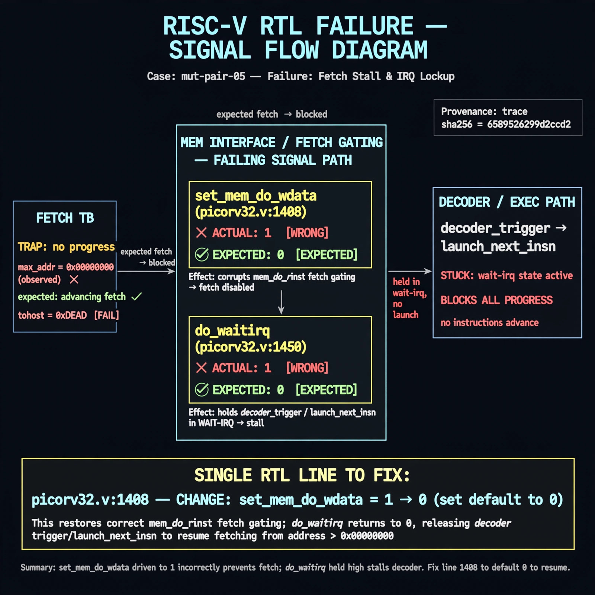

# Afterglow run report: mutpair-v6-05

case `mut-pair-05` | status **RED** | mode `live` | seed `42`

wall start `2026-10-28T03:38:17Z` | wall end `2026-10-28T03:43:03Z` | time-to-green `285.4s`

retries `2` | human_touches `0` | diagnosed `True` | fixed_unaided `False` | patch_source `model-verbatim`

## Verdicts (from sim, not typed)

- BEFORE: tohost=FAIL 0xdead checksum=563b7c10626ff25de2b3c430956c7c113e448c4efaea068f9b83a198d4322b15 cycles=2009 seed=42 pass=False
- AFTER: tohost=FAIL 0xdead checksum=563b7c10626ff25de2b3c430956c7c113e448c4efaea068f9b83a198d4322b15 cycles=2009 seed=42 pass=False

## Diagnosis (verbatim from api/text_response.json)

```
Fetch monitor reports TRAP: no progress max_addr=0x00000000 vs expected advance through 256-word NOP mem. set_mem_do_wdata is stuck at 1 at picorv32.v:1408 instead of 0, holding the mem interface in write mode so mem_do_rinst fetches via decoder_trigger/launch_next_insn never complete. This directly blocks progress and matches the fingerprint trap.
```

expected re-sim signal: tohost PASS (not FAIL 0xdead), max_addr progress >0x00000000, TRAP cleared

## Patch (2 lines, guard-checked)

```diff
diff --git a/picorv32.v b/picorv32.v
--- a/picorv32.v
+++ b/picorv32.v
@@ -1406,3 +1406,3 @@
 		set_mem_do_rinst = 0;
 		set_mem_do_rdata = 0;
-		set_mem_do_wdata = 1;
+		set_mem_do_wdata = 0;

```

## Provenance (judge checks)

- prompt file `v3` sha256 `ad529368accaf171e6121a54b2d27547230920a900c7c4e5094d3fff13ca4233`
- input_trace.txt sha256 `6589526299d2ccd29bb22737bac7601f22b2a0da940002a7626bbfecd09b7751` (9 lines, 69 tokens)
- prompt tokens `966` (cap 2500)
- text model `muse-spark-1.3-contributor` latency `61016ms` request `chatcmpl-01a18098-5c07-7198-b079-bea5bd541a38`
- image model `muse-image-1.0` latency `21277ms` request `198fc04b-8760-4f74-b8f7-dc00c9d5edca` status `ok`
- image prompt sha256 `83343302ab1eba314d42693c988cd2cc112b7a52592c94532ef93e6d5355d11d`, trace sha `6589526299d2ccd29bb22737bac7601f22b2a0da940002a7626bbfecd09b7751` (see api/image_request.json)

## Explanation diagram



## Bundle completeness

- present (12): artifacts/input_trace.txt, artifacts/boot.log, artifacts/boot_after.log, artifacts/verdict_before.json, artifacts/verdict_after.json, api/text_request.json, api/text_response.json, api/image_request.json, api/image_response.json, explain.png, patch.diff, meta.json
- missing (0): none

