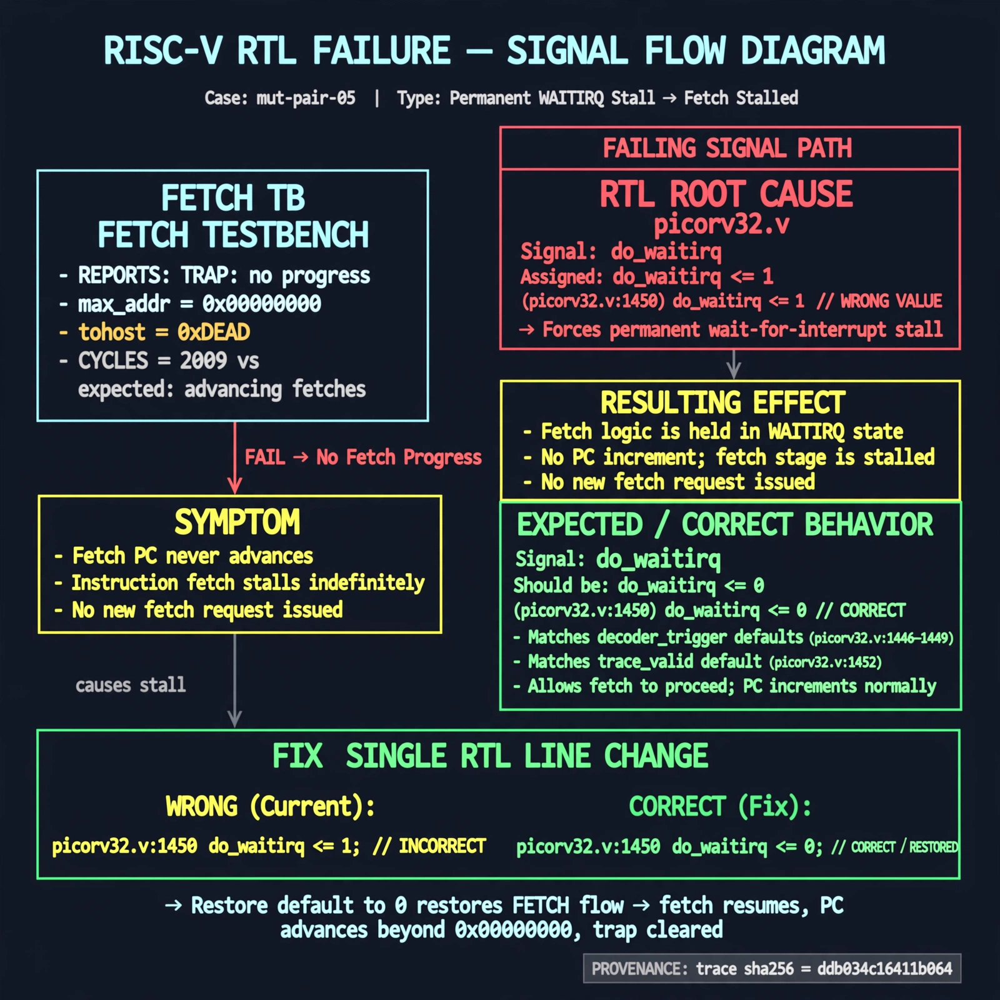

# Afterglow run report: mutpair-v8b-05

case `mut-pair-05` | status **RED** | mode `live` | seed `42`

wall start `2026-10-28T13:31:56Z` | wall end `2026-10-28T13:48:08Z` | time-to-green `971.5s`

retries `2` | human_touches `0` | diagnosed `True` | fixed_unaided `False` | patch_source `model-verbatim`

## Verdicts (from sim, not typed)

- BEFORE: tohost=FAIL 0xdead checksum=563b7c10626ff25de2b3c430956c7c113e448c4efaea068f9b83a198d4322b15 cycles=2009 seed=42 pass=False
- AFTER: tohost=FAIL 0xdead checksum=563b7c10626ff25de2b3c430956c7c113e448c4efaea068f9b83a198d4322b15 cycles=2009 seed=42 pass=False

## Diagnosis (verbatim from api/text_response.json)

```
Fetch TB reports TRAP: no progress max_addr=0x00000000 with tohost FAIL 0xdead at CYCLES=2009 vs expected advancing fetches. Default assignment do_waitirq <= 1 at picorv32.v:1450 forces permanent wait-for-interrupt stall so fetch PC never advances. Restoring the default to 0, consistent with decoder_trigger defaults at picorv32.v:1446-1449 and trace_valid at picorv32.v:1452, fixes the stall.
```

expected re-sim signal: tohost PASS with no TRAP: no progress, max_addr advancing beyond 0x00000000

## Patch (2 lines, guard-checked)

```diff
diff --git a/picorv32.v b/picorv32.v
--- a/picorv32.v
+++ b/picorv32.v
@@ -1448,8 +1448,8 @@
 		decoder_pseudo_trigger <= 0;
 		decoder_pseudo_trigger_q <= decoder_pseudo_trigger;
-		do_waitirq <= 1;
+		do_waitirq <= 0;
 
 		trace_valid <= 0;
 
 		if (!ENABLE_TRACE)
 			trace_data <= 'bx;

```

## Provenance (judge checks)

- prompt file `v3` sha256 `ad529368accaf171e6121a54b2d27547230920a900c7c4e5094d3fff13ca4233`
- input_trace.txt sha256 `ddb034c16411b064656ce47c77b0d8736d4d28977903b3d37fc99defb6dcb55a` (9 lines, 69 tokens)
- prompt tokens `1162` (cap 2500)
- text model `muse-spark-1.3-contributor` latency `73441ms` request `chatcmpl-01a182c4-4b23-7264-8d1b-d762cf9fe6b7`
- image model `muse-image-1.0` latency `22900ms` request `a4385c53-4682-4173-8c24-2c895e2e0e4a` status `ok`
- image prompt sha256 `3afe49013468fdf17e89af3b959387462f258a3d0fa5c8ef33c71b8c75f2ab70`, trace sha `ddb034c16411b064656ce47c77b0d8736d4d28977903b3d37fc99defb6dcb55a` (see api/image_request.json)

## Explanation diagram



## Bundle completeness

- present (12): artifacts/input_trace.txt, artifacts/boot.log, artifacts/boot_after.log, artifacts/verdict_before.json, artifacts/verdict_after.json, api/text_request.json, api/text_response.json, api/image_request.json, api/image_response.json, explain.png, patch.diff, meta.json
- missing (0): none

