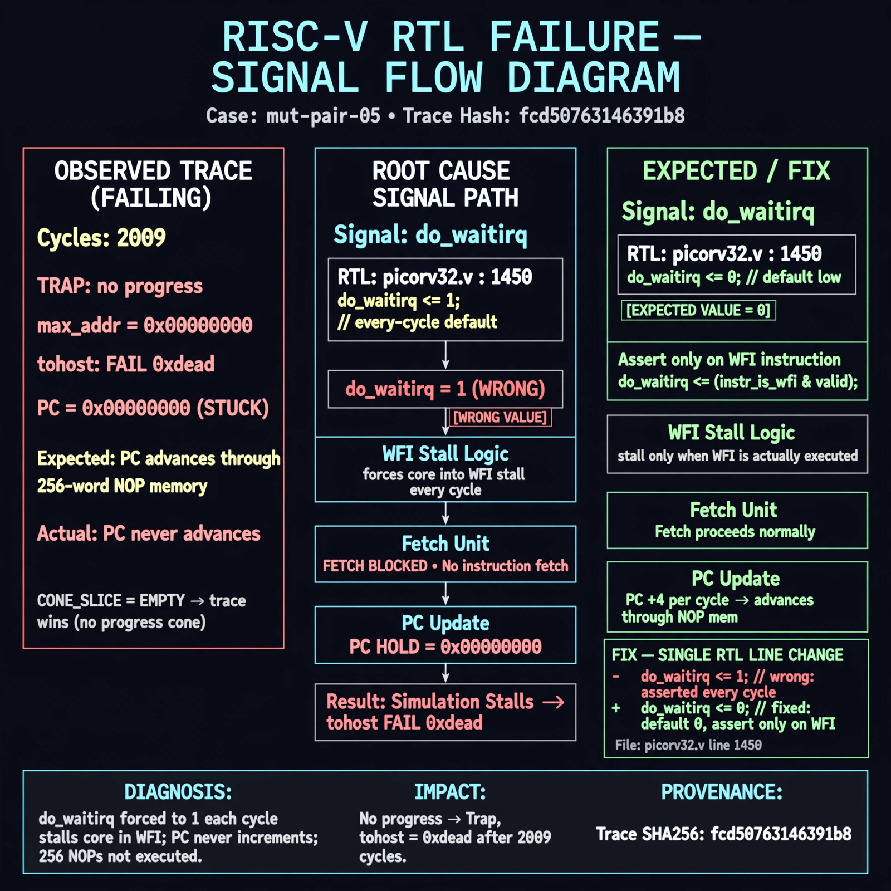

# Afterglow run report: mutpair-v9-05

case `mut-pair-05` | status **GREEN** | mode `live` | seed `42`

wall start `2026-10-28T14:05:15Z` | wall end `2026-10-28T14:15:01Z` | time-to-green `585.9s`

retries `1` | human_touches `0` | diagnosed `True` | fixed_unaided `True` | patch_source `model-verbatim`

## Verdicts (from sim, not typed)

- BEFORE: tohost=FAIL 0xdead checksum=563b7c10626ff25de2b3c430956c7c113e448c4efaea068f9b83a198d4322b15 cycles=2009 seed=42 pass=False
- AFTER: tohost=PASS checksum=5c28238265cb94168311e9914f0df355642c557d04dba11845d557ac8a64aa4a cycles=2009 seed=42 pass=True

## Diagnosis (verbatim from api/text_response.json)

```
Trace shows `TRAP: no progress max_addr=0x00000000` and `tohost: FAIL 0xdead` after 2009 cycles, meaning PC never advanced through 256-word NOP mem where progress was expected. CONE_SLICE is empty so trace wins. Root cause is picorv32.v:1450 `do_waitirq <= 1;` as the every-cycle default, which forces WFI stall and blocks fetch; it should be 0 and asserted only on WFI.
```

expected re-sim signal: tohost PASS with progress max_addr != 0x00000000, no TRAP: no progress, no FAIL 0xdead

## Patch (6 lines, guard-checked)

```diff
diff --git a/picorv32.v b/picorv32.v
--- a/picorv32.v
+++ b/picorv32.v
@@ -1406,3 +1406,3 @@
 		set_mem_do_rinst = 0;
 		set_mem_do_rdata = 0;
-		set_mem_do_wdata = 1;
+		set_mem_do_wdata = 0;

 		alu_out_0_q <= alu_out_0;
 		alu_out_q <= alu_out;
@@ -1448,3 +1448,3 @@
 		decoder_pseudo_trigger <= 0;
 		decoder_pseudo_trigger_q <= decoder_pseudo_trigger;
-		do_waitirq <= 1;
+		do_waitirq <= 0;

 		trace_valid <= 0;

 		if (!ENABLE_TRACE)
 			trace_data <= 'bx;
diff --git a/picorv32.v b/picorv32.v
--- a/picorv32.v
+++ b/picorv32.v
@@ -1448,3 +1448,3 @@
 		decoder_pseudo_trigger <= 0;
 		decoder_pseudo_trigger_q <= decoder_pseudo_trigger;
-		do_waitirq <= 1;
+		do_waitirq <= 0;

 		trace_valid <= 0;

 		if (!ENABLE_TRACE)
 			trace_data <= 'bx;

```

## Provenance (judge checks)

- prompt file `v3` sha256 `ad529368accaf171e6121a54b2d27547230920a900c7c4e5094d3fff13ca4233`
- input_trace.txt sha256 `fcd50763146391b87e1b299e2f8f05876fadc3a54126ed742f27000ae8c6d2ce` (9 lines, 69 tokens)
- prompt tokens `1132` (cap 2500)
- text model `muse-spark-1.3-contributor` latency `60350ms` request `chatcmpl-01a182dd-0d17-71d2-9656-37b9189b8581`
- image model `muse-image-1.0` latency `13812ms` request `1d51332f-55a4-4550-b022-61c9f30538f0` status `ok`
- image prompt sha256 `dfd6a473ce1e2c640694509e860d78829e84e97cb9264ad08f7d117f4b37378d`, trace sha `fcd50763146391b87e1b299e2f8f05876fadc3a54126ed742f27000ae8c6d2ce` (see api/image_request.json)

## Explanation diagram



## Bundle completeness

- present (12): artifacts/input_trace.txt, artifacts/boot.log, artifacts/boot_after.log, artifacts/verdict_before.json, artifacts/verdict_after.json, api/text_request.json, api/text_response.json, api/image_request.json, api/image_response.json, explain.png, patch.diff, meta.json
- missing (0): none

