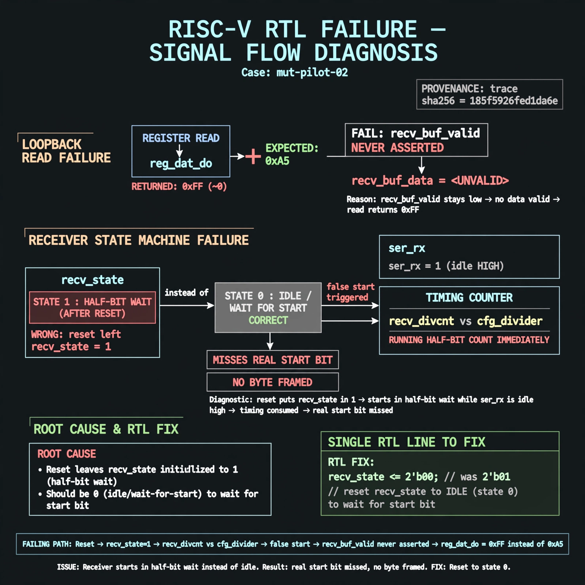

# Afterglow run report: opt-live-02

case `mut-pilot-02` | status **GREEN** | mode `live` | seed `42`

wall start `2026-10-27T02:43:21Z` | wall end `2026-10-27T02:46:22Z` | time-to-green `181.4s`

retries `0` | human_touches `0` | diagnosed `True` | fixed_unaided `True` | patch_source `model-verbatim`

## Verdicts (from sim, not typed)

- BEFORE: tohost=FAIL 0xdead checksum=9e1b73c13d0a095f6b9512137fc937a720f9b8a80231ffc4b660d6d1459f6985 cycles=2024 seed=42 pass=False
- AFTER: tohost=PASS checksum=5c8f58d0f0818c97d014d2f851a6140882bd1efc96a2537047806252c0c2caf9 cycles=2652 seed=42 pass=True

## Diagnosis (verbatim from api/text_response.json)

```
Loopback read via reg_dat_do returned 0xff (~0) instead of 0xa5 because recv_buf_valid never asserted with recv_buf_data. Reset leaves recv_state in 1 so receiver starts in half-bit wait using recv_divcnt vs cfg_divider while ser_rx is idle high instead of waiting in state 0 for start. The false start consumes timing and the real start bit is missed, so no byte is framed.
```

expected re-sim signal: tohost PASS (FAIL 0xdead cleared), uart loopback got 0xa5 want 0xa5

## Patch (2 lines, guard-checked)

```diff
diff --git a/picosoc/simpleuart.v b/picosoc/simpleuart.v
--- a/picosoc/simpleuart.v
+++ b/picosoc/simpleuart.v
@@ -66,7 +66,7 @@
 	always @(posedge clk) begin
 		if (!resetn) begin
-			recv_state <= 1;
+			recv_state <= 0;
 			recv_divcnt <= 0;
 			recv_pattern <= 0;
 			recv_buf_data <= 0;
 			recv_buf_valid <= 0;

```

## Provenance (judge checks)

- prompt file `/home/tuncay/afterglow/agent/prompts/v2.txt` sha256 `d31e1ef6b74ddf52ee59e790ebff2f3defa9b03be82e699f45ef620cf8e27a6e`
- input_trace.txt sha256 `185f5926fed1da6eb2c0865717ade5051bd480d612357aedea2a973f70549636` (9 lines, 68 tokens)
- prompt tokens `696` (cap 2500)
- text model `muse-spark-1.3-contributor` latency `35250ms` request `chatcmpl-01a17b3e-340e-7215-acf8-a846d75df1cb`
- image model `muse-image-1.0` latency `10765ms` request `a75eacf7-eeef-4b64-a364-37a5ea273262` status `ok`
- image prompt sha256 `1e6e84c5249cfe00526e718eb873c87804987a8154f4503a83d96f4f3f85fc1b`, trace sha `185f5926fed1da6eb2c0865717ade5051bd480d612357aedea2a973f70549636` (see api/image_request.json)

## Explanation diagram



## Bundle completeness

- present (12): artifacts/input_trace.txt, artifacts/boot.log, artifacts/boot_after.log, artifacts/verdict_before.json, artifacts/verdict_after.json, api/text_request.json, api/text_response.json, api/image_request.json, api/image_response.json, explain.png, patch.diff, meta.json
- missing (0): none

