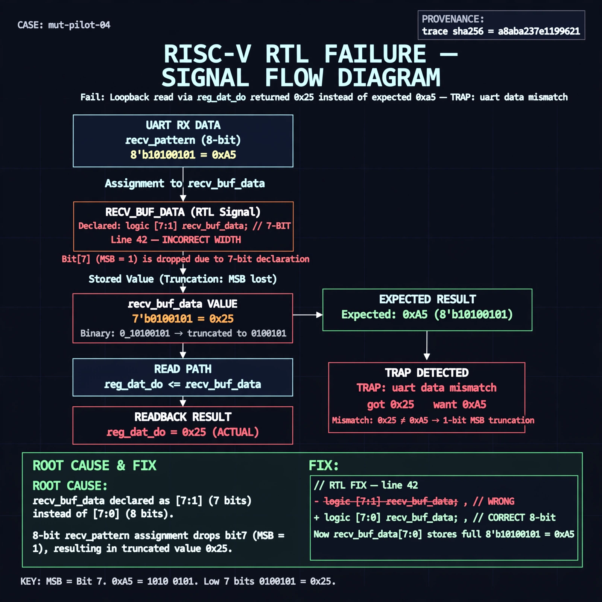

# Afterglow run report: opt-live-04

case `mut-pilot-04` | status **GREEN** | mode `live` | seed `42`

wall start `2026-10-27T02:46:22Z` | wall end `2026-10-27T02:50:42Z` | time-to-green `260.0s`

retries `0` | human_touches `0` | diagnosed `True` | fixed_unaided `True` | patch_source `model-verbatim`

## Verdicts (from sim, not typed)

- BEFORE: tohost=FAIL 0xdead checksum=8b2af01e67af322e16cfa4cad217f40b67f44caf77e903eb7705ced31eb7d9a3 cycles=2652 seed=42 pass=False
- AFTER: tohost=PASS checksum=5c8f58d0f0818c97d014d2f851a6140882bd1efc96a2537047806252c0c2caf9 cycles=2652 seed=42 pass=True

## Diagnosis (verbatim from api/text_response.json)

```
Loopback read via reg_dat_do returned 0x25 instead of expected 0xa5 (TRAP: uart data mismatch got 0x25 want 0xa5). 0xa5 is 8'b10100101 whose low 7 bits are 7'b0100101 = 0x25, indicating 1-bit truncation of MSB. Root cause is line 42 declaring recv_buf_data as [7:1] (7 bits) instead of [7:0], so 8-bit recv_pattern assignment drops bit7 and reg_dat_do reports the truncated value.
```

expected re-sim signal: tohost PASS (no TRAP), uart loopback got 0xa5 want 0xa5

## Patch (2 lines, guard-checked)

```diff
diff --git a/picosoc/simpleuart.v b/picosoc/simpleuart.v
--- a/picosoc/simpleuart.v
+++ b/picosoc/simpleuart.v
@@ -39,7 +39,7 @@
 	reg [3:0] recv_state;
 	reg [31:0] recv_divcnt;
 	reg [7:0] recv_pattern;
-	reg [7:1] recv_buf_data;
+	reg [7:0] recv_buf_data;
 	reg recv_buf_valid;
 
 	reg [9:0] send_pattern;

```

## Provenance (judge checks)

- prompt file `/home/tuncay/afterglow/agent/prompts/v2.txt` sha256 `d31e1ef6b74ddf52ee59e790ebff2f3defa9b03be82e699f45ef620cf8e27a6e`
- input_trace.txt sha256 `a8aba237e1199621bad0193dcda24cc4de1651f166c4bd2c7ddc2971ed3a2849` (9 lines, 68 tokens)
- prompt tokens `681` (cap 2500)
- text model `muse-spark-1.3-contributor` latency `26762ms` request `chatcmpl-01a17b40-d784-71a8-9b61-fc9b01648c43`
- image model `muse-image-1.0` latency `11611ms` request `6556d7b4-aa9f-4838-9796-d36d8a2bd24b` status `ok`
- image prompt sha256 `2a4646adf7e016de831e3ec749130880a05a6b96cd7ab64a2c12c4e59aedc0fb`, trace sha `a8aba237e1199621bad0193dcda24cc4de1651f166c4bd2c7ddc2971ed3a2849` (see api/image_request.json)

## Explanation diagram



## Bundle completeness

- present (12): artifacts/input_trace.txt, artifacts/boot.log, artifacts/boot_after.log, artifacts/verdict_before.json, artifacts/verdict_after.json, api/text_request.json, api/text_response.json, api/image_request.json, api/image_response.json, explain.png, patch.diff, meta.json
- missing (0): none

