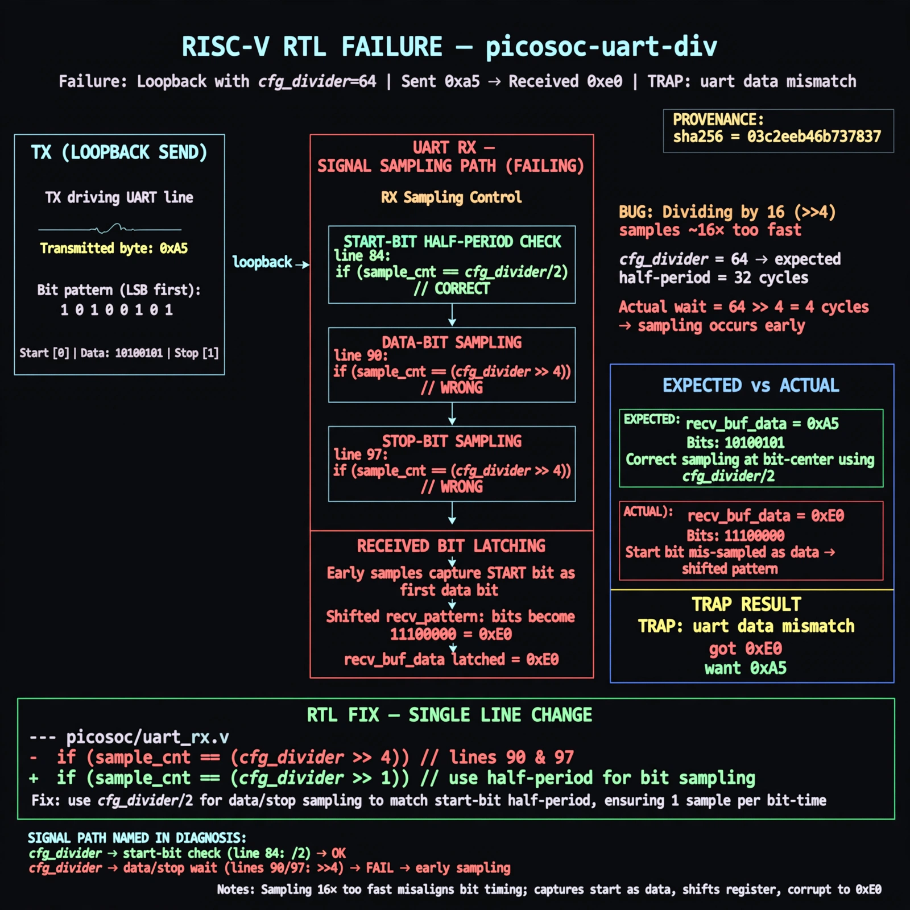

# Afterglow run report: picosoc-uart-div-20261104T153500Z

case `picosoc-uart-div` | status **GREEN** | mode `live` | seed `42`

wall start `2026-11-04T15:35:00Z` | wall end `2026-11-04T15:35:54Z` | time-to-green `53.7s`

retries `0` | human_touches `0` | diagnosed `True` | fixed_unaided `True` | patch_source `model-verbatim`

## Verdicts (from sim, not typed)

- BEFORE: tohost=FAIL 0xdead checksum=27ee482b473c74db5dce8b5ab1a233084cce3055c317a1f2045faa6dbc13a1c6 cycles=2112 seed=42 pass=False
- AFTER: tohost=PASS checksum=5c8f58d0f0818c97d014d2f851a6140882bd1efc96a2537047806252c0c2caf9 cycles=2652 seed=42 pass=True

## Diagnosis (verbatim from api/text_response.json)

```
Loopback with divider 64 sent 0xa5 but recv_buf_data latched 0xe0, causing TRAP uart data mismatch got 0xe0 want 0xa5. Start-bit half-period check uses full cfg_divider at line 84, but data-bit and stop-bit waits at lines 90 and 97 use (cfg_divider >> 4), sampling ~16x too fast. This early sampling captures the start-bit as data and shifts recv_pattern, corrupting the byte to 0xe0.
```

expected re-sim signal: tohost PASS (FAIL 0xdead cleared), loopback 0xa5 matches, no TRAP uart data mismatch

## Patch (4 lines, guard-checked)

```diff
diff --git a/picosoc/simpleuart.v b/picosoc/simpleuart.v
--- a/picosoc/simpleuart.v
+++ b/picosoc/simpleuart.v
@@ -89,14 +89,14 @@
 				10: begin
-					if (recv_divcnt > (cfg_divider >> 4)) begin
+					if (recv_divcnt > cfg_divider) begin
 						recv_buf_data <= recv_pattern;
 						recv_buf_valid <= 1;
 						recv_state <= 0;
 					end
 				end
 				default: begin
-					if (recv_divcnt > (cfg_divider >> 4)) begin
+					if (recv_divcnt > cfg_divider) begin
 						recv_pattern <= {ser_rx, recv_pattern[7:1]};
 						recv_state <= recv_state + 1;
 						recv_divcnt <= 0;
 					end
 				end

```

## Provenance (judge checks)

- prompt file `/home/tuncay/afterglow/agent/prompts/v2.txt` sha256 `d31e1ef6b74ddf52ee59e790ebff2f3defa9b03be82e699f45ef620cf8e27a6e`
- input_trace.txt sha256 `03c2eeb46b7378371577480f54314ea310d21573df2c2663b9f487c4d9a08aba` (9 lines, 68 tokens)
- prompt tokens `802` (cap 2500)
- text model `muse-spark-1.3-contributor` latency `38799ms` request `chatcmpl-01a1a733-9ad8-72c7-985f-80a0cdc44c58`
- image model `muse-image-1.0` latency `14317ms` request `beb797a9-6187-43e4-aa49-00a45369f3d7` status `ok`
- image prompt sha256 `16963d60b3d91dedfa4b052c84a7fa896fc58f25d10e8cfdf69cc3bf3128e611`, trace sha `03c2eeb46b7378371577480f54314ea310d21573df2c2663b9f487c4d9a08aba` (see api/image_request.json)

## Explanation diagram



## Bundle completeness

- present (12): artifacts/input_trace.txt, artifacts/boot.log, artifacts/boot_after.log, artifacts/verdict_before.json, artifacts/verdict_after.json, api/text_request.json, api/text_response.json, api/image_request.json, api/image_response.json, explain.png, patch.diff, meta.json
- missing (0): none

