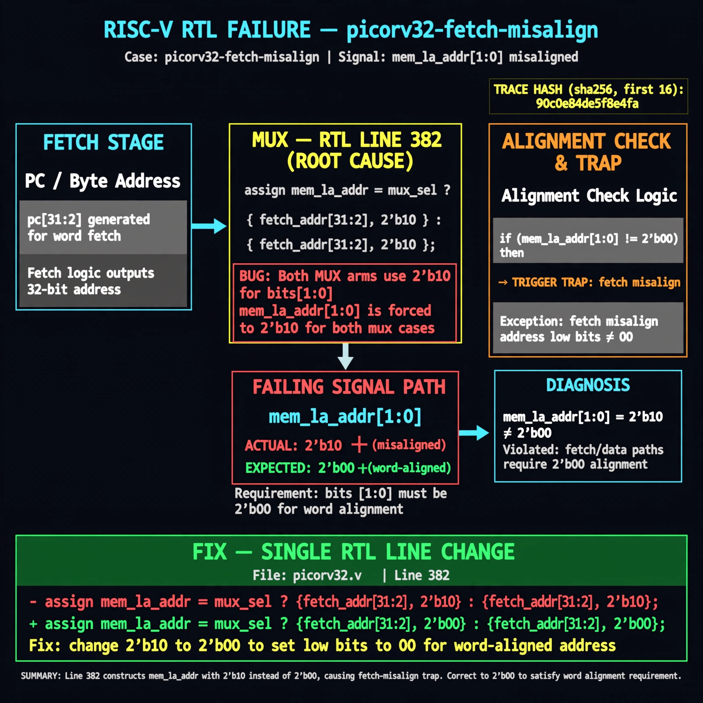

# Afterglow run report: stranger-jalr-lsb-20261026T220712Z

case `picorv32-fetch-misalign` | status **GREEN** | mode `live` | seed `42`

wall start `2026-10-26T22:07:12Z` | wall end `2026-10-26T22:08:16Z` | time-to-green `64.2s`

retries `0` | human_touches `0` | diagnosed `True` | fixed_unaided `True` | patch_source `model-verbatim`

## Verdicts (from sim, not typed)

- BEFORE: tohost=FAIL 0xdead checksum=a29998cd8e81501b64b44a66e009c12b297662db5ef5369b12ef3feae608e5d5 cycles=2009 seed=42 pass=False
- AFTER: tohost=PASS checksum=5c28238265cb94168311e9914f0df355642c557d04dba11845d557ac8a64aa4a cycles=2009 seed=42 pass=True

## Diagnosis (verbatim from api/text_response.json)

```
mem_la_addr[1:0] drives 2'b10 instead of 2'b00, matching TRAP: fetch misalign addr low bits nonzero. Both fetch and data paths should be word-aligned with low bits 2'b00. Root cause is line 382 which builds mem_la_addr with {.., 2'b10} for both mux arms.
```

expected re-sim signal: tohost: PASS (not FAIL 0xdead), no TRAP: fetch misalign addr low bits nonzero

## Patch (2 lines, guard-checked)

```diff
diff --git a/picorv32.v b/picorv32.v
--- a/picorv32.v
+++ b/picorv32.v
@@ -382,1 +382,1 @@
-	assign mem_la_addr = (mem_do_prefetch || mem_do_rinst) ? {next_pc[31:2] + mem_la_firstword_xfer, 2'b10} : {reg_op1[31:2], 2'b10};
+	assign mem_la_addr = (mem_do_prefetch || mem_do_rinst) ? {next_pc[31:2] + mem_la_firstword_xfer, 2'b00} : {reg_op1[31:2], 2'b00};

```

## Provenance (judge checks)

- prompt file `/home/tuncay/afterglow/agent/prompts/v1.txt` sha256 `a33e9d03790a89ce89d4d12a7b53c72268fcccaed45861c132aa9fd413792056`
- input_trace.txt sha256 `90c0e84de5f8e4faa3ef0c09a43b873e8ec8c3cf00310f00a5a09063ca544dc5` (9 lines, 72 tokens)
- prompt tokens `601` (cap 2500)
- text model `muse-spark-1.3-contributor` latency `39660ms` request `chatcmpl-01a17a41-730f-7405-b953-2919fc786bcf`
- image model `muse-image-1.0` latency `24010ms` request `1fd58034-0eb7-4550-9d61-942b4bfe5378` status `ok`
- image prompt sha256 `a0eb37a3a9061b6196d4b287824f21d4cec2f07375199e6b5e6f10d8f07d1f0a`, trace sha `90c0e84de5f8e4faa3ef0c09a43b873e8ec8c3cf00310f00a5a09063ca544dc5` (see api/image_request.json)

## Explanation diagram



## Bundle completeness

- present (12): artifacts/input_trace.txt, artifacts/boot.log, artifacts/boot_after.log, artifacts/verdict_before.json, artifacts/verdict_after.json, api/text_request.json, api/text_response.json, api/image_request.json, api/image_response.json, explain.png, patch.diff, meta.json
- missing (0): none

