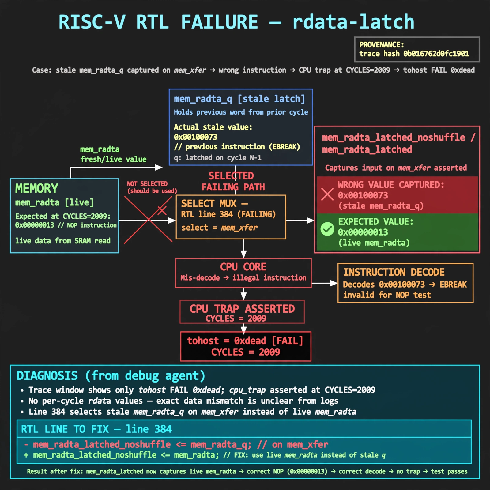

# Afterglow run report: stranger-stranger-fence-decode-20261026T220327Z

case `rdata-latch` | status **GREEN** | mode `live` | seed `42`

wall start `2026-10-26T22:05:14Z` | wall end `2026-10-26T22:06:31Z` | time-to-green `77.2s`

retries `0` | human_touches `0` | diagnosed `True` | fixed_unaided `True` | patch_source `model-verbatim`

## Verdicts (from sim, not typed)

- BEFORE: tohost=FAIL 0xdead checksum=c2a7a4d6295484feeb9ec1ea9381732b8e39a7ccd1997c7d70f6454da2fb4659 cycles=2009 seed=42 pass=False
- AFTER: tohost=PASS checksum=5c28238265cb94168311e9914f0df355642c557d04dba11845d557ac8a64aa4a cycles=2009 seed=42 pass=True

## Diagnosis (verbatim from api/text_response.json)

```
Trace window shows only tohost FAIL 0xdead with cpu trap asserted at CYCLES=2009 and no per-cycle rdata values, so exact data mismatch is unclear from logs. Excerpt line 384 selects stale mem_rdata_q on mem_xfer instead of live mem_rdata, so mem_rdata_latched_noshuffle/mem_rdata_latched captures the previous word. Wrong fetch word causes mis-decode/trap and FAIL in the NOP fetch test.
```

expected re-sim signal: tohost: PASS with TRAP deasserted and fetch alignment OK (checksum != c2a7a4d6295484feeb9ec1ea9381732b8e39a7ccd1997c7d70f6454da2fb4659, CYCLES progress past 2009)

## Patch (2 lines, guard-checked)

```diff
diff --git a/picorv32.v b/picorv32.v
--- a/picorv32.v
+++ b/picorv32.v
@@ -384,1 +384,1 @@
-	assign mem_rdata_latched_noshuffle = (mem_xfer || LATCHED_MEM_RDATA) ? mem_rdata_q : mem_rdata;
+	assign mem_rdata_latched_noshuffle = (mem_xfer || LATCHED_MEM_RDATA) ? mem_rdata : mem_rdata_q;

```

## Provenance (judge checks)

- prompt file `/home/tuncay/afterglow/agent/prompts/v1.txt` sha256 `a33e9d03790a89ce89d4d12a7b53c72268fcccaed45861c132aa9fd413792056`
- input_trace.txt sha256 `0b016762d0fc1901e430be2145b36959521df1aec84f4a5cfd4fbb0a36fd64a9` (9 lines, 69 tokens)
- prompt tokens `579` (cap 2500)
- text model `muse-spark-1.3-contributor` latency `46366ms` request `chatcmpl-01a17a3f-bf50-7548-8a36-f553ce812480`
- image model `muse-image-1.0` latency `30270ms` request `22f9a7fb-e680-401e-bfa6-119a28185186` status `ok`
- image prompt sha256 `0cd22f0844b057259d5d3b9e4d0f2ca05f437c91cfe91e09a55ed6b94d65d022`, trace sha `0b016762d0fc1901e430be2145b36959521df1aec84f4a5cfd4fbb0a36fd64a9` (see api/image_request.json)

## Explanation diagram



## Bundle completeness

- present (12): artifacts/input_trace.txt, artifacts/boot.log, artifacts/boot_after.log, artifacts/verdict_before.json, artifacts/verdict_after.json, api/text_request.json, api/text_response.json, api/image_request.json, api/image_response.json, explain.png, patch.diff, meta.json
- missing (0): none

