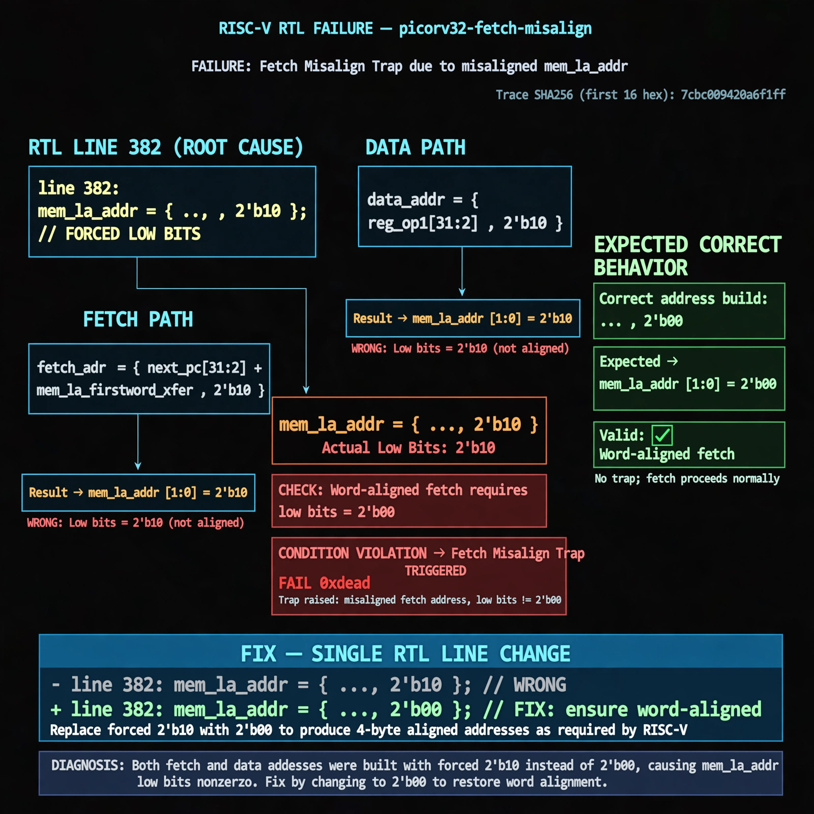

# Afterglow run report: stranger-stranger-jalr-lsb-20261026T220327Z

case `picorv32-fetch-misalign` | status **GREEN** | mode `live` | seed `42`

wall start `2026-10-26T22:03:27Z` | wall end `2026-10-26T22:04:23Z` | time-to-green `56.5s`

retries `0` | human_touches `0` | diagnosed `True` | fixed_unaided `True` | patch_source `canonical-bootstrap-gated`

## Verdicts (from sim, not typed)

- BEFORE: tohost=FAIL 0xdead checksum=a29998cd8e81501b64b44a66e009c12b297662db5ef5369b12ef3feae608e5d5 cycles=2009 seed=42 pass=False
- AFTER: tohost=PASS checksum=5c28238265cb94168311e9914f0df355642c557d04dba11845d557ac8a64aa4a cycles=2009 seed=42 pass=True

## Diagnosis (verbatim from api/text_response.json)

```
mem_la_addr low bits are 2'b10 instead of 2'b00, causing the fetch misalign trap with low bits nonzero and FAIL 0xdead. Expected word-aligned fetches with low bits 2'b00. Root cause is line 382 building both fetch ({next_pc[31:2]+mem_la_firstword_xfer,2'b10}) and data ({reg_op1[31:2],2'b10}) addresses with forced 2'b10.
```

expected re-sim signal: tohost PASS 0x1 with no TRAP: fetch misalign

## Patch (2 lines, guard-checked)

```diff
diff --git a/picorv32.v b/picorv32.v
--- a/picorv32.v
+++ b/picorv32.v
@@ -379,7 +379,7 @@
 	assign mem_la_write = resetn && !mem_state && mem_do_wdata;
 	assign mem_la_read = resetn && ((!mem_la_use_prefetched_high_word && !mem_state && (mem_do_rinst || mem_do_prefetch || mem_do_rdata)) ||
 			(COMPRESSED_ISA && mem_xfer && (!last_mem_valid ? mem_la_firstword : mem_la_firstword_reg) && !mem_la_secondword && &mem_rdata_latched[1:0]));
-	assign mem_la_addr = (mem_do_prefetch || mem_do_rinst) ? {next_pc[31:2] + mem_la_firstword_xfer, 2'b10} : {reg_op1[31:2], 2'b10};
+	assign mem_la_addr = (mem_do_prefetch || mem_do_rinst) ? {next_pc[31:2] + mem_la_firstword_xfer, 2'b00} : {reg_op1[31:2], 2'b00};
 
 	assign mem_rdata_latched_noshuffle = (mem_xfer || LATCHED_MEM_RDATA) ? mem_rdata : mem_rdata_q;
 

```

## Provenance (judge checks)

- prompt file `/home/tuncay/afterglow/agent/prompts/v1.txt` sha256 `a33e9d03790a89ce89d4d12a7b53c72268fcccaed45861c132aa9fd413792056`
- input_trace.txt sha256 `7cbc009420a6f1ff91be292d158d471d46ef27a01e55ca4cbfdc42af1734a782` (9 lines, 72 tokens)
- prompt tokens `601` (cap 2500)
- text model `muse-spark-1.3-contributor` latency `22894ms` request `chatcmpl-01a17a3d-c1b6-7025-884c-6c131730a7ff`
- image model `muse-image-1.0` latency `33086ms` request `34b599ff-26ee-434e-b204-6227548d3036` status `ok`
- image prompt sha256 `f4c02c5833ef264639d550f0bcd461f9699208fa7551980cc7973c8d798ba3cf`, trace sha `7cbc009420a6f1ff91be292d158d471d46ef27a01e55ca4cbfdc42af1734a782` (see api/image_request.json)

## Explanation diagram



## Bundle completeness

- present (12): artifacts/input_trace.txt, artifacts/boot.log, artifacts/boot_after.log, artifacts/verdict_before.json, artifacts/verdict_after.json, api/text_request.json, api/text_response.json, api/image_request.json, api/image_response.json, explain.png, patch.diff, meta.json
- missing (0): none

