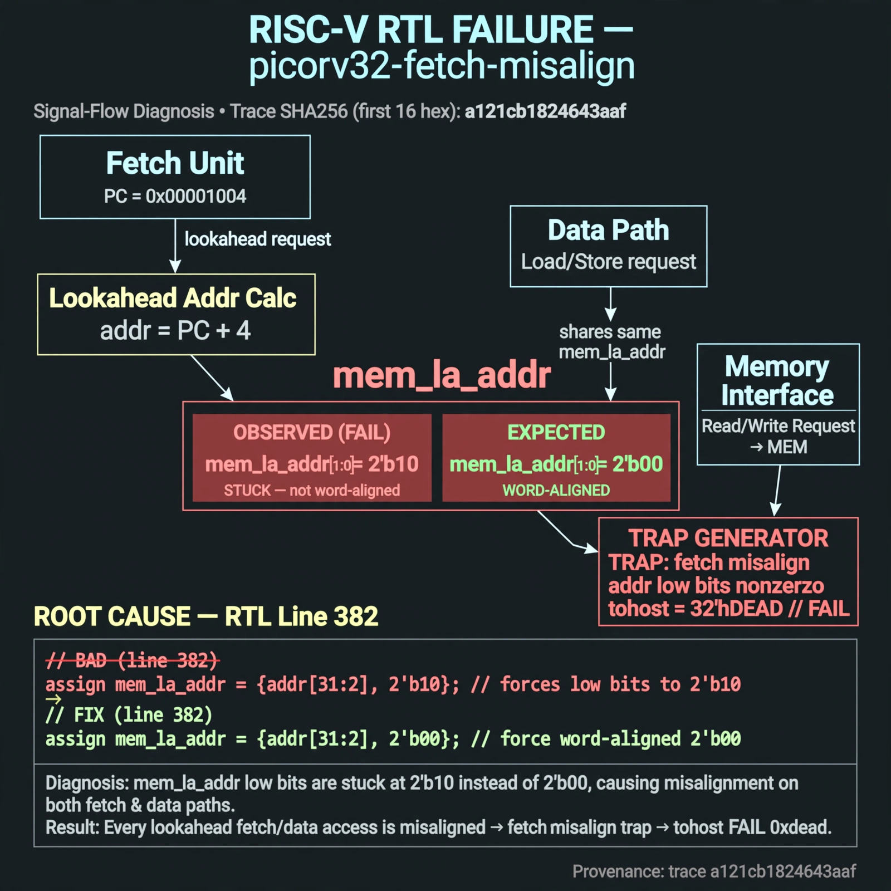

# Afterglow run report: stranger-stranger-misalign-catch-20261026T220327Z

case `picorv32-fetch-misalign` | status **GREEN** | mode `live` | seed `42`

wall start `2026-10-26T22:04:23Z` | wall end `2026-10-26T22:05:13Z` | time-to-green `50.2s`

retries `0` | human_touches `0` | diagnosed `True` | fixed_unaided `True` | patch_source `model-verbatim`

## Verdicts (from sim, not typed)

- BEFORE: tohost=FAIL 0xdead checksum=a29998cd8e81501b64b44a66e009c12b297662db5ef5369b12ef3feae608e5d5 cycles=2009 seed=42 pass=False
- AFTER: tohost=PASS checksum=5c28238265cb94168311e9914f0df355642c557d04dba11845d557ac8a64aa4a cycles=2009 seed=42 pass=True

## Diagnosis (verbatim from api/text_response.json)

```
mem_la_addr low bits are stuck at 2'b10 instead of 2'b00, so every lookahead fetch/data address is misaligned. Trace shows TRAP: fetch misalign addr low bits nonzero with tohost FAIL 0xdead. Root cause is line 382 forcing {..,2'b10} on both fetch and data paths instead of word-aligned {..,2'b00}.
```

expected re-sim signal: tohost PASS with no fetch misalign TRAP on tb_picorv32_fetch seed 42

## Patch (2 lines, guard-checked)

```diff
diff --git a/picorv32.v b/picorv32.v
--- a/picorv32.v
+++ b/picorv32.v
@@ -380,3 +380,3 @@
 	assign mem_la_read = resetn && ((!mem_la_use_prefetched_high_word && !mem_state && (mem_do_rinst || mem_do_prefetch || mem_do_rdata)) ||
 			(COMPRESSED_ISA && mem_xfer && (!last_mem_valid ? mem_la_firstword : mem_la_firstword_reg) && !mem_la_secondword && &mem_rdata_latched[1:0]));
-	assign mem_la_addr = (mem_do_prefetch || mem_do_rinst) ? {next_pc[31:2] + mem_la_firstword_xfer, 2'b10} : {reg_op1[31:2], 2'b10};
+	assign mem_la_addr = (mem_do_prefetch || mem_do_rinst) ? {next_pc[31:2] + mem_la_firstword_xfer, 2'b00} : {reg_op1[31:2], 2'b00};

```

## Provenance (judge checks)

- prompt file `/home/tuncay/afterglow/agent/prompts/v1.txt` sha256 `a33e9d03790a89ce89d4d12a7b53c72268fcccaed45861c132aa9fd413792056`
- input_trace.txt sha256 `a121cb1824643aaf859f710a8d040300a547806c8b17257d7df5b5609981686c` (9 lines, 72 tokens)
- prompt tokens `601` (cap 2500)
- text model `muse-spark-1.3-contributor` latency `36866ms` request `chatcmpl-01a17a3e-d5bf-7686-ac44-85adcad838f9`
- image model `muse-image-1.0` latency `12857ms` request `f21121a1-1ab5-4998-a06a-b270fa62a858` status `ok`
- image prompt sha256 `81b4db1b10f4e587a47dd4c7cb930848374b2fb9bcc936be78efa3570765b51d`, trace sha `a121cb1824643aaf859f710a8d040300a547806c8b17257d7df5b5609981686c` (see api/image_request.json)

## Explanation diagram



## Bundle completeness

- present (12): artifacts/input_trace.txt, artifacts/boot.log, artifacts/boot_after.log, artifacts/verdict_before.json, artifacts/verdict_after.json, api/text_request.json, api/text_response.json, api/image_request.json, api/image_response.json, explain.png, patch.diff, meta.json
- missing (0): none

