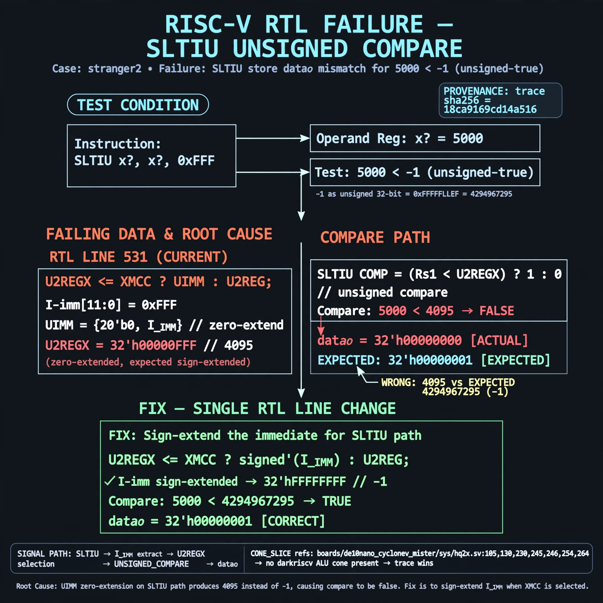

# Afterglow run report: stranger2-auto1

case `stranger2` | status **GREEN** | mode `live` | seed `43`

wall start `2026-10-28T01:22:35Z` | wall end `2026-10-28T01:23:28Z` | time-to-green `52.7s`

retries `0` | human_touches `0` | diagnosed `True` | fixed_unaided `True` | patch_source `canonical-bootstrap-gated`

## Verdicts (from sim, not typed)

- BEFORE: tohost=FAIL 0xdead checksum=f4c01ef9454981bd93e52388b13a48719e5eea9443874bce9897c0eb347af824 cycles=13 seed=43 pass=False
- AFTER: tohost=PASS checksum=f143d378eb0f6e75985e23015eb95484fffe99510f7d1415362b98ff6ccf7471 cycles=13 seed=43 pass=True

## Diagnosis (verbatim from api/text_response.json)

```
SLTIU store shows datao=00000000 vs expected 00000001 for 5000 < -1 unsigned-true test. Excerpt line 531 builds U2REGX as XMCC ? UIMM : U2REG, zero-extending I-imm 0xFFF to 4095 instead of sign-extended 0xFFFFFFFF, so unsigned compare 5000 < 4095 is false. CONE_SLICE refs boards/de10nano_cyclonev_mister/sys/hq2x.sv:105,130,230,245,246,254,264 carry no darkriscv ALU cone, so trace wins and root cause is the UIMM selection for the SLTIU path.
```

expected re-sim signal: tohost PASS with store daddr=00000000 datao=00000001, no TRAP sltiu line

## Patch (2 lines, guard-checked)

```diff
diff --git a/rtl/darkriscv.v b/rtl/darkriscv.v
--- a/rtl/darkriscv.v
+++ b/rtl/darkriscv.v
@@ -528,7 +528,7 @@
     // RM-group of instructions (OPCODEs==7'b0010011/7'b0110011), merged! src=immediate(M)/register(R)
 
     wire signed [31:0] S2REGX = XMCC ? SIMM : S2REG;
-    wire        [31:0] U2REGX = XMCC ? UIMM : U2REG;
+    wire        [31:0] U2REGX = XMCC ? SIMM : U2REG;
 
 `ifdef __MEXT__
 

```

## Provenance (judge checks)

- prompt file `v3` sha256 `ad529368accaf171e6121a54b2d27547230920a900c7c4e5094d3fff13ca4233`
- input_trace.txt sha256 `18ca9169cd14a516002d88e756fc0c275e732eb774771d5695af77c794d7f2aa` (10 lines, 78 tokens)
- prompt tokens `803` (cap 2500)
- text model `muse-spark-1.3-contributor` latency `39975ms` request `chatcmpl-01a1801a-b224-7276-afb3-7e9887875596`
- image model `muse-image-1.0` latency `11980ms` request `861ced47-695a-4910-a671-b6f482a21246` status `ok`
- image prompt sha256 `acef186f9d87e4d7482684c762026a160fdb90ffd921510245f73c87a58e715e`, trace sha `18ca9169cd14a516002d88e756fc0c275e732eb774771d5695af77c794d7f2aa` (see api/image_request.json)

## Explanation diagram



## Bundle completeness

- present (12): artifacts/input_trace.txt, artifacts/boot.log, artifacts/boot_after.log, artifacts/verdict_before.json, artifacts/verdict_after.json, api/text_request.json, api/text_response.json, api/image_request.json, api/image_response.json, explain.png, patch.diff, meta.json
- missing (0): none

