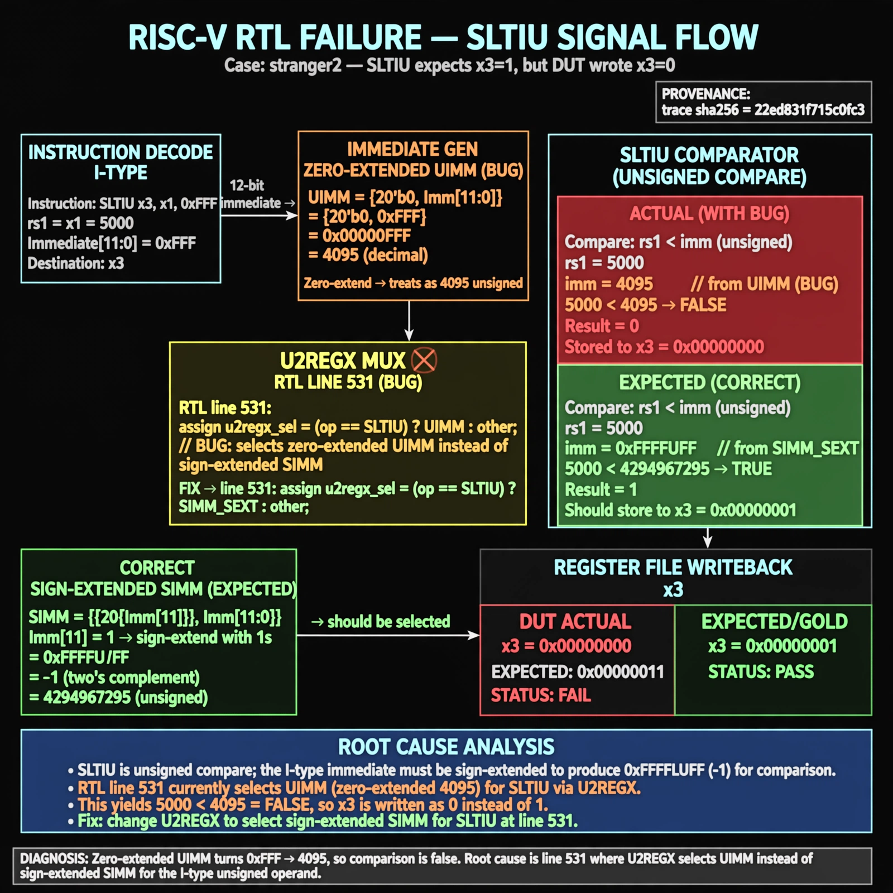

# Afterglow run report: stranger2-triage

case `stranger2` | status **GREEN** | mode `live` | seed `42`

wall start `2026-10-27T18:44:43Z` | wall end `2026-10-27T18:46:15Z` | time-to-green `92.1s`

retries `0` | human_touches `0` | diagnosed `True` | fixed_unaided `True` | patch_source `model-verbatim`

## Verdicts (from sim, not typed)

- BEFORE: tohost=FAIL 0xdead checksum=f4c01ef9454981bd93e52388b13a48719e5eea9443874bce9897c0eb347af824 cycles=13 seed=42 pass=False
- AFTER: tohost=PASS checksum=f143d378eb0f6e75985e23015eb95484fffe99510f7d1415362b98ff6ccf7471 cycles=13 seed=42 pass=True

## Diagnosis (verbatim from api/text_response.json)

```
SLTIU test expects x3=1 for unsigned compare 5000 < 0xFFFFFFFF (-1 sign-extended) but DUT stored datao=0x00000000 instead of 0x00000001. Zero-extended UIMM turns 0xFFF into 4095, so 5000<4095 evaluates false. Root cause is line 531 where U2REGX selects UIMM instead of sign-extended SIMM bits for the I-type unsigned operand.
```

expected re-sim signal: tohost: PASS with store daddr=00000000 datao=00000001

## Patch (2 lines, guard-checked)

```diff
diff --git a/rtl/darkriscv.v b/rtl/darkriscv.v
--- a/rtl/darkriscv.v
+++ b/rtl/darkriscv.v
@@ -528,7 +528,7 @@
     // RM-group of instructions (OPCODEs==7'b0010011/7'b0110011), merged! src=immediate(M)/register(R)
 
     wire signed [31:0] S2REGX = XMCC ? SIMM : S2REG;
-    wire        [31:0] U2REGX = XMCC ? UIMM : U2REG;
+    wire        [31:0] U2REGX = XMCC ? SIMM : U2REG;
 
 `ifdef __MEXT__

```

## Provenance (judge checks)

- prompt file `/home/tuncay/afterglow/agent/prompts/v2.txt` sha256 `d31e1ef6b74ddf52ee59e790ebff2f3defa9b03be82e699f45ef620cf8e27a6e`
- input_trace.txt sha256 `22ed831f715c0fc36944f9d5d6634331f398bf3e80c2e5fc2bb5025d157ff0ff` (10 lines, 78 tokens)
- prompt tokens `658` (cap 2500)
- text model `muse-spark-1.3-contributor` latency `55646ms` request `chatcmpl-01a17eae-af97-7739-b4ba-b3e436b73c68`
- image model `muse-image-1.0` latency `35505ms` request `50f10762-44a4-40d1-8bbc-1bf743c56865` status `ok`
- image prompt sha256 `5347f2a392712a09319b6698b33d67b41d7c664729ecfe5b17504ce7c65f7221`, trace sha `22ed831f715c0fc36944f9d5d6634331f398bf3e80c2e5fc2bb5025d157ff0ff` (see api/image_request.json)

## Explanation diagram



## Bundle completeness

- present (12): artifacts/input_trace.txt, artifacts/boot.log, artifacts/boot_after.log, artifacts/verdict_before.json, artifacts/verdict_after.json, api/text_request.json, api/text_response.json, api/image_request.json, api/image_response.json, explain.png, patch.diff, meta.json
- missing (0): none

