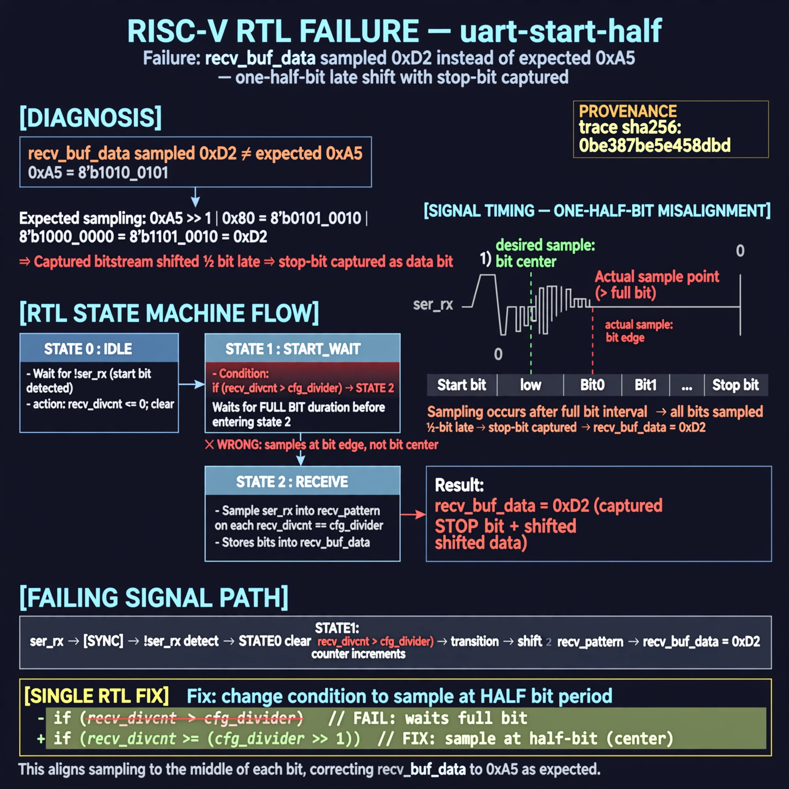

# Afterglow run report: task4-proof-20261026T213611Z-uart-start-half

case `uart-start-half` | status **GREEN** | mode `live` | seed `42`

wall start `2026-10-26T21:36:11Z` | wall end `2026-10-26T21:37:20Z` | time-to-green `68.8s`

retries `0` | human_touches `0` | diagnosed `True` | fixed_unaided `True` | patch_source `model-verbatim`

## Verdicts (from sim, not typed)

- BEFORE: tohost=FAIL 0xdead checksum=7ead7d9c1ebd862283bf0991c6a01fd4f7dad63f24f2be953b7f57e1f7edd073 cycles=2684 seed=42 pass=False
- AFTER: tohost=PASS checksum=5c8f58d0f0818c97d014d2f851a6140882bd1efc96a2537047806252c0c2caf9 cycles=2652 seed=42 pass=True

## Diagnosis (verbatim from api/text_response.json)

```
recv_buf_data sampled 0xd2 instead of expected 0xa5 (0xa5>>1|0x80), indicating a one-half-bit late shift with stop-bit captured. State 0 detects !ser_rx and clears recv_divcnt, but state 1 then waits for recv_divcnt > cfg_divider (full bit) before entering state 2. That full-bit start wait misaligns all default-state recv_pattern sampling to bit edges instead of bit centers.
```

expected re-sim signal: tohost PASS (no FAIL 0xdead/TRAP), loopback send 0xa5 got 0xa5 with new checksum != 7ead7d9c1ebd862283bf0991c6a01fd4f7dad63f24f2be953b7f57e1f7edd073

## Patch (2 lines, guard-checked)

```diff
diff --git a/picosoc/simpleuart.v b/picosoc/simpleuart.v
--- a/picosoc/simpleuart.v
+++ b/picosoc/simpleuart.v
@@ -83,6 +83,6 @@
 				1: begin
-					if (recv_divcnt > cfg_divider) begin
+					if (recv_divcnt > (cfg_divider >> 1)) begin
 						recv_state <= 2;
 						recv_divcnt <= 0;
 					end
 				end

```

## Provenance (judge checks)

- prompt file `/home/tuncay/afterglow/agent/prompts/v1.txt` sha256 `a33e9d03790a89ce89d4d12a7b53c72268fcccaed45861c132aa9fd413792056`
- input_trace.txt sha256 `0be387be5e458dbdf4f9d21c1c25e64978d35c9ac76a2fb1477f3e0e6b386bcc` (9 lines, 68 tokens)
- prompt tokens `497` (cap 2500)
- text model `muse-spark-1.3-contributor` latency `48395ms` request `chatcmpl-01a17a25-3214-723b-85fa-19450f1ec97a`
- image model `muse-image-1.0` latency `19935ms` request `cadfb970-c993-4acd-8a74-7f6f0af01a7c` status `ok`
- image prompt sha256 `4cbedcdf62172f5af8ca5158c7c1399b37ab4c7face40121f85be6d6b6e5f3d1`, trace sha `0be387be5e458dbdf4f9d21c1c25e64978d35c9ac76a2fb1477f3e0e6b386bcc` (see api/image_request.json)

## Explanation diagram



## Bundle completeness

- present (12): artifacts/input_trace.txt, artifacts/boot.log, artifacts/boot_after.log, artifacts/verdict_before.json, artifacts/verdict_after.json, api/text_request.json, api/text_response.json, api/image_request.json, api/image_response.json, explain.png, patch.diff, meta.json
- missing (0): none

