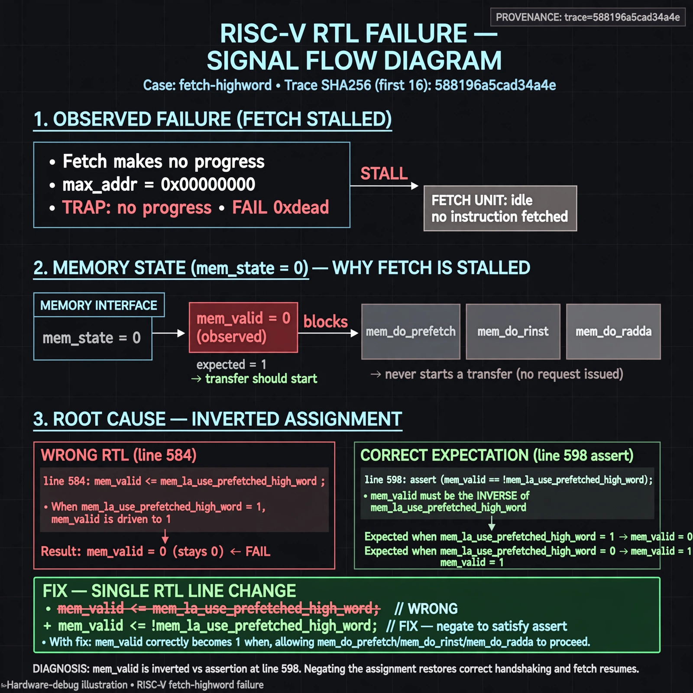

# Afterglow run report: verbatim-fetch-highword

case `fetch-highword` | status **TRIAGE** | mode `live` | seed `42`

wall start `2026-10-30T15:11:52Z` | wall end `2026-10-30T15:28:16Z` | time-to-green `984.2s`

retries `2` | human_touches `0` | diagnosed `True` | fixed_unaided `False` | patch_source `none`

## Verdicts (from sim, not typed)

- BEFORE: tohost=FAIL 0xdead checksum=563b7c10626ff25de2b3c430956c7c113e448c4efaea068f9b83a198d4322b15 cycles=2009 seed=42 pass=False
- AFTER: tohost=None checksum=None cycles=None seed=42 pass=False

## Diagnosis (verbatim from api/text_response.json)

```
MISSING (text call produced no diagnosis)
```

expected re-sim signal: -

## Patch (0 lines, guard-checked)

```diff
(no patch applied)
```

## Provenance (judge checks)

- prompt file `/home/tuncay/afterglow/agent/prompts/v2.txt` sha256 `d31e1ef6b74ddf52ee59e790ebff2f3defa9b03be82e699f45ef620cf8e27a6e`
- input_trace.txt sha256 `588196a5cad34a4e68f4fc12341985316b09c5a431d5b9d71ed486c9d8c28782` (9 lines, 69 tokens)
- prompt tokens `715` (cap 2500)
- text model `muse-spark-1.3-contributor` latency `?ms` request `?`
- image model `muse-image-1.0` latency `41321ms` request `29502861-612c-4370-a5ed-8d47809fa3ba` status `ok`
- image prompt sha256 `b8cfa01aa6a47dd04a8749a301f9ce0ee6f0037383dcab4df020f75305bbf889`, trace sha `588196a5cad34a4e68f4fc12341985316b09c5a431d5b9d71ed486c9d8c28782` (see api/image_request.json)

## Explanation diagram



## Bundle completeness

- present (12): artifacts/input_trace.txt, artifacts/boot.log, artifacts/boot_after.log, artifacts/verdict_before.json, artifacts/verdict_after.json, api/text_request.json, api/text_response.json, api/image_request.json, api/image_response.json, explain.png, patch.diff, meta.json
- missing (0): none

