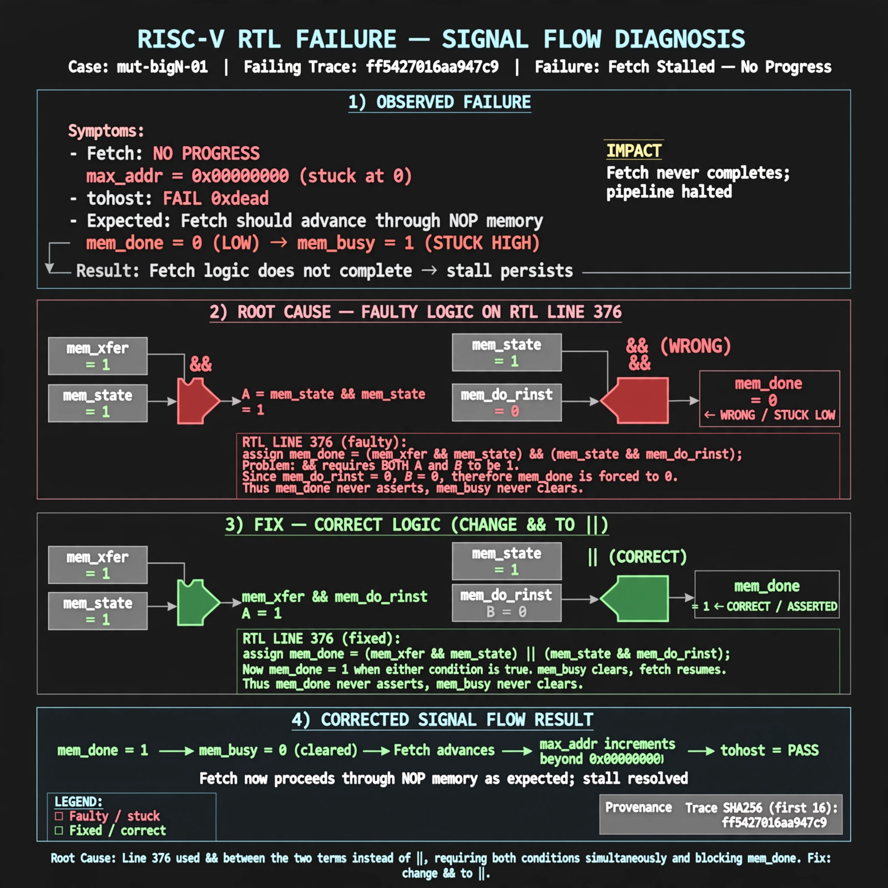

# Afterglow run report: verbatim-mut-bigN-01

case `mut-bigN-01` | status **GREEN** | mode `live` | seed `42`

wall start `2026-10-30T15:28:16Z` | wall end `2026-10-30T15:29:27Z` | time-to-green `71.2s`

retries `0` | human_touches `0` | diagnosed `True` | fixed_unaided `True` | patch_source `model-verbatim`

## Verdicts (from sim, not typed)

- BEFORE: tohost=FAIL 0xdead checksum=563b7c10626ff25de2b3c430956c7c113e448c4efaea068f9b83a198d4322b15 cycles=2009 seed=42 pass=False
- AFTER: tohost=PASS checksum=5c28238265cb94168311e9914f0df355642c557d04dba11845d557ac8a64aa4a cycles=2009 seed=42 pass=True

## Diagnosis (verbatim from api/text_response.json)

```
Fetch shows no progress (max_addr=0x00000000, tohost FAIL 0xdead) instead of advancing through NOP memory. mem_done stays low so mem_busy never clears and fetch never completes. Root cause is line 376 combining the mem_xfer with |mem_state term and the &mem_state with mem_do_rinst term using && instead of ||, requiring both simultaneously and blocking mem_done.
```

expected re-sim signal: tohost PASS (not FAIL 0xdead) with fetch progress max_addr != 0x00000000, checksum != 563b7c10626ff25de2b3c430956c7c113e448c4efaea068f9b83a198d4322b15

## Patch (2 lines, guard-checked)

```diff
diff --git a/picorv32.v b/picorv32.v
--- a/picorv32.v
+++ b/picorv32.v
@@ -376,1 +376,1 @@
-	wire mem_done = resetn && ((mem_xfer && |mem_state && (mem_do_rinst || mem_do_rdata || mem_do_wdata)) && (&mem_state && mem_do_rinst)) &&
+	wire mem_done = resetn && ((mem_xfer && |mem_state && (mem_do_rinst || mem_do_rdata || mem_do_wdata)) || (&mem_state && mem_do_rinst)) &&

```

## Provenance (judge checks)

- prompt file `/home/tuncay/afterglow/agent/prompts/v2.txt` sha256 `d31e1ef6b74ddf52ee59e790ebff2f3defa9b03be82e699f45ef620cf8e27a6e`
- input_trace.txt sha256 `ff5427016aa947c935bf78f4ea15ed5e83e6b705c06f09fb7c61668ec4b9a219` (9 lines, 69 tokens)
- prompt tokens `702` (cap 2500)
- text model `muse-spark-1.3-contributor` latency `41652ms` request `chatcmpl-01a18d6d-b01e-736a-9bcc-a69eb1a7f4b7`
- image model `muse-image-1.0` latency `28787ms` request `26b95327-e3d9-4421-9528-ab54c2086e33` status `ok`
- image prompt sha256 `955c3a2286c84cb0b1c451e52ab584251c58e4b756c72e382267bb0d76e3bc23`, trace sha `ff5427016aa947c935bf78f4ea15ed5e83e6b705c06f09fb7c61668ec4b9a219` (see api/image_request.json)

## Explanation diagram



## Bundle completeness

- present (12): artifacts/input_trace.txt, artifacts/boot.log, artifacts/boot_after.log, artifacts/verdict_before.json, artifacts/verdict_after.json, api/text_request.json, api/text_response.json, api/image_request.json, api/image_response.json, explain.png, patch.diff, meta.json
- missing (0): none

