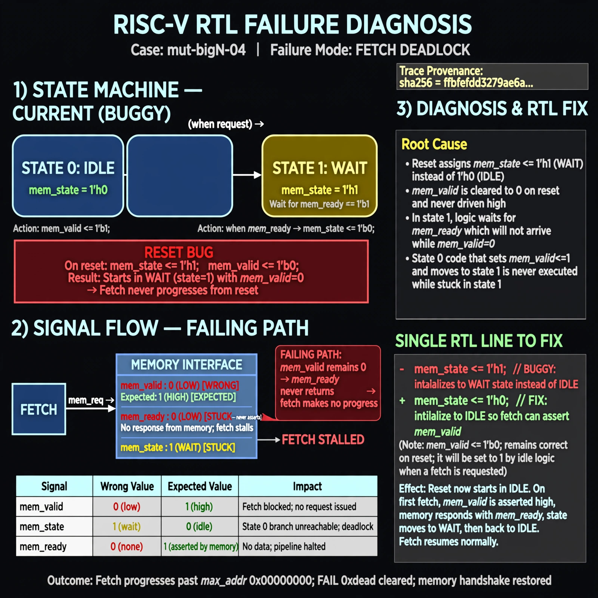

# Afterglow run report: verbatim-mut-bigN-04

case `mut-bigN-04` | status **GREEN** | mode `live` | seed `42`

wall start `2026-10-30T15:29:27Z` | wall end `2026-10-30T15:30:41Z` | time-to-green `73.3s`

retries `0` | human_touches `0` | diagnosed `True` | fixed_unaided `True` | patch_source `model-verbatim`

## Verdicts (from sim, not typed)

- BEFORE: tohost=FAIL 0xdead checksum=563b7c10626ff25de2b3c430956c7c113e448c4efaea068f9b83a198d4322b15 cycles=2009 seed=42 pass=False
- AFTER: tohost=PASS checksum=5c28238265cb94168311e9914f0df355642c557d04dba11845d557ac8a64aa4a cycles=2009 seed=42 pass=True

## Diagnosis (verbatim from api/text_response.json)

```
Fetch makes no progress (max_addr 0x00000000, FAIL 0xdead) because mem_valid stays low so mem_ready never returns. The excerpt resets mem_state <= 1 while clearing mem_valid <= 0, entering the wait state instead of idle 0. With mem_state stuck at 1 with mem_valid low, the state 0 branch that asserts mem_valid and moves to 1 can never run, deadlocking fetch.
```

expected re-sim signal: tohost PASS (not FAIL 0xdead) with fetch progress max_addr != 0

## Patch (2 lines, guard-checked)

```diff
diff --git a/picorv32.v b/picorv32.v
--- a/picorv32.v
+++ b/picorv32.v
@@ -565,8 +565,8 @@
 	always @(posedge clk) begin
 		if (!resetn || trap) begin
 			if (!resetn)
-				mem_state <= 1;
+				mem_state <= 0;
 			if (!resetn || mem_ready)
 				mem_valid <= 0;
 			mem_la_secondword <= 0;
 			prefetched_high_word <= 0;

```

## Provenance (judge checks)

- prompt file `/home/tuncay/afterglow/agent/prompts/v2.txt` sha256 `d31e1ef6b74ddf52ee59e790ebff2f3defa9b03be82e699f45ef620cf8e27a6e`
- input_trace.txt sha256 `ffbfefdd3279ae6a6dffccf8c0c33d6e1e31dacb4b022bfd10e9f85aed1004d9` (9 lines, 69 tokens)
- prompt tokens `612` (cap 2500)
- text model `muse-spark-1.3-contributor` latency `40884ms` request `chatcmpl-01a18d6e-c356-7026-8465-848ad97cfb48`
- image model `muse-image-1.0` latency `31675ms` request `a24f6b43-7473-4794-81cc-48b4c568c25e` status `ok`
- image prompt sha256 `d315db743b6752c01e7a4489577bd39cdb2a1df2320a15f8a31cc9f39f1a01a5`, trace sha `ffbfefdd3279ae6a6dffccf8c0c33d6e1e31dacb4b022bfd10e9f85aed1004d9` (see api/image_request.json)

## Explanation diagram



## Bundle completeness

- present (12): artifacts/input_trace.txt, artifacts/boot.log, artifacts/boot_after.log, artifacts/verdict_before.json, artifacts/verdict_after.json, api/text_request.json, api/text_response.json, api/image_request.json, api/image_response.json, explain.png, patch.diff, meta.json
- missing (0): none

