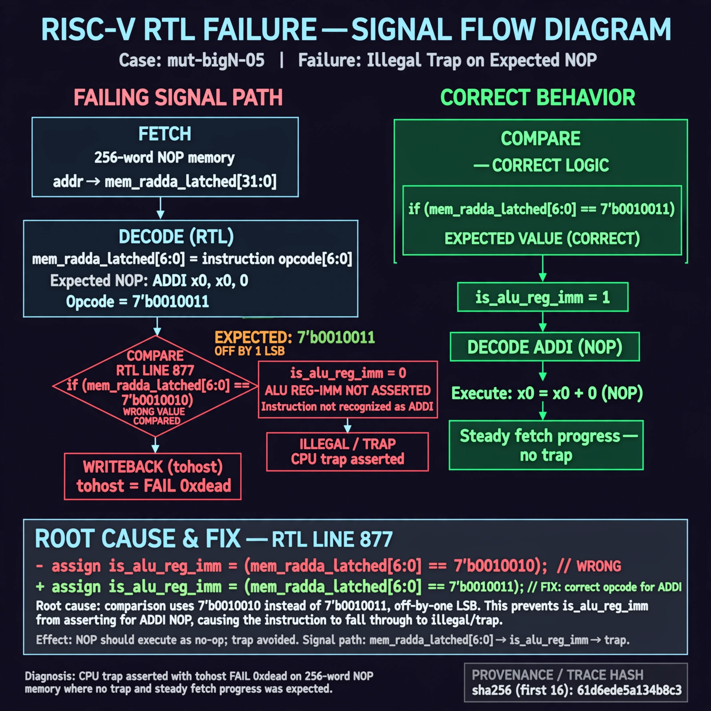

# Afterglow run report: verbatim-mut-bigN-05

case `mut-bigN-05` | status **GREEN** | mode `live` | seed `42`

wall start `2026-10-30T15:30:41Z` | wall end `2026-10-30T15:31:46Z` | time-to-green `65.4s`

retries `0` | human_touches `0` | diagnosed `True` | fixed_unaided `True` | patch_source `model-verbatim`

## Verdicts (from sim, not typed)

- BEFORE: tohost=FAIL 0xdead checksum=c2a7a4d6295484feeb9ec1ea9381732b8e39a7ccd1997c7d70f6454da2fb4659 cycles=2009 seed=42 pass=False
- AFTER: tohost=PASS checksum=5c28238265cb94168311e9914f0df355642c557d04dba11845d557ac8a64aa4a cycles=2009 seed=42 pass=True

## Diagnosis (verbatim from api/text_response.json)

```
CPU trap asserted with tohost FAIL 0xdead on 256-word NOP memory where no trap and steady fetch progress was expected. NOP is ADDI x0,x0,0 with opcode 7'b0010011 but is_alu_reg_imm never asserted so the instruction fell through to illegal/trap. Root cause is line 877 comparing mem_rdata_latched[6:0] to 7'b0010010 instead of 7'b0010011, off by one LSB.
```

expected re-sim signal: tohost: PASS with TRAP deasserted and fetch progress through NOP memory

## Patch (2 lines, guard-checked)

```diff
diff --git a/picorv32.v b/picorv32.v
--- a/picorv32.v
+++ b/picorv32.v
@@ -874,5 +874,5 @@
 			is_beq_bne_blt_bge_bltu_bgeu <= mem_rdata_latched[6:0] == 7'b1100011;
 			is_lb_lh_lw_lbu_lhu          <= mem_rdata_latched[6:0] == 7'b0000011;
 			is_sb_sh_sw                  <= mem_rdata_latched[6:0] == 7'b0100011;
-			is_alu_reg_imm               <= mem_rdata_latched[6:0] == 7'b0010010;
+			is_alu_reg_imm               <= mem_rdata_latched[6:0] == 7'b0010011;
 			is_alu_reg_reg               <= mem_rdata_latched[6:0] == 7'b0110011;

```

## Provenance (judge checks)

- prompt file `/home/tuncay/afterglow/agent/prompts/v2.txt` sha256 `d31e1ef6b74ddf52ee59e790ebff2f3defa9b03be82e699f45ef620cf8e27a6e`
- input_trace.txt sha256 `61d6ede5a134b8c316e32fb1b12e35a5ec3168c73e7f06b5cce8bac803fcf75c` (9 lines, 69 tokens)
- prompt tokens `704` (cap 2500)
- text model `muse-spark-1.3-contributor` latency `21503ms` request `chatcmpl-01a18d6f-9639-76e6-9c82-2d9855cbbea5`
- image model `muse-image-1.0` latency `43197ms` request `c4262e6b-c3ce-4619-91b3-513a3f3e4185` status `ok`
- image prompt sha256 `7b1d36e1c95318b87261be026af41d7f414b814374aa24c517da29daf0c1a1f0`, trace sha `61d6ede5a134b8c316e32fb1b12e35a5ec3168c73e7f06b5cce8bac803fcf75c` (see api/image_request.json)

## Explanation diagram



## Bundle completeness

- present (12): artifacts/input_trace.txt, artifacts/boot.log, artifacts/boot_after.log, artifacts/verdict_before.json, artifacts/verdict_after.json, api/text_request.json, api/text_response.json, api/image_request.json, api/image_response.json, explain.png, patch.diff, meta.json
- missing (0): none

