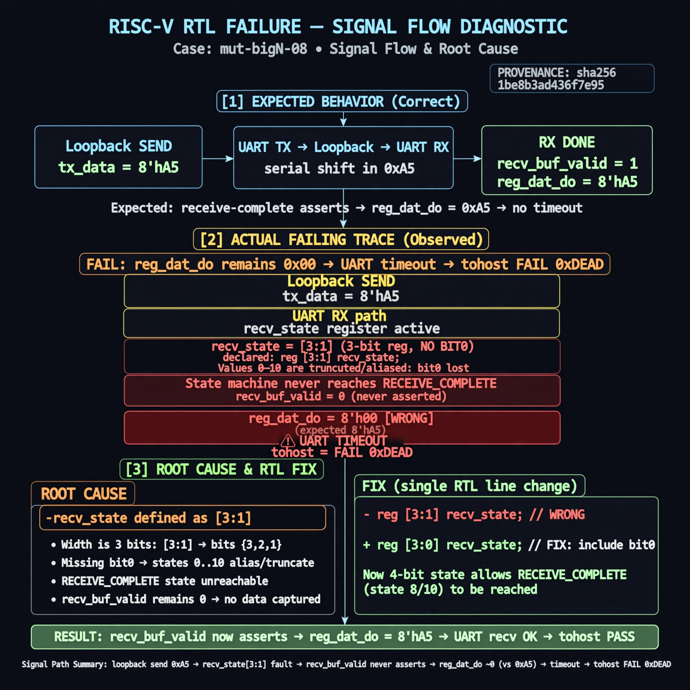

# Afterglow run report: verbatim-mut-bigN-08

case `mut-bigN-08` | status **GREEN** | mode `live` | seed `42`

wall start `2026-10-30T15:39:19Z` | wall end `2026-10-30T15:40:16Z` | time-to-green `57.1s`

retries `0` | human_touches `0` | diagnosed `True` | fixed_unaided `True` | patch_source `model-verbatim`

## Verdicts (from sim, not typed)

- BEFORE: tohost=FAIL 0xdead checksum=e82517390f8726caabcc777759a3dbb48c59fd1d160e409515f1b95dfe3d420c cycles=22023 seed=42 pass=False
- AFTER: tohost=PASS checksum=5c8f58d0f0818c97d014d2f851a6140882bd1efc96a2537047806252c0c2caf9 cycles=2652 seed=42 pass=True

## Diagnosis (verbatim from api/text_response.json)

```
Loopback send 0xa5 never produces a received byte, reg_dat_do stays ~0 instead of 0xa5, causing uart timeout and tohost FAIL 0xdead. Root cause in excerpt is reg recv_state declared as [3:1] with no bit0, so states 1-10 are truncated/aliased and receive-complete is unreachable. Thus recv_buf_valid never asserts.
```

expected re-sim signal: tohost PASS (vs FAIL 0xdead), loopback 0xa5 received, uart timeout cleared

## Patch (2 lines, guard-checked)

```diff
diff --git a/picosoc/simpleuart.v b/picosoc/simpleuart.v
--- a/picosoc/simpleuart.v
+++ b/picosoc/simpleuart.v
@@ -39,1 +39,1 @@
-	reg [3:1] recv_state;
+	reg [3:0] recv_state;

```

## Provenance (judge checks)

- prompt file `/home/tuncay/afterglow/agent/prompts/v2.txt` sha256 `d31e1ef6b74ddf52ee59e790ebff2f3defa9b03be82e699f45ef620cf8e27a6e`
- input_trace.txt sha256 `1be8b3ad436f7e95d86d663842d0a70f5fbe7c34aff0f56c3064a0283dae0160` (9 lines, 66 tokens)
- prompt tokens `595` (cap 2500)
- text model `muse-spark-1.3-contributor` latency `43639ms` request `chatcmpl-01a18d77-d69b-7101-8a7e-fb506a669f00`
- image model `muse-image-1.0` latency `12891ms` request `bca55d61-357a-446f-b9ee-7ebf02edf2e2` status `ok`
- image prompt sha256 `3234ee73dd5ad431c2b770c630ca7a118228cf45c8c33f27bd1f749beaaa8f51`, trace sha `1be8b3ad436f7e95d86d663842d0a70f5fbe7c34aff0f56c3064a0283dae0160` (see api/image_request.json)

## Explanation diagram



## Bundle completeness

- present (12): artifacts/input_trace.txt, artifacts/boot.log, artifacts/boot_after.log, artifacts/verdict_before.json, artifacts/verdict_after.json, api/text_request.json, api/text_response.json, api/image_request.json, api/image_response.json, explain.png, patch.diff, meta.json
- missing (0): none

