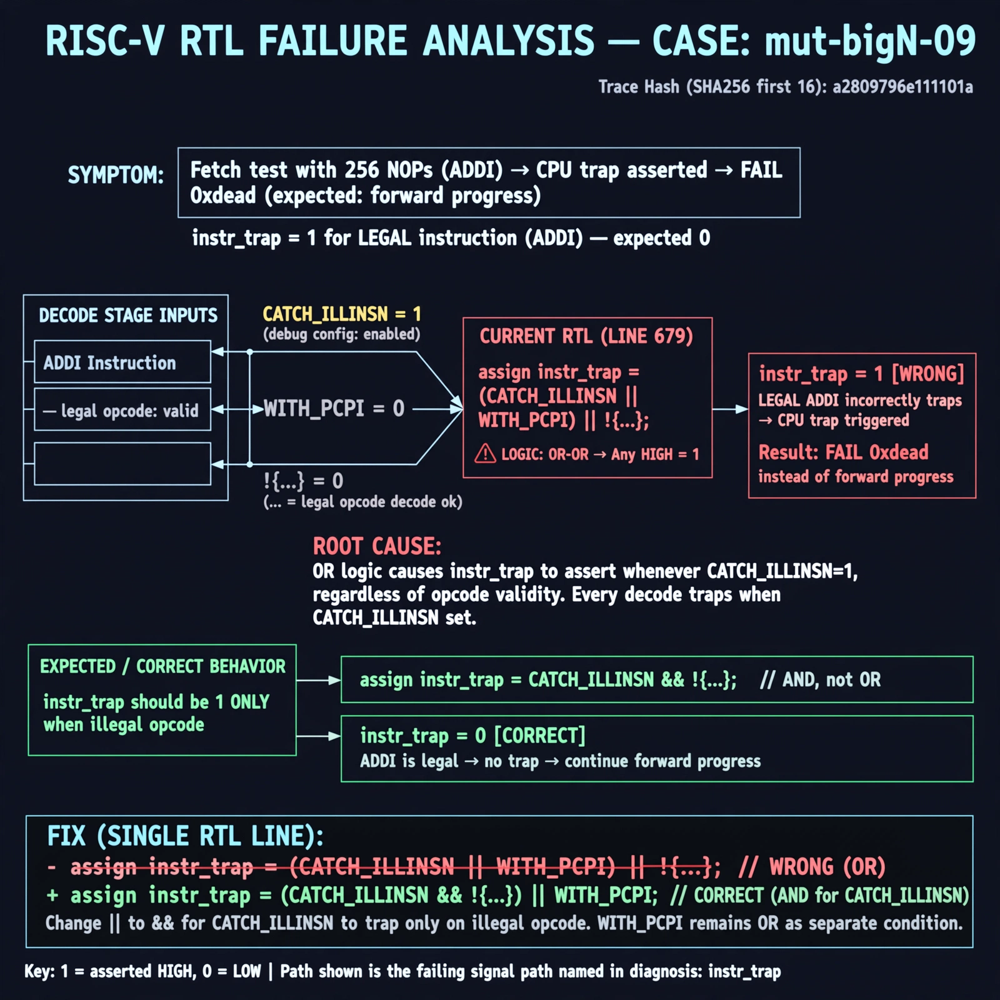

# Afterglow run report: verbatim-mut-bigN-09

case `mut-bigN-09` | status **GREEN** | mode `live` | seed `42`

wall start `2026-10-30T15:40:17Z` | wall end `2026-10-30T15:42:46Z` | time-to-green `149.9s`

retries `0` | human_touches `0` | diagnosed `True` | fixed_unaided `True` | patch_source `model-verbatim`

## Verdicts (from sim, not typed)

- BEFORE: tohost=FAIL 0xdead checksum=c2a7a4d6295484feeb9ec1ea9381732b8e39a7ccd1997c7d70f6454da2fb4659 cycles=2009 seed=42 pass=False
- AFTER: tohost=PASS checksum=5c28238265cb94168311e9914f0df355642c557d04dba11845d557ac8a64aa4a cycles=2009 seed=42 pass=True

## Diagnosis (verbatim from api/text_response.json)

```
Fetch test with 256 NOPs (ADDI) asserted cpu trap and returned FAIL 0xdead instead of forward progress. instr_trap was 1 for a legal instruction instead of 0. Root cause at line 679: `assign instr_trap = (CATCH_ILLINSN || WITH_PCPI) || !{...}` uses OR so with CATCH_ILLINSN set every decode traps; it must be AND to trap only on illegal opcode.
```

expected re-sim signal: tohost: PASS with no cpu trap asserted, fetch alignment + progress OK

## Patch (2 lines, guard-checked)

```diff
diff --git a/picorv32.v b/picorv32.v
--- a/picorv32.v
+++ b/picorv32.v
@@ -679,1 +679,1 @@
-	assign instr_trap = (CATCH_ILLINSN || WITH_PCPI) || !{instr_lui, instr_auipc, instr_jal, instr_jalr,
+	assign instr_trap = (CATCH_ILLINSN || WITH_PCPI) && !{instr_lui, instr_auipc, instr_jal, instr_jalr,

```

## Provenance (judge checks)

- prompt file `/home/tuncay/afterglow/agent/prompts/v2.txt` sha256 `d31e1ef6b74ddf52ee59e790ebff2f3defa9b03be82e699f45ef620cf8e27a6e`
- input_trace.txt sha256 `a2809796e111101a981de739454146afe9264d1867d6767838f02a6a023bc73b` (9 lines, 69 tokens)
- prompt tokens `648` (cap 2500)
- text model `muse-spark-1.3-contributor` latency `43589ms` request `chatcmpl-01a18d7a-14c6-75e7-976e-8e1cef2e719a`
- image model `muse-image-1.0` latency `15752ms` request `f761d517-3ee6-4e53-96bf-8d62a7d5e8d7` status `ok`
- image prompt sha256 `c74c4f986c6039e2d878e12acf95b8734a054a697918493a4a6b61aaa023523c`, trace sha `a2809796e111101a981de739454146afe9264d1867d6767838f02a6a023bc73b` (see api/image_request.json)

## Explanation diagram



## Bundle completeness

- present (12): artifacts/input_trace.txt, artifacts/boot.log, artifacts/boot_after.log, artifacts/verdict_before.json, artifacts/verdict_after.json, api/text_request.json, api/text_response.json, api/image_request.json, api/image_response.json, explain.png, patch.diff, meta.json
- missing (0): none

