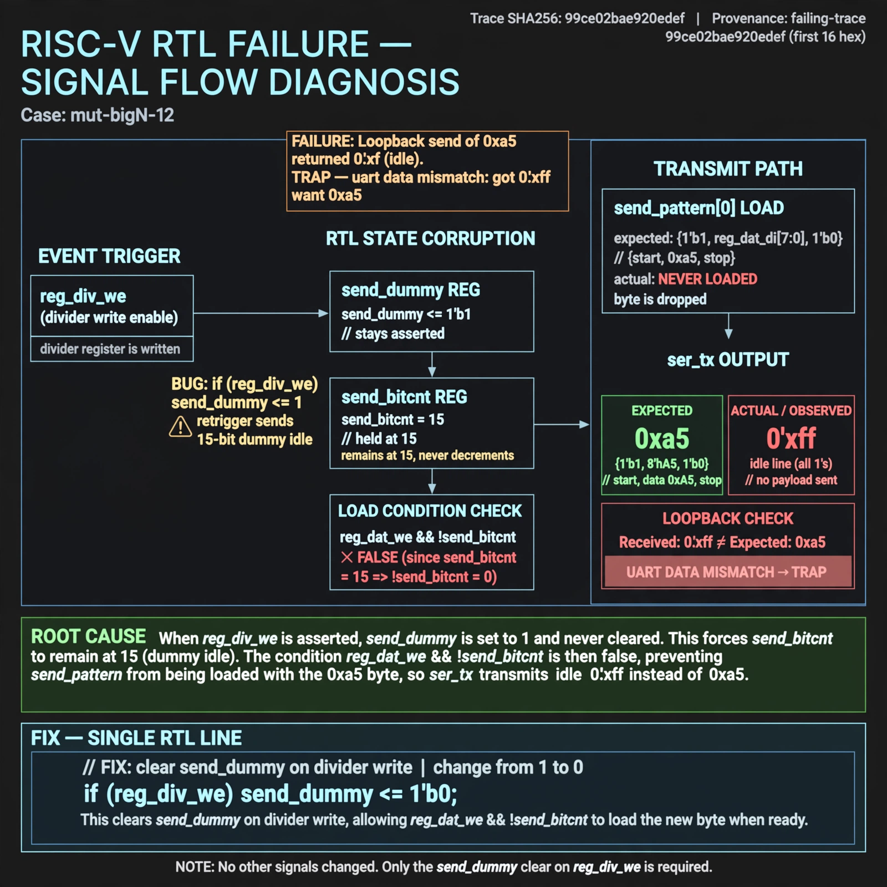

# Afterglow run report: verbatim-mut-bigN-12

case `mut-bigN-12` | status **RED** | mode `live` | seed `42`

wall start `2026-10-30T15:44:17Z` | wall end `2026-10-30T16:01:22Z` | time-to-green `1024.7s`

retries `1` | human_touches `0` | diagnosed `True` | fixed_unaided `False` | patch_source `model-verbatim`

## Verdicts (from sim, not typed)

- BEFORE: tohost=FAIL 0xdead checksum=9e1b73c13d0a095f6b9512137fc937a720f9b8a80231ffc4b660d6d1459f6985 cycles=2024 seed=42 pass=False
- AFTER: tohost=FAIL 0xdead checksum=9e1b73c13d0a095f6b9512137fc937a720f9b8a80231ffc4b660d6d1459f6985 cycles=2024 seed=42 pass=False

## Diagnosis (verbatim from api/text_response.json)

```
Loopback send of 0xa5 returned 0xff idle with TRAP uart data mismatch got 0xff want 0xa5. ser_tx = send_pattern[0] never loaded {1'b1, reg_dat_di[7:0], 1'b0} because send_bitcnt was held at 15 by send_dummy. Root cause is `if (reg_div_we) send_dummy <= 1` retriggering a 15-bit dummy idle after divider write, so `reg_dat_we && !send_bitcnt` is false and the byte is dropped.
```

expected re-sim signal: tohost PASS, loopback got 0xa5 no TRAP uart data mismatch, checksum != 9e1b73c13d0a095f6b9512137fc937a720f9b8a80231ffc4b660d6d1459f6985

## Patch (2 lines, guard-checked)

```diff
diff --git a/picosoc/simpleuart.v b/picosoc/simpleuart.v
--- a/picosoc/simpleuart.v
+++ b/picosoc/simpleuart.v
@@ -109,7 +109,5 @@
 	always @(posedge clk) begin
-		if (reg_div_we)
-			send_dummy <= 1;
 		send_divcnt <= send_divcnt + 1;
 		if (!resetn) begin
 			send_pattern <= ~1;
 			send_bitcnt <= 0;

```

## Provenance (judge checks)

- prompt file `/home/tuncay/afterglow/agent/prompts/v2.txt` sha256 `d31e1ef6b74ddf52ee59e790ebff2f3defa9b03be82e699f45ef620cf8e27a6e`
- input_trace.txt sha256 `99ce02bae920edef0ed5f58250ba2f986a68194abadb8de3a0031d073050b938` (9 lines, 68 tokens)
- prompt tokens `815` (cap 2500)
- text model `muse-spark-1.3-contributor` latency `59254ms` request `chatcmpl-01a18d7d-ede0-711b-bc08-bed4cc0bb8db`
- image model `muse-image-1.0` latency `13056ms` request `b6e9f312-3fd0-4296-9e5b-b2370a3e65c4` status `ok`
- image prompt sha256 `04bec35125810597d92ecc33c0df3006422d78dfb820aafcbaae2117cbbbe7b0`, trace sha `99ce02bae920edef0ed5f58250ba2f986a68194abadb8de3a0031d073050b938` (see api/image_request.json)

## Explanation diagram



## Bundle completeness

- present (12): artifacts/input_trace.txt, artifacts/boot.log, artifacts/boot_after.log, artifacts/verdict_before.json, artifacts/verdict_after.json, api/text_request.json, api/text_response.json, api/image_request.json, api/image_response.json, explain.png, patch.diff, meta.json
- missing (0): none

