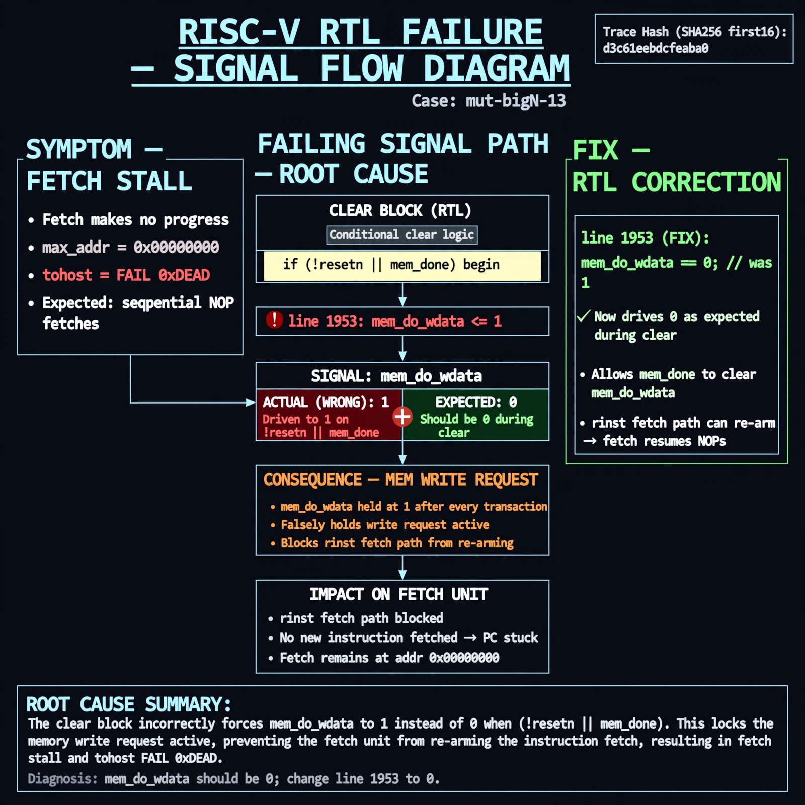

# Afterglow run report: verbatim-mut-bigN-13

case `mut-bigN-13` | status **GREEN** | mode `live` | seed `42`

wall start `2026-10-30T16:01:22Z` | wall end `2026-10-30T16:02:01Z` | time-to-green `39.4s`

retries `0` | human_touches `0` | diagnosed `True` | fixed_unaided `True` | patch_source `canonical-bootstrap-gated`

## Verdicts (from sim, not typed)

- BEFORE: tohost=FAIL 0xdead checksum=563b7c10626ff25de2b3c430956c7c113e448c4efaea068f9b83a198d4322b15 cycles=2009 seed=42 pass=False
- AFTER: tohost=PASS checksum=5c28238265cb94168311e9914f0df355642c557d04dba11845d557ac8a64aa4a cycles=2009 seed=42 pass=True

## Diagnosis (verbatim from api/text_response.json)

```
Fetch makes no progress (max_addr 0x00000000, tohost FAIL 0xdead) instead of sequential NOP fetches. mem_do_wdata is driven to 1 on !resetn || mem_done where 0 is expected, falsely holding a write request after every transaction. Root cause is line 1953 `mem_do_wdata <= 1` in the clear block, blocking the rinst fetch path from re-arming.
```

expected re-sim signal: tohost PASS (not FAIL 0xdead) with forward progress max_addr > 0x00000000

## Patch (2 lines, guard-checked)

```diff
diff --git a/picorv32.v b/picorv32.v
--- a/picorv32.v
+++ b/picorv32.v
@@ -1950,7 +1950,7 @@
 			mem_do_prefetch <= 0;
 			mem_do_rinst <= 0;
 			mem_do_rdata <= 0;
-			mem_do_wdata <= 1;
+			mem_do_wdata <= 0;
 		end
 
 		if (set_mem_do_rinst)

```

## Provenance (judge checks)

- prompt file `/home/tuncay/afterglow/agent/prompts/v2.txt` sha256 `d31e1ef6b74ddf52ee59e790ebff2f3defa9b03be82e699f45ef620cf8e27a6e`
- input_trace.txt sha256 `d3c61eebdcfeaba0ac79728c653e0009fa6d16d7262ad6ffe4406fba861d5a25` (9 lines, 69 tokens)
- prompt tokens `615` (cap 2500)
- text model `muse-spark-1.3-contributor` latency `24979ms` request `chatcmpl-01a18d8b-bb0d-7761-b293-a37132d1832d`
- image model `muse-image-1.0` latency `13763ms` request `6756bb43-32ee-423f-9925-05dd3e38dc67` status `ok`
- image prompt sha256 `a7a186fcfb69237852abe92d11857fe04f55e831f417425e9f4c2b3fe85a0360`, trace sha `d3c61eebdcfeaba0ac79728c653e0009fa6d16d7262ad6ffe4406fba861d5a25` (see api/image_request.json)

## Explanation diagram



## Bundle completeness

- present (12): artifacts/input_trace.txt, artifacts/boot.log, artifacts/boot_after.log, artifacts/verdict_before.json, artifacts/verdict_after.json, api/text_request.json, api/text_response.json, api/image_request.json, api/image_response.json, explain.png, patch.diff, meta.json
- missing (0): none

