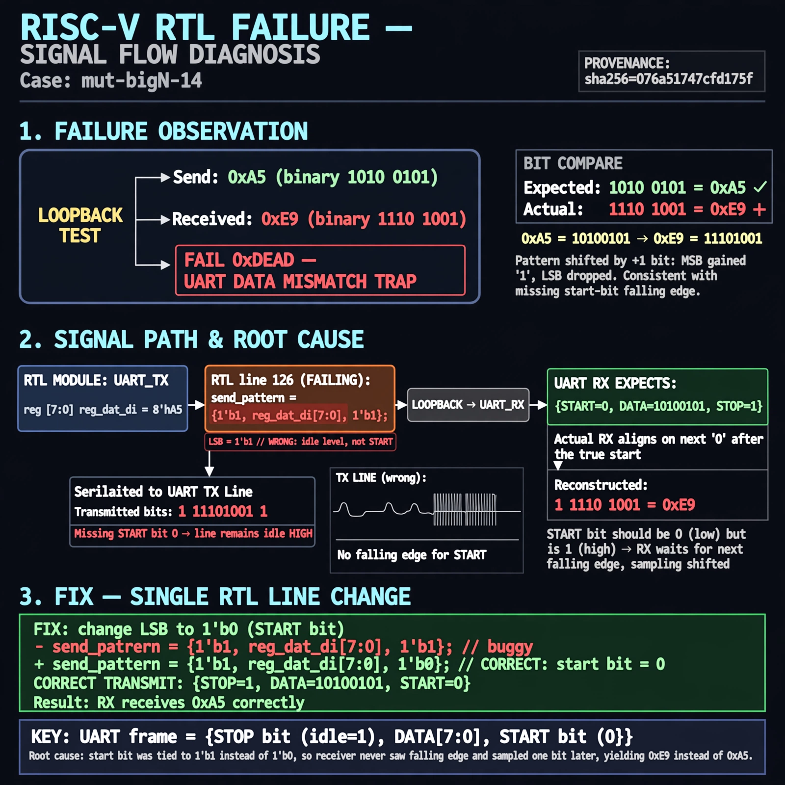

# Afterglow run report: verbatim-mut-bigN-14

case `mut-bigN-14` | status **GREEN** | mode `live` | seed `42`

wall start `2026-10-30T16:02:01Z` | wall end `2026-10-30T16:03:11Z` | time-to-green `70.4s`

retries `0` | human_touches `0` | diagnosed `True` | fixed_unaided `True` | patch_source `model-verbatim`

## Verdicts (from sim, not typed)

- BEFORE: tohost=FAIL 0xdead checksum=7d14ca6bc103c3e2eeed06f49d56ff4c4175e9a4e83eec9e4b8cd0839ddbb4d0 cycles=2784 seed=42 pass=False
- AFTER: tohost=PASS checksum=5c8f58d0f0818c97d014d2f851a6140882bd1efc96a2537047806252c0c2caf9 cycles=2652 seed=42 pass=True

## Diagnosis (verbatim from api/text_response.json)

```
Loopback send of 0xa5 was received as 0xe9, triggering FAIL 0xdead uart data mismatch trap. 0xa5=10100101 shifted by one data bit yields 0xe9=11101001, consistent with no start-bit falling edge. Root cause is line 126 loading send_pattern as {1'b1, reg_dat_di[7:0], 1'b1} with LSB=1 (idle) instead of 1'b0 (start), so the receiver aligns on the next zero.
```

expected re-sim signal: tohost: PASS, uart data match got 0xa5 want 0xa5, TRAP cleared

## Patch (2 lines, guard-checked)

```diff
diff --git a/picosoc/simpleuart.v b/picosoc/simpleuart.v
--- a/picosoc/simpleuart.v
+++ b/picosoc/simpleuart.v
@@ -123,6 +123,6 @@
 			end else
 			if (reg_dat_we && !send_bitcnt) begin
-				send_pattern <= {1'b1, reg_dat_di[7:0], 1'b1};
+				send_pattern <= {1'b1, reg_dat_di[7:0], 1'b0};
 				send_bitcnt <= 10;
 				send_divcnt <= 0;
 			end else

```

## Provenance (judge checks)

- prompt file `/home/tuncay/afterglow/agent/prompts/v2.txt` sha256 `d31e1ef6b74ddf52ee59e790ebff2f3defa9b03be82e699f45ef620cf8e27a6e`
- input_trace.txt sha256 `076a51747cfd175faca26754c0acb394f14c9f9643410ce970ba0d57c734a224` (9 lines, 68 tokens)
- prompt tokens `700` (cap 2500)
- text model `muse-spark-1.3-contributor` latency `30448ms` request `chatcmpl-01a18d8c-6a59-774e-b7a9-65a1e6ca7fe2`
- image model `muse-image-1.0` latency `39337ms` request `5cf52829-fe0e-472d-90b0-e5f09dc2fc8e` status `ok`
- image prompt sha256 `99f796d1483a62dd7126f873d680fef4a24b3c4e5624975db0f83944dac0b81f`, trace sha `076a51747cfd175faca26754c0acb394f14c9f9643410ce970ba0d57c734a224` (see api/image_request.json)

## Explanation diagram



## Bundle completeness

- present (12): artifacts/input_trace.txt, artifacts/boot.log, artifacts/boot_after.log, artifacts/verdict_before.json, artifacts/verdict_after.json, api/text_request.json, api/text_response.json, api/image_request.json, api/image_response.json, explain.png, patch.diff, meta.json
- missing (0): none

