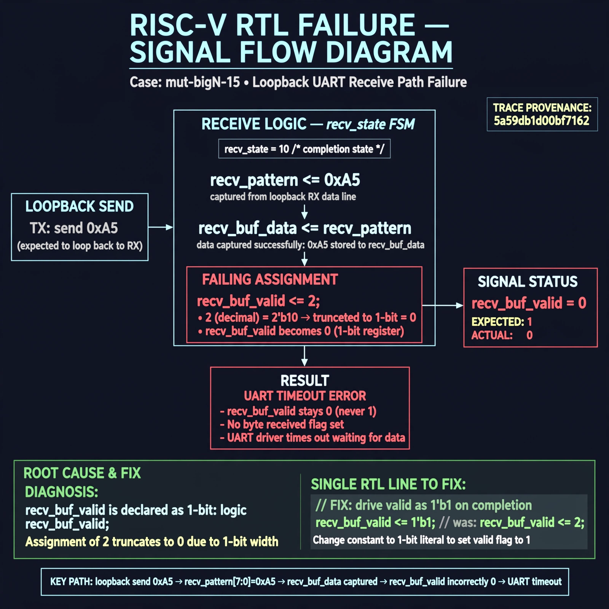

# Afterglow run report: verbatim-mut-bigN-15

case `mut-bigN-15` | status **GREEN** | mode `live` | seed `42`

wall start `2026-10-30T16:03:11Z` | wall end `2026-10-30T16:04:03Z` | time-to-green `51.7s`

retries `0` | human_touches `0` | diagnosed `True` | fixed_unaided `True` | patch_source `model-verbatim`

## Verdicts (from sim, not typed)

- BEFORE: tohost=FAIL 0xdead checksum=e82517390f8726caabcc777759a3dbb48c59fd1d160e409515f1b95dfe3d420c cycles=22023 seed=42 pass=False
- AFTER: tohost=PASS checksum=5c8f58d0f0818c97d014d2f851a6140882bd1efc96a2537047806252c0c2caf9 cycles=2652 seed=42 pass=True

## Diagnosis (verbatim from api/text_response.json)

```
Loopback send 0xa5 never completes: recv_buf_valid stays 0 instead of 1, causing uart timeout with no byte received. In recv_state 10 completion the code assigns recv_buf_valid <= 2 which truncates to 0 for a 1-bit valid flag. Thus recv_buf_data is captured from recv_pattern but never marked valid.
```

expected re-sim signal: tohost PASS, loopback 0xa5 received with no uart timeout

## Patch (2 lines, guard-checked)

```diff
diff --git a/picosoc/simpleuart.v b/picosoc/simpleuart.v
--- a/picosoc/simpleuart.v
+++ b/picosoc/simpleuart.v
@@ -89,7 +89,7 @@
 				10: begin
 					if (recv_divcnt > cfg_divider) begin
 						recv_buf_data <= recv_pattern;
-						recv_buf_valid <= 2;
+						recv_buf_valid <= 1;
 						recv_state <= 0;
 					end
 				end

```

## Provenance (judge checks)

- prompt file `/home/tuncay/afterglow/agent/prompts/v2.txt` sha256 `d31e1ef6b74ddf52ee59e790ebff2f3defa9b03be82e699f45ef620cf8e27a6e`
- input_trace.txt sha256 `5a59db1d00bf7162c8c6140eb89e8bd23bf68d8073bfb4e8c8ed1def52f8fab8` (9 lines, 66 tokens)
- prompt tokens `595` (cap 2500)
- text model `muse-spark-1.3-contributor` latency `37600ms` request `chatcmpl-01a18d8d-995c-72bd-81d5-368b3aaf5c62`
- image model `muse-image-1.0` latency `13526ms` request `c17fa66d-30ab-4181-b82e-9228310577f1` status `ok`
- image prompt sha256 `d9723940e2e4ec20362c2f7e9a6c86aa9e1340d73f01c128072a84e6af4c23e4`, trace sha `5a59db1d00bf7162c8c6140eb89e8bd23bf68d8073bfb4e8c8ed1def52f8fab8` (see api/image_request.json)

## Explanation diagram



## Bundle completeness

- present (12): artifacts/input_trace.txt, artifacts/boot.log, artifacts/boot_after.log, artifacts/verdict_before.json, artifacts/verdict_after.json, api/text_request.json, api/text_response.json, api/image_request.json, api/image_response.json, explain.png, patch.diff, meta.json
- missing (0): none

