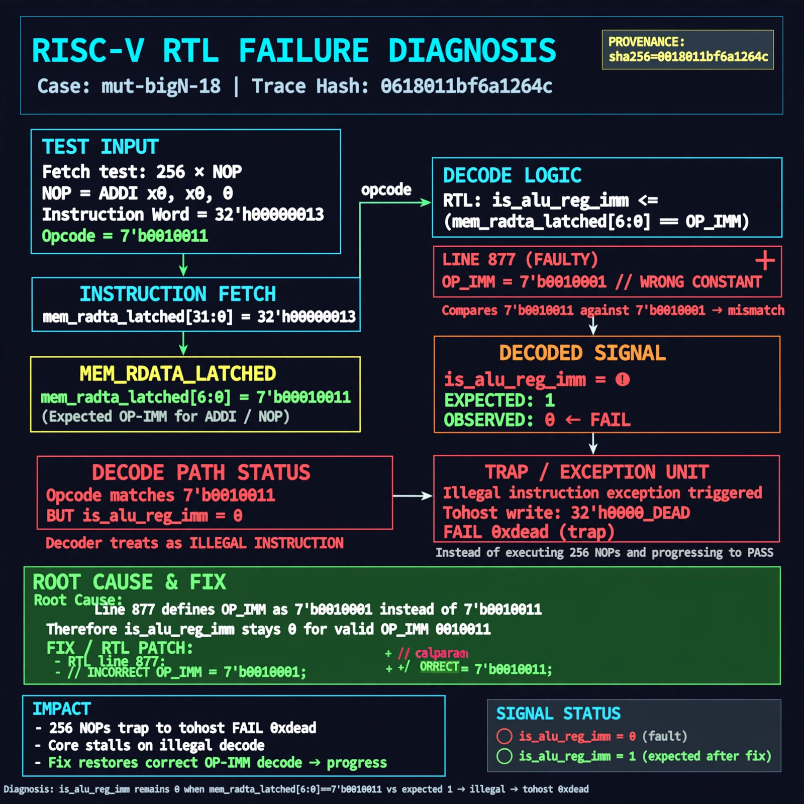

# Afterglow run report: verbatim-mut-bigN-18

case `mut-bigN-18` | status **GREEN** | mode `live` | seed `42`

wall start `2026-10-30T16:04:03Z` | wall end `2026-10-30T16:05:21Z` | time-to-green `78.2s`

retries `0` | human_touches `0` | diagnosed `True` | fixed_unaided `True` | patch_source `model-verbatim`

## Verdicts (from sim, not typed)

- BEFORE: tohost=FAIL 0xdead checksum=c2a7a4d6295484feeb9ec1ea9381732b8e39a7ccd1997c7d70f6454da2fb4659 cycles=2009 seed=42 pass=False
- AFTER: tohost=PASS checksum=5c28238265cb94168311e9914f0df355642c557d04dba11845d557ac8a64aa4a cycles=2009 seed=42 pass=True

## Diagnosis (verbatim from api/text_response.json)

```
Fetch test with 256 NOP (ADDI, opcode 0010011) words traps with tohost FAIL 0xdead instead of progressing. is_alu_reg_imm stays 0 for mem_rdata_latched[6:0]==7'b0010011 vs expected 1, so NOPs decode as illegal. Root cause in excerpt line 877 decoding OP-IMM as 7'b0010001 instead of 7'b0010011.
```

expected re-sim signal: tohost PASS with no TRAP / no FAIL 0xdead, checksum differs from failing c2a7a4d6295484feeb9ec1ea9381732b8e39a7ccd1997c7d70f6454da2fb4659

## Patch (2 lines, guard-checked)

```diff
diff --git a/picorv32.v b/picorv32.v
--- a/picorv32.v
+++ b/picorv32.v
@@ -874,5 +874,5 @@
 			is_beq_bne_blt_bge_bltu_bgeu <= mem_rdata_latched[6:0] == 7'b1100011;
 			is_lb_lh_lw_lbu_lhu          <= mem_rdata_latched[6:0] == 7'b0000011;
 			is_sb_sh_sw                  <= mem_rdata_latched[6:0] == 7'b0100011;
-			is_alu_reg_imm               <= mem_rdata_latched[6:0] == 7'b0010001;
+			is_alu_reg_imm               <= mem_rdata_latched[6:0] == 7'b0010011;
 			is_alu_reg_reg               <= mem_rdata_latched[6:0] == 7'b0110011;

```

## Provenance (judge checks)

- prompt file `/home/tuncay/afterglow/agent/prompts/v2.txt` sha256 `d31e1ef6b74ddf52ee59e790ebff2f3defa9b03be82e699f45ef620cf8e27a6e`
- input_trace.txt sha256 `0618011bf6a1264cefac1ccbc5c6323ede285570d660940517179af05910a3fc` (9 lines, 69 tokens)
- prompt tokens `704` (cap 2500)
- text model `muse-spark-1.3-contributor` latency `43789ms` request `chatcmpl-01a18d8e-7b9b-705d-8498-8e086df0581e`
- image model `muse-image-1.0` latency `33712ms` request `12a31680-be10-4592-bc3a-8ba4ba8dc408` status `ok`
- image prompt sha256 `19566ffcda23c5808506f47d5b96e5de349dadc70e29e9d52003919488797cd9`, trace sha `0618011bf6a1264cefac1ccbc5c6323ede285570d660940517179af05910a3fc` (see api/image_request.json)

## Explanation diagram



## Bundle completeness

- present (12): artifacts/input_trace.txt, artifacts/boot.log, artifacts/boot_after.log, artifacts/verdict_before.json, artifacts/verdict_after.json, api/text_request.json, api/text_response.json, api/image_request.json, api/image_response.json, explain.png, patch.diff, meta.json
- missing (0): none

