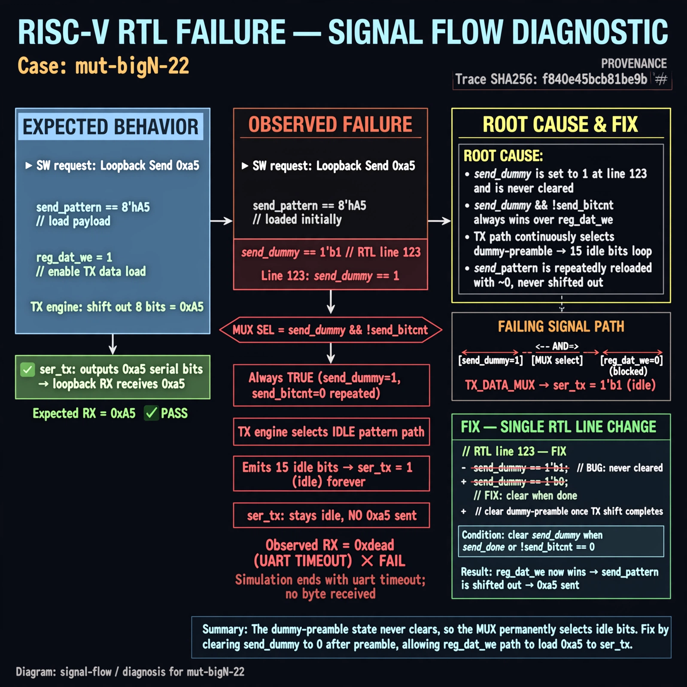

# Afterglow run report: verbatim-mut-bigN-22

case `mut-bigN-22` | status **GREEN** | mode `live` | seed `42`

wall start `2026-10-30T16:14:57Z` | wall end `2026-10-30T16:16:09Z` | time-to-green `72.2s`

retries `0` | human_touches `0` | diagnosed `True` | fixed_unaided `True` | patch_source `model-verbatim`

## Verdicts (from sim, not typed)

- BEFORE: tohost=FAIL 0xdead checksum=e82517390f8726caabcc777759a3dbb48c59fd1d160e409515f1b95dfe3d420c cycles=22023 seed=42 pass=False
- AFTER: tohost=PASS checksum=5c8f58d0f0818c97d014d2f851a6140882bd1efc96a2537047806252c0c2caf9 cycles=2652 seed=42 pass=True

## Diagnosis (verbatim from api/text_response.json)

```
Loopback send of 0xa5 never appears on ser_tx; sim ends with uart timeout, no byte received (FAIL 0xdead vs expected RX 0xa5). ser_tx stays idle because send_pattern is repeatedly reloaded with ~0. Root cause in excerpt line 123: send_dummy <= 1 never clears the dummy-preamble state, so send_dummy && !send_bitcnt always wins over reg_dat_we and the TX engine loops 15 idle bits forever.
```

expected re-sim signal: tohost PASS with loopback byte 0xa5 received, no uart timeout

## Patch (2 lines, guard-checked)

```diff
diff --git a/picosoc/simpleuart.v b/picosoc/simpleuart.v
--- a/picosoc/simpleuart.v
+++ b/picosoc/simpleuart.v
@@ -119,7 +119,7 @@
 			if (send_dummy && !send_bitcnt) begin
 				send_pattern <= ~0;
 				send_bitcnt <= 15;
 				send_divcnt <= 0;
-				send_dummy <= 1;
+				send_dummy <= 0;
 			end else
 			if (reg_dat_we && !send_bitcnt) begin

```

## Provenance (judge checks)

- prompt file `/home/tuncay/afterglow/agent/prompts/v2.txt` sha256 `d31e1ef6b74ddf52ee59e790ebff2f3defa9b03be82e699f45ef620cf8e27a6e`
- input_trace.txt sha256 `f840e45bcb81be9b87c136d3423de32cc95815cfad749e0d7d6ac83b02e11945` (9 lines, 66 tokens)
- prompt tokens `611` (cap 2500)
- text model `muse-spark-1.3-contributor` latency `55606ms` request `chatcmpl-01a18d98-a217-73d2-a803-2bb5ab7e60dd`
- image model `muse-image-1.0` latency `15979ms` request `89af941d-1ef1-44c5-a5ab-9acc3bfe13f2` status `ok`
- image prompt sha256 `08e505f6cba7b04f32b4031b5515c13daffb779f10fb5dde56549d2b5ee16542`, trace sha `f840e45bcb81be9b87c136d3423de32cc95815cfad749e0d7d6ac83b02e11945` (see api/image_request.json)

## Explanation diagram



## Bundle completeness

- present (12): artifacts/input_trace.txt, artifacts/boot.log, artifacts/boot_after.log, artifacts/verdict_before.json, artifacts/verdict_after.json, api/text_request.json, api/text_response.json, api/image_request.json, api/image_response.json, explain.png, patch.diff, meta.json
- missing (0): none

