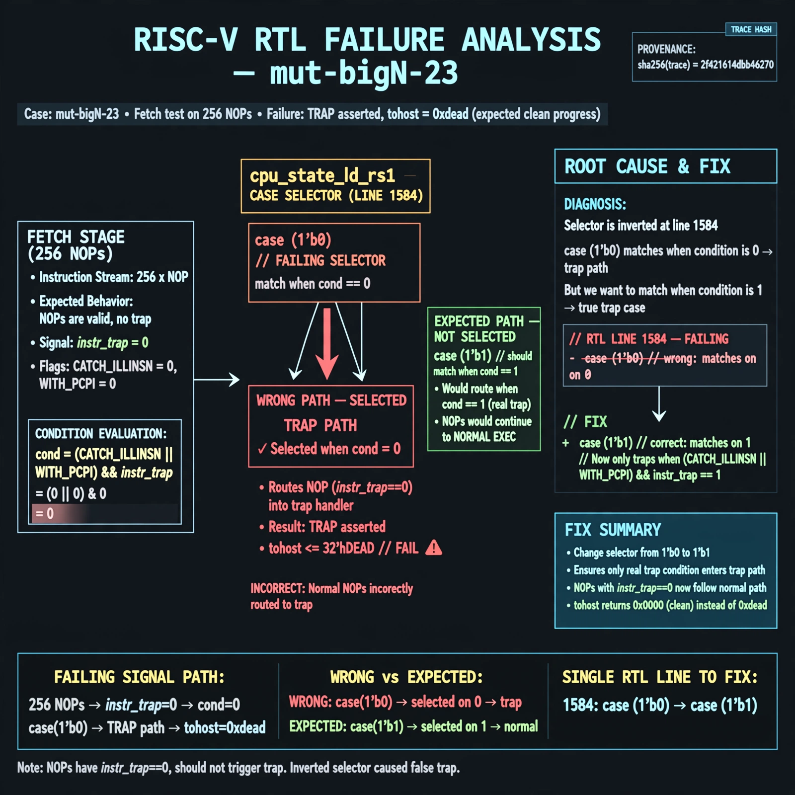

# Afterglow run report: verbatim-mut-bigN-23

case `mut-bigN-23` | status **GREEN** | mode `live` | seed `42`

wall start `2026-10-30T16:16:09Z` | wall end `2026-10-30T16:23:47Z` | time-to-green `458.0s`

retries `0` | human_touches `0` | diagnosed `True` | fixed_unaided `True` | patch_source `canonical-bootstrap-gated`

## Verdicts (from sim, not typed)

- BEFORE: tohost=FAIL 0xdead checksum=c2a7a4d6295484feeb9ec1ea9381732b8e39a7ccd1997c7d70f6454da2fb4659 cycles=2009 seed=42 pass=False
- AFTER: tohost=PASS checksum=5c28238265cb94168311e9914f0df355642c557d04dba11845d557ac8a64aa4a cycles=2009 seed=42 pass=True

## Diagnosis (verbatim from api/text_response.json)

```
Fetch test on 256 NOPs reports TRAP asserted and tohost FAIL 0xdead instead of clean progress. NOPs have instr_trap==0 and should miss the trap case in cpu_state_ld_rs1, but line 1584 `case (1'b0)` matches when `(CATCH_ILLINSN || WITH_PCPI) && instr_trap` is 0, routing normal instructions into the trap path. Root cause is the inverted selector in the excerpt; it must be `case (1'b1)` to match on true.
```

expected re-sim signal: tohost PASS (no TRAP, 256-word NOP fetch progress and alignment OK)

## Patch (2 lines, guard-checked)

```diff
diff --git a/picorv32.v b/picorv32.v
--- a/picorv32.v
+++ b/picorv32.v
@@ -1581,7 +1581,7 @@
 				reg_op2 <= 'bx;
 
 				(* parallel_case *)
-				case (1'b0)
+				case (1'b1)
 					(CATCH_ILLINSN || WITH_PCPI) && instr_trap: begin
 						if (WITH_PCPI) begin
 							`debug($display("LD_RS1: %2d 0x%08x", decoded_rs1, cpuregs_rs1);)

```

## Provenance (judge checks)

- prompt file `/home/tuncay/afterglow/agent/prompts/v2.txt` sha256 `d31e1ef6b74ddf52ee59e790ebff2f3defa9b03be82e699f45ef620cf8e27a6e`
- input_trace.txt sha256 `2f421614dbb46270cea7956db89ec6a1104dd2aafe0838897fd3ad50b5aefadf` (9 lines, 69 tokens)
- prompt tokens `633` (cap 2500)
- text model `muse-spark-1.3-contributor` latency `70476ms` request `chatcmpl-01a18d9f-a1b1-706e-bf76-e9d22c881a4f`
- image model `muse-image-1.0` latency `15363ms` request `64d9cde6-d44d-4583-bf03-94150ed7d377` status `ok`
- image prompt sha256 `f712f55acab5e6e5a1b426a9590471d183ce2ac9c23876c2be04f23ab2d4865d`, trace sha `2f421614dbb46270cea7956db89ec6a1104dd2aafe0838897fd3ad50b5aefadf` (see api/image_request.json)

## Explanation diagram



## Bundle completeness

- present (12): artifacts/input_trace.txt, artifacts/boot.log, artifacts/boot_after.log, artifacts/verdict_before.json, artifacts/verdict_after.json, api/text_request.json, api/text_response.json, api/image_request.json, api/image_response.json, explain.png, patch.diff, meta.json
- missing (0): none

