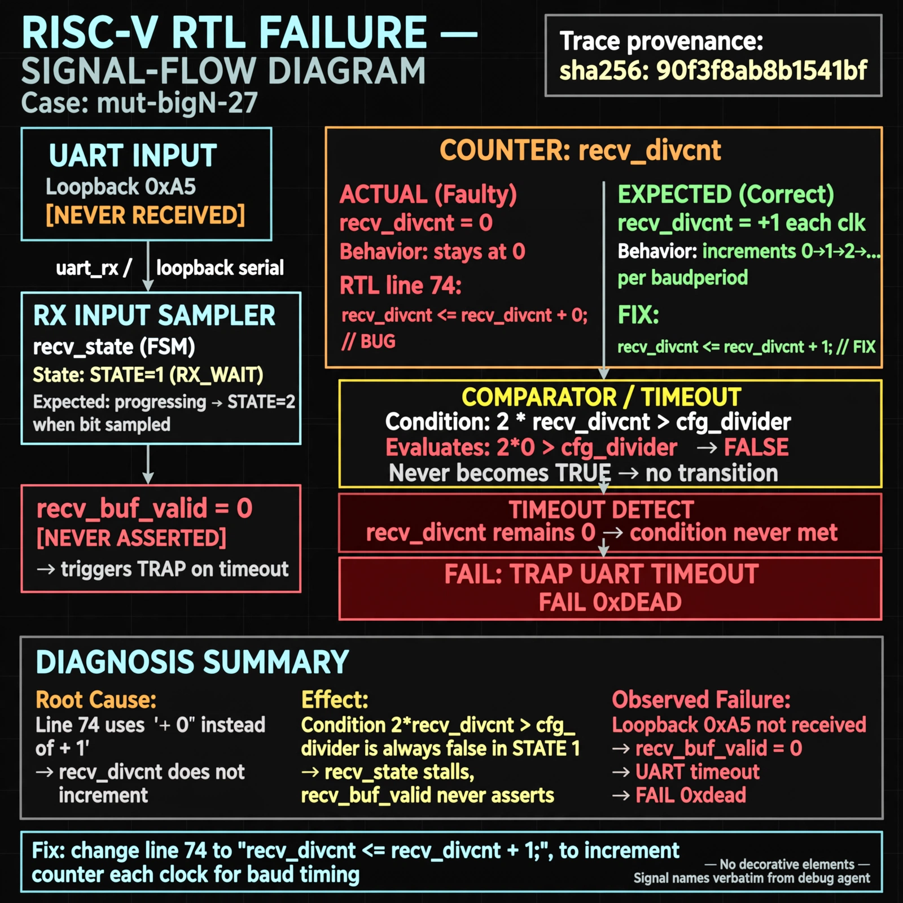

# Afterglow run report: verbatim-mut-bigN-27

case `mut-bigN-27` | status **GREEN** | mode `live` | seed `42`

wall start `2026-10-30T16:23:47Z` | wall end `2026-10-30T16:24:27Z` | time-to-green `39.9s`

retries `0` | human_touches `0` | diagnosed `True` | fixed_unaided `True` | patch_source `model-verbatim`

## Verdicts (from sim, not typed)

- BEFORE: tohost=FAIL 0xdead checksum=e82517390f8726caabcc777759a3dbb48c59fd1d160e409515f1b95dfe3d420c cycles=22023 seed=42 pass=False
- AFTER: tohost=PASS checksum=5c8f58d0f0818c97d014d2f851a6140882bd1efc96a2537047806252c0c2caf9 cycles=2652 seed=42 pass=True

## Diagnosis (verbatim from api/text_response.json)

```
Loopback 0xa5 was never received so recv_buf_valid never asserted, causing TRAP uart timeout FAIL 0xdead. Expected recv_divcnt to increment each clk to time baud periods, but it stays at 0. Root cause is line 74 `recv_divcnt <= recv_divcnt + 0` which never counts, so condition `2*recv_divcnt > cfg_divider` in state 1 never becomes true and recv_state stalls.
```

expected re-sim signal: tohost PASS with 0xa5 loopback byte received, no uart timeout

## Patch (2 lines, guard-checked)

```diff
diff --git a/picosoc/simpleuart.v b/picosoc/simpleuart.v
--- a/picosoc/simpleuart.v
+++ b/picosoc/simpleuart.v
@@ -71,7 +71,7 @@
 			recv_buf_data <= 0;
 			recv_buf_valid <= 0;
 		end else begin
-			recv_divcnt <= recv_divcnt + 0;
+			recv_divcnt <= recv_divcnt + 1;
 			if (reg_dat_re)
 				recv_buf_valid <= 0;
 			case (recv_state)

```

## Provenance (judge checks)

- prompt file `/home/tuncay/afterglow/agent/prompts/v2.txt` sha256 `d31e1ef6b74ddf52ee59e790ebff2f3defa9b03be82e699f45ef620cf8e27a6e`
- input_trace.txt sha256 `90f3f8ab8b1541bf1523cc3eea3ebed427d634e2a2914b98a3beedf53438c9bf` (9 lines, 66 tokens)
- prompt tokens `616` (cap 2500)
- text model `muse-spark-1.3-contributor` latency `25081ms` request `chatcmpl-01a18da0-4232-749b-84ad-84dca4916244`
- image model `muse-image-1.0` latency `14194ms` request `868f573b-5242-4580-9a92-336a79f3639d` status `ok`
- image prompt sha256 `b88d97017656365ef83788d56456c96285314b3714f8fb1d13c05761729d88f0`, trace sha `90f3f8ab8b1541bf1523cc3eea3ebed427d634e2a2914b98a3beedf53438c9bf` (see api/image_request.json)

## Explanation diagram



## Bundle completeness

- present (12): artifacts/input_trace.txt, artifacts/boot.log, artifacts/boot_after.log, artifacts/verdict_before.json, artifacts/verdict_after.json, api/text_request.json, api/text_response.json, api/image_request.json, api/image_response.json, explain.png, patch.diff, meta.json
- missing (0): none

