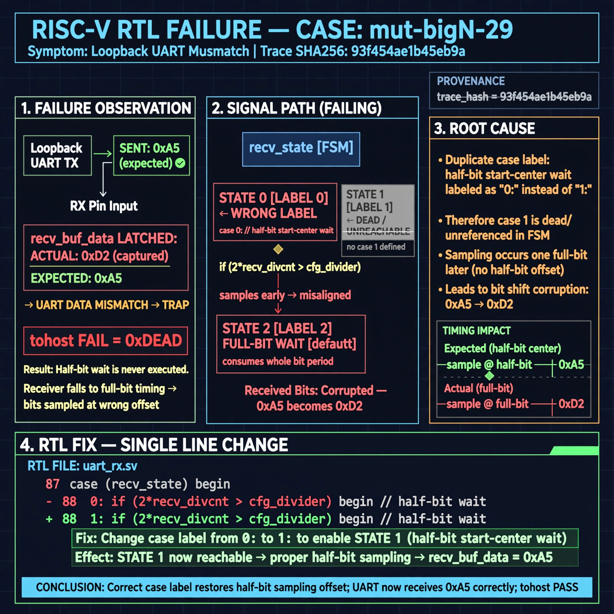

# Afterglow run report: verbatim-mut-bigN-29

case `mut-bigN-29` | status **GREEN** | mode `live` | seed `42`

wall start `2026-10-30T16:24:27Z` | wall end `2026-10-30T16:25:42Z` | time-to-green `75.1s`

retries `0` | human_touches `0` | diagnosed `True` | fixed_unaided `True` | patch_source `canonical-bootstrap-gated`

## Verdicts (from sim, not typed)

- BEFORE: tohost=FAIL 0xdead checksum=7ead7d9c1ebd862283bf0991c6a01fd4f7dad63f24f2be953b7f57e1f7edd073 cycles=2684 seed=42 pass=False
- AFTER: tohost=PASS checksum=5c8f58d0f0818c97d014d2f851a6140882bd1efc96a2537047806252c0c2caf9 cycles=2652 seed=42 pass=True

## Diagnosis (verbatim from api/text_response.json)

```
Loopback UART sent 0xa5 but recv_buf_data latched 0xd2, causing TRAP uart data mismatch and tohost FAIL 0xdead. Root cause is duplicate case label 0 in recv_state case: the half-bit start-center wait (2*recv_divcnt > cfg_divider) is labeled 0 instead of 1 so state 1 is dead and falls to default full-bit wait. This half-bit sampling offset corrupts received bits.
```

expected re-sim signal: tohost: PASS, uart loopback 0xa5 matches, no TRAP uart data mismatch

## Patch (2 lines, guard-checked)

```diff
diff --git a/picosoc/simpleuart.v b/picosoc/simpleuart.v
--- a/picosoc/simpleuart.v
+++ b/picosoc/simpleuart.v
@@ -80,7 +80,7 @@
 						recv_state <= 1;
 					recv_divcnt <= 0;
 				end
-				0: begin
+				1: begin
 					if (2*recv_divcnt > cfg_divider) begin
 						recv_state <= 2;
 						recv_divcnt <= 0;

```

## Provenance (judge checks)

- prompt file `/home/tuncay/afterglow/agent/prompts/v2.txt` sha256 `d31e1ef6b74ddf52ee59e790ebff2f3defa9b03be82e699f45ef620cf8e27a6e`
- input_trace.txt sha256 `93f454ae1b45eb9abb2fca905323672b5275a2218ca75ee8a8be83439df8b91f` (9 lines, 68 tokens)
- prompt tokens `706` (cap 2500)
- text model `muse-spark-1.3-contributor` latency `41223ms` request `chatcmpl-01a18da1-1d35-73ae-b8fa-23ce6eb08d8e`
- image model `muse-image-1.0` latency `33227ms` request `1cc3f02b-e15c-4062-ac20-26349d90f137` status `ok`
- image prompt sha256 `322ad0fb737e3dbd5db472120b8475f04cae457f72677e6997104ef3c8aa470b`, trace sha `93f454ae1b45eb9abb2fca905323672b5275a2218ca75ee8a8be83439df8b91f` (see api/image_request.json)

## Explanation diagram



## Bundle completeness

- present (12): artifacts/input_trace.txt, artifacts/boot.log, artifacts/boot_after.log, artifacts/verdict_before.json, artifacts/verdict_after.json, api/text_request.json, api/text_response.json, api/image_request.json, api/image_response.json, explain.png, patch.diff, meta.json
- missing (0): none

