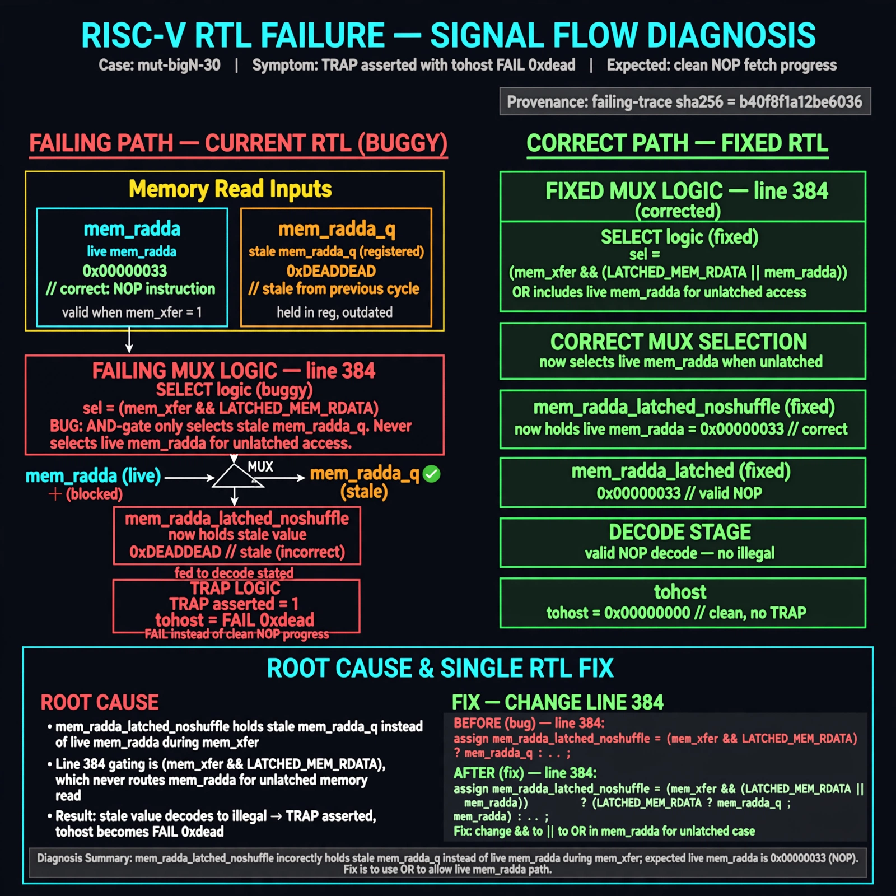

# Afterglow run report: verbatim-mut-bigN-30

case `mut-bigN-30` | status **GREEN** | mode `live` | seed `42`

wall start `2026-10-30T16:25:42Z` | wall end `2026-10-30T16:30:43Z` | time-to-green `301.2s`

retries `0` | human_touches `0` | diagnosed `True` | fixed_unaided `True` | patch_source `model-verbatim`

## Verdicts (from sim, not typed)

- BEFORE: tohost=FAIL 0xdead checksum=c2a7a4d6295484feeb9ec1ea9381732b8e39a7ccd1997c7d70f6454da2fb4659 cycles=2009 seed=42 pass=False
- AFTER: tohost=PASS checksum=5c28238265cb94168311e9914f0df355642c557d04dba11845d557ac8a64aa4a cycles=2009 seed=42 pass=True

## Diagnosis (verbatim from api/text_response.json)

```
TRAP asserted with tohost FAIL 0xdead instead of clean NOP fetch progress. mem_rdata_latched_noshuffle holds stale mem_rdata_q instead of live mem_rdata during mem_xfer, so mem_rdata_latched decodes illegal. Root cause is line 384 gating with (mem_xfer && LATCHED_MEM_RDATA) which never selects mem_rdata for unlatched memory; it must be OR.
```

expected re-sim signal: tohost PASS with no TRAP asserted, fetch alignment progress instead of FAIL 0xdead

## Patch (2 lines, guard-checked)

```diff
diff --git a/picorv32.v b/picorv32.v
--- a/picorv32.v
+++ b/picorv32.v
@@ -382,5 +382,5 @@
 	assign mem_la_addr = (mem_do_prefetch || mem_do_rinst) ? {next_pc[31:2] + mem_la_firstword_xfer, 2'b00} : {reg_op1[31:2], 2'b00};
 
-	assign mem_rdata_latched_noshuffle = (mem_xfer && LATCHED_MEM_RDATA) ? mem_rdata : mem_rdata_q;
+	assign mem_rdata_latched_noshuffle = (mem_xfer || LATCHED_MEM_RDATA) ? mem_rdata : mem_rdata_q;
 
 	assign mem_rdata_latched = COMPRESSED_ISA && mem_la_use_prefetched_high_word ? {16'bx, mem_16bit_buffer} :

```

## Provenance (judge checks)

- prompt file `/home/tuncay/afterglow/agent/prompts/v2.txt` sha256 `d31e1ef6b74ddf52ee59e790ebff2f3defa9b03be82e699f45ef620cf8e27a6e`
- input_trace.txt sha256 `b40f8f1a12be60361c691d7e5bab1372791f333a4acc10c2cd931d47ca2e95bb` (9 lines, 69 tokens)
- prompt tokens `699` (cap 2500)
- text model `muse-spark-1.3-contributor` latency `68468ms` request `chatcmpl-01a18da5-b0f0-771a-b673-cedae3785c9e`
- image model `muse-image-1.0` latency `34529ms` request `b8f68ce1-9c42-4523-bb8c-955617fca6a6` status `ok`
- image prompt sha256 `ad81ba794bb47377f27be2b014350ee6e0fef094af6e168d40b31290ad4b1d75`, trace sha `b40f8f1a12be60361c691d7e5bab1372791f333a4acc10c2cd931d47ca2e95bb` (see api/image_request.json)

## Explanation diagram



## Bundle completeness

- present (12): artifacts/input_trace.txt, artifacts/boot.log, artifacts/boot_after.log, artifacts/verdict_before.json, artifacts/verdict_after.json, api/text_request.json, api/text_response.json, api/image_request.json, api/image_response.json, explain.png, patch.diff, meta.json
- missing (0): none

