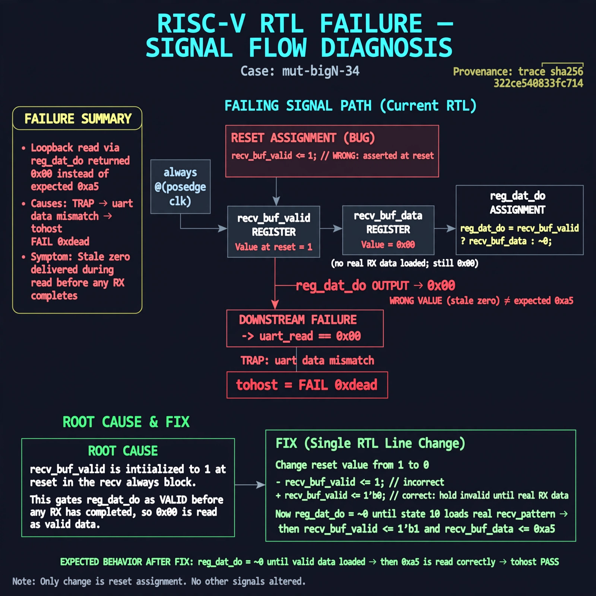

# Afterglow run report: verbatim-mut-bigN-34

case `mut-bigN-34` | status **GREEN** | mode `live` | seed `42`

wall start `2026-10-30T16:30:43Z` | wall end `2026-10-30T16:43:03Z` | time-to-green `739.6s`

retries `1` | human_touches `0` | diagnosed `True` | fixed_unaided `True` | patch_source `model-verbatim`

## Verdicts (from sim, not typed)

- BEFORE: tohost=FAIL 0xdead checksum=1a01e3dd7554c28fc4f88add55dab14e0af721c0bb643827dbea0abf6c429e3c cycles=2024 seed=42 pass=False
- AFTER: tohost=PASS checksum=5c8f58d0f0818c97d014d2f851a6140882bd1efc96a2537047806252c0c2caf9 cycles=2652 seed=42 pass=True

## Diagnosis (verbatim from api/text_response.json)

```
Loopback read via reg_dat_do returned recv_buf_data 0x00 instead of expected 0xa5, causing TRAP uart data mismatch and tohost FAIL 0xdead. The gate recv_buf_valid is 1 at reset so reg_dat_do = recv_buf_valid ? recv_buf_data : ~0 reports stale zero as valid before any RX completes. Root cause is reset assignment recv_buf_valid <= 1 in the recv always @(posedge clk) block; it must be 0 to gate reg_dat_do until state 10 loads real recv_pattern.
```

expected re-sim signal: tohost PASS (was FAIL 0xdead), loopback got 0xa5 want 0xa5 with no TRAP uart data mismatch

## Patch (2 lines, guard-checked)

```diff
diff --git a/picosoc/simpleuart.v b/picosoc/simpleuart.v
--- a/picosoc/simpleuart.v
+++ b/picosoc/simpleuart.v
@@ -72,1 +72,1 @@
-			recv_buf_valid <= 1;
+			recv_buf_valid <= 0;

```

## Provenance (judge checks)

- prompt file `/home/tuncay/afterglow/agent/prompts/v2.txt` sha256 `d31e1ef6b74ddf52ee59e790ebff2f3defa9b03be82e699f45ef620cf8e27a6e`
- input_trace.txt sha256 `322ce540833fc714469c13028dde9bfda5250ec90f7b779749074c51a2b46628` (9 lines, 68 tokens)
- prompt tokens `803` (cap 2500)
- text model `muse-spark-1.3-contributor` latency `83554ms` request `chatcmpl-01a18db1-5045-754d-a017-f19d89e9e0d5`
- image model `muse-image-1.0` latency `12604ms` request `8120a93e-8c18-4bfe-98ed-385b7f01cd80` status `ok`
- image prompt sha256 `f516a213938c96b2650eff0c9f607eb08b780fd7b4da3f8e22a1eea2c32450d4`, trace sha `322ce540833fc714469c13028dde9bfda5250ec90f7b779749074c51a2b46628` (see api/image_request.json)

## Explanation diagram



## Bundle completeness

- present (12): artifacts/input_trace.txt, artifacts/boot.log, artifacts/boot_after.log, artifacts/verdict_before.json, artifacts/verdict_after.json, api/text_request.json, api/text_response.json, api/image_request.json, api/image_response.json, explain.png, patch.diff, meta.json
- missing (0): none

