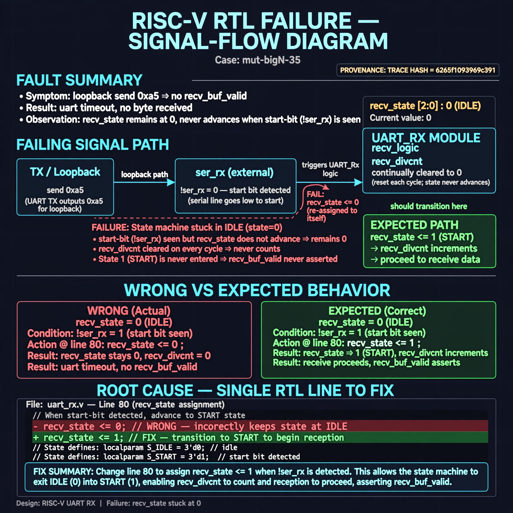

# Afterglow run report: verbatim-mut-bigN-35

case `mut-bigN-35` | status **GREEN** | mode `live` | seed `42`

wall start `2026-10-30T16:43:03Z` | wall end `2026-10-30T16:44:05Z` | time-to-green `62.4s`

retries `0` | human_touches `0` | diagnosed `True` | fixed_unaided `True` | patch_source `model-verbatim`

## Verdicts (from sim, not typed)

- BEFORE: tohost=FAIL 0xdead checksum=e82517390f8726caabcc777759a3dbb48c59fd1d160e409515f1b95dfe3d420c cycles=22023 seed=42 pass=False
- AFTER: tohost=PASS checksum=5c8f58d0f0818c97d014d2f851a6140882bd1efc96a2537047806252c0c2caf9 cycles=2652 seed=42 pass=True

## Diagnosis (verbatim from api/text_response.json)

```
Loopback send 0xa5 never results in recv_buf_valid, trace ends in uart timeout with no byte received. recv_state stays at 0 instead of advancing when start-bit (!ser_rx) is seen, so recv_divcnt is continually cleared and state 1 is never entered. Root cause in excerpt is line 80 assigning recv_state <= 0 to itself instead of recv_state <= 1.
```

expected re-sim signal: tohost: PASS loopback 0xa5 received, no uart timeout

## Patch (2 lines, guard-checked)

```diff
diff --git a/picosoc/simpleuart.v b/picosoc/simpleuart.v
--- a/picosoc/simpleuart.v
+++ b/picosoc/simpleuart.v
@@ -77,6 +77,6 @@
 			case (recv_state)
 				0: begin
 					if (!ser_rx)
-						recv_state <= 0;
+						recv_state <= 1;
 					recv_divcnt <= 0;
 				end

```

## Provenance (judge checks)

- prompt file `/home/tuncay/afterglow/agent/prompts/v2.txt` sha256 `d31e1ef6b74ddf52ee59e790ebff2f3defa9b03be82e699f45ef620cf8e27a6e`
- input_trace.txt sha256 `6265f1093969c391b6b7626c5723d86e6cd8e7bfca5f06dea74e979c3ca129a3` (9 lines, 66 tokens)
- prompt tokens `621` (cap 2500)
- text model `muse-spark-1.3-contributor` latency `35507ms` request `chatcmpl-01a18db2-0e8c-7751-8929-cf411f27c2b5`
- image model `muse-image-1.0` latency `26271ms` request `690c585c-cf32-4723-b865-f3dd9314eba7` status `ok`
- image prompt sha256 `281ebfb732227ec8827512b9d5352717618efa79b19c69fbc1bb1a8cbba1fa67`, trace sha `6265f1093969c391b6b7626c5723d86e6cd8e7bfca5f06dea74e979c3ca129a3` (see api/image_request.json)

## Explanation diagram



## Bundle completeness

- present (12): artifacts/input_trace.txt, artifacts/boot.log, artifacts/boot_after.log, artifacts/verdict_before.json, artifacts/verdict_after.json, api/text_request.json, api/text_response.json, api/image_request.json, api/image_response.json, explain.png, patch.diff, meta.json
- missing (0): none

