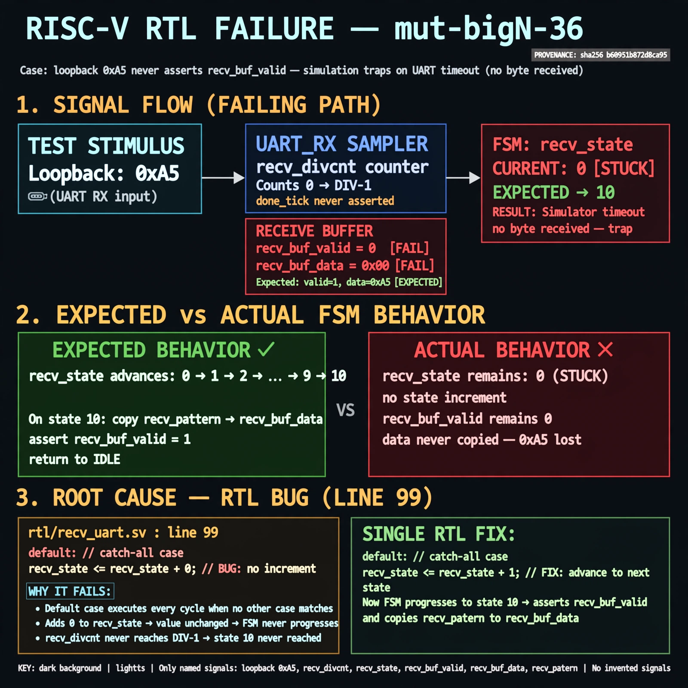

# Afterglow run report: verbatim-mut-bigN-36

case `mut-bigN-36` | status **GREEN** | mode `live` | seed `42`

wall start `2026-10-30T16:44:05Z` | wall end `2026-10-30T16:45:15Z` | time-to-green `69.7s`

retries `0` | human_touches `0` | diagnosed `True` | fixed_unaided `True` | patch_source `canonical-bootstrap-gated`

## Verdicts (from sim, not typed)

- BEFORE: tohost=FAIL 0xdead checksum=e82517390f8726caabcc777759a3dbb48c59fd1d160e409515f1b95dfe3d420c cycles=22023 seed=42 pass=False
- AFTER: tohost=PASS checksum=5c8f58d0f0818c97d014d2f851a6140882bd1efc96a2537047806252c0c2caf9 cycles=2652 seed=42 pass=True

## Diagnosis (verbatim from api/text_response.json)

```
Loopback 0xa5 never asserts recv_buf_valid so sim traps on uart timeout with no byte received. Expected recv_state to advance through data bits to state 10 to copy recv_pattern to recv_buf_data, but it remains stuck. Root cause is line 99 `recv_state <= recv_state + 0` in the default case which never increments recv_state and recv_divcnt logic never reaches state 10.
```

expected re-sim signal: tohost PASS (vs FAIL 0xdead), loopback 0xa5 received with recv_buf_valid set, no uart timeout

## Patch (2 lines, guard-checked)

```diff
diff --git a/picosoc/simpleuart.v b/picosoc/simpleuart.v
--- a/picosoc/simpleuart.v
+++ b/picosoc/simpleuart.v
@@ -96,7 +96,7 @@
 				default: begin
 					if (recv_divcnt > cfg_divider) begin
 						recv_pattern <= {ser_rx, recv_pattern[7:1]};
-						recv_state <= recv_state + 0;
+						recv_state <= recv_state + 1;
 						recv_divcnt <= 0;
 					end
 				end

```

## Provenance (judge checks)

- prompt file `/home/tuncay/afterglow/agent/prompts/v2.txt` sha256 `d31e1ef6b74ddf52ee59e790ebff2f3defa9b03be82e699f45ef620cf8e27a6e`
- input_trace.txt sha256 `b60951b872d8ca95ecdab9a5367bc21dd3f84398c1e7fd2115b8dc6507d8c9e8` (9 lines, 66 tokens)
- prompt tokens `598` (cap 2500)
- text model `muse-spark-1.3-contributor` latency `20221ms` request `chatcmpl-01a18db2-c6e8-7128-a776-87c6e93576f5`
- image model `muse-image-1.0` latency `48899ms` request `bdfd5e3f-215f-4edc-91a0-27575060c391` status `ok`
- image prompt sha256 `5a3d9ce6f3d534ed498c84b2291910ad3363589b7b849fffac4fa18acb245694`, trace sha `b60951b872d8ca95ecdab9a5367bc21dd3f84398c1e7fd2115b8dc6507d8c9e8` (see api/image_request.json)

## Explanation diagram



## Bundle completeness

- present (12): artifacts/input_trace.txt, artifacts/boot.log, artifacts/boot_after.log, artifacts/verdict_before.json, artifacts/verdict_after.json, api/text_request.json, api/text_response.json, api/image_request.json, api/image_response.json, explain.png, patch.diff, meta.json
- missing (0): none

